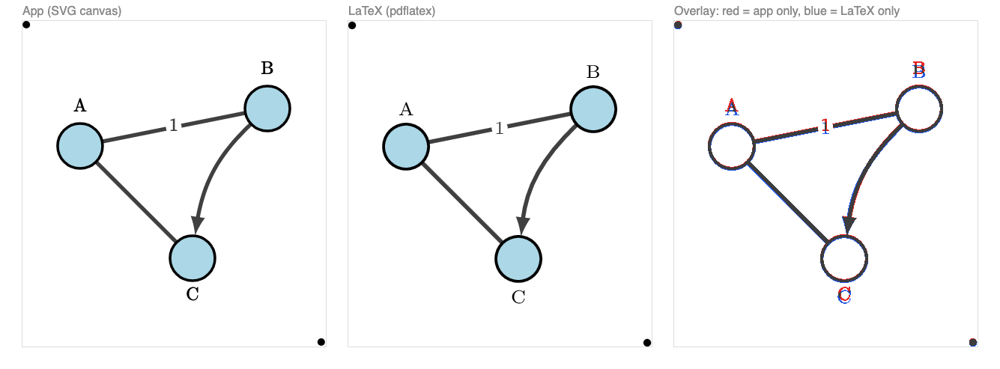
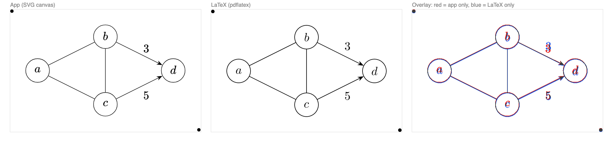
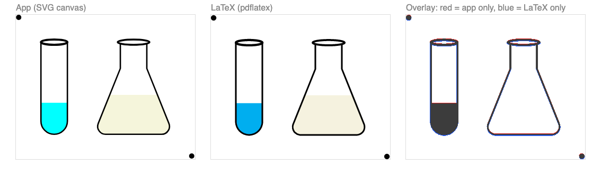
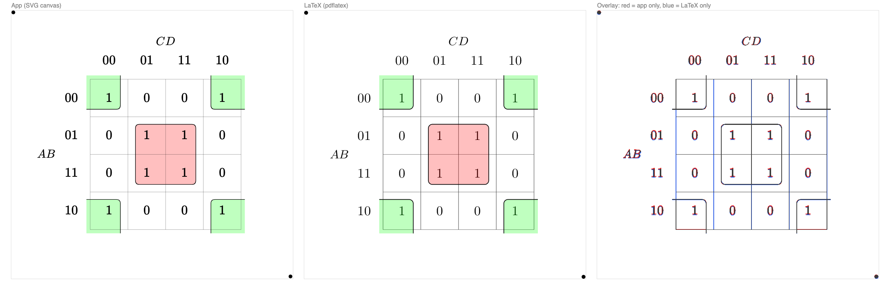
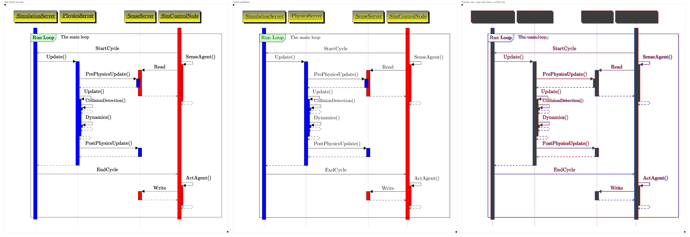
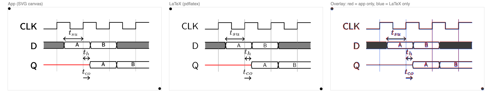

# How closely LaTeX matches the canvas

You draw in DiagramTeX, copy the code, paste it into Overleaf or your own `.tex` file and compile. This page
answers how close the result comes to what you saw, with measured numbers, side-by-side samples, and the
differences that are still there.

**In short:** across 52 test figures, **99.5 % of the ink lands within 0.5 mm** of where the canvas drew it
(median 99.9 %), and **99.8 % lands within 1 mm**. Every figure type scores at least 96 % within 0.5 mm.
Shapes, arrows, symbols, plots, 3D figures and every block (quantum circuits, trees, commutative diagrams,
xymatrix, circuits, automata, graphs, networks, timing diagrams, Karnaugh maps, chemistry, the chemistry
laboratory, UML class and sequence diagrams, 2D geometry, bit fields, physics) are drawn in the same places.
What is left is mostly the font: the canvas draws letters a little heavier than pdflatex does.

TikZ written elsewhere is checked too: 37 import fixtures average 99.7 % within 0.5 mm, and a held-out
sample of 1,971 real snippets from arXiv, TeX.SE, DaTikZ and CTAN is scored below.

The test setup and every image are in [docs/latex-parity/](docs/latex-parity/README.md).

## How it was measured

1. Each test figure is exported with the same code the **Code** dialog and `.tex` export produce (standalone).
   It is compiled with **pdflatex** (TeX Live 2026, pgf 3.1, pgfplots 1.18) and rasterised by Ghostscript at
   100 px per cm.
2. The app's own PNG export of the same shapes is made at the same scale (headless Chrome).
3. Both are cropped to two registration dots placed at the figure's corners, so they share one frame.
4. **Match score**: the share of all inked pixels, from both pictures, that have ink from the other picture
   within a given distance. 100 % means every line, letter and fill drawn by one is also drawn by the other,
   within that tolerance.

The 0.2 mm column is close to an exact pixel overlap, so anti-aliasing and the heavier canvas font pull it
down (text-heavy figures score lowest there). **Read the 0.5 mm column** as "looks the same on paper" and the
1 mm column as "same layout, maybe nudged".

Measured on DiagramTeX 1.60.5 (27 November 2026). 175 figures were run in all, and every export compiled; the
main table shows the 52 scored ones and the harder cases follow it.

## Scores

| Figure type | Test figures | ≤ 0.2 mm | ≤ 0.5 mm | ≤ 1 mm | ≤ 0.5 mm in 1.40.0 |
| --- | ---: | ---: | ---: | ---: | ---: |
| Lines, arrow tips, dashes, ticked shafts | 5 | 99.4 % | 99.9 % | 100 % | 99.9 % |
| Shapes, fills, translucent shapes | 2 | 97.3 % | 98.9 % | 100 % | 98.9 % |
| Text and maths labels | 2 | 90.8 % | 99.7 % | 100 % | 98.9 % |
| Symbol library (basic, electrical, flowchart, physics) | 4 | 99.9 % | 100 % | 100 % | 100 % |
| Pie chart | 1 | 99.1 % | 99.9 % | 100 % | 99.9 % |
| 2D plots: function, line, scatter, area, bar, contour, heatmap | 7 | 98.9 % | 99.5 % | 99.7 % | 99.7 % |
| 3D plots: function, surface, mesh, parametric, curve, scatter | 6 | 97.7 % | 99.5 % | 99.8 % | 99.3 % |
| 3D solids and revolve | 4 | 99.5 % | 99.7 % | 99.8 % | 99.7 % |
| Quantum circuit (quantikz) | blk_qc | 99.4 % | 100 % | 100 % | 100 % |
| Tree (forest) | blk_forest | 90.6 % | 100 % | 100 % | 100 % |
| Commutative diagram (tikz-cd) | blk_cd | 92.2 % | 100 % | 100 % | 100 % |
| XyMatrix | blk_xy | 88.8 % | 99.9 % | 100 % | 99.3 % |
| Karnaugh map | blk_kmap | 95.5 % | 96.0 % | 96.6 % | 100 % |
| Timing diagram (tikz-timing) | blk_timing | 99.1 % | 99.4 % | 99.7 % | 99.8 % |
| Automaton | blk_automata | 95.6 % | 99.7 % | 100 % | 100 % |
| Graph (TikZ `\graph`) | blk_graph | 97.0 % | 99.7 % | 100 % | |
| Network (tikz-network) | blk_network | 98.4 % | 100 % | 100 % | |
| Circuit (circuitikz) | blk_cz | 94.2 % | 98.1 % | 100 % | 98.4 % |
| Chemistry (chemfig) | blk_chem | 100 % | 100 % | 100 % | 100 % |
| Chemistry laboratory (tikz-chemlab) | blk_chemlab | 100 % | 100 % | 100 % | |
| ZX calculus | blk_zx | 99.8 % | 100 % | 100 % | 100 % |
| Bloch sphere | blk_bloch | 94.1 % | 97.7 % | 99.2 % | 97.7 % |
| Feynman diagram | blk_feynman | 93.6 % | 100 % | 100 % | 97.4 % |
| 3D geometry (tikz-3dplot) | blk_geo3d | 90.1 % | 98.0 % | 100 % | 97.0 % |
| UML class diagram (pgf-umlcd) | blk_uml | 94.5 % | 98.2 % | 99.9 % | 98.0 % |
| UML sequence diagram (pgf-umlsd) | blk_umlsd | 96.8 % | 100 % | 100 % | 100 % |
| 2D geometry | blk_geo2d | 88.7 % | 99.6 % | 100 % | 97.4 % |
| Bit field (bytefield) | blk_bytefield | 96.2 % | 99.9 % | 100 % | 99.9 % |
| Physics diagram | blk_physics | 99.6 % | 100 % | 100 % | 99.8 % |
| Pictures (PNG, JPEG, SVG via `\includesvg`, rotated and translucent) | 4 | 100 % | 100 % | 100 % | 100 % |
| **All 52 figures** (mean / median, pictures not counted) | | 97.2 / 98.9 % | **99.5 / 99.9 %** | 99.8 / 100 % | |

Rows with several figures show the mean. The last column is the previous full round (1.40.0); blank rows are
blocks added since (XyMatrix was scored then as a harder case). On the 48 figures scored both times the
0.5 mm mean went from 99.4 % to 99.5 %. 49 of the 52 figures score at least 98 % within 0.5 mm; the three
below that are the Karnaugh map (96.0 %), the Bloch sphere (97.7 %) and the shapes figure (97.8 %), the same
three as in the 16 November repeat run.

**The Karnaugh map** is the one row that dropped from the 1.40.0 round (100 % → 96.0 %; already 96.0 % on
16 November). Every cell, value, group and label is in place (see the sample below). The loss is in the
inner grid lines, which pdflatex draws a shade darker than the canvas, so they fall on different sides of the
ink threshold, and in captions like `AB = 00`, where the canvas puts spaces round the `=` and pdflatex sets
`AB= 00`. The light grid of the line plot (98.2 %) is the same threshold effect: both draw the grid.

Harder cases, scored separately (0.5 mm / 1 mm; the last column is 1.40.0 at 0.5 mm):

| Case | ≤ 0.5 mm | ≤ 1 mm | 1.40.0 |
| --- | ---: | ---: | ---: |
| Quantum: gate over several wires | 99.6 % | 100 % | 99.9 % |
| Quantum: gate groups with labels | 97.3 % | 100 % | 98.0 % |
| Quantum: classical wires | 98.8 % | 99.8 % | |
| tikz-cd: tall and deep cells (∏, ∑) | 98.6 % | 100 % | 100 % |
| tikz-cd: bends and shifts | 97.3 % | 100 % | |
| xymatrix: exact sequences over two rows | 98.8 % | 100 % | 99.4 % |
| xymatrix: curves, shifts, hooks, `\|` labels | 99.8 % | 100 % | 100 % |
| xymatrix: tips (`->>`, `>->`, `=>`, `\|->`, `=`) | 100 % | 100 % | 100 % |
| xymatrix: mixed styles with `@C=3pc` | 99.7 % | 100 % | 99.7 % |
| xymatrix: turning arrow (`` `[ul] `[l] ``…) | 98.2 % | 100 % | 89.3 % |
| tikz-cd: custom `to path` with rounded corners | 84.1 % | 100 % | 87.6 % |
| tikz-cd: `from=` arrows, `bend`, `crossing over` | 99.9 % | 100 % | 100 % |
| tikz-cd: trailing `\\` before `\end{tikzcd}` | 100 % | 100 % | 100 % |
| forest: probability tree (per-node `grow`) | 100 % | 100 % | 100 % |
| forest: syntax tree with roofs | 100 % | 100 % | 100 % |
| forest: org chart (forked edges) | 93.5 % | 99.6 % | 97.1 % |
| forest: folder tree | 99.9 % | 100 % | 87.6 % |
| Automata: two state machines | 99.7–99.8 % | 100 % | |
| circuitikz: voltage arrows (`v=`) | 100 % | 100 % | 100 % |
| circuitikz: labels and currents on one part | 96.5 % | 99.8 % | 96.9 % |
| circuitikz: `v^= v<= v^<=`, straight, American, raised voltages, `voltage=american` | 100 % | 100 % | 100 % |
| circuitikz: voltages on sources, current directions, part colour, `++`, `-\|`, `\coordinate` | 100 % | 100 % | 100 % |
| circuitikz: amplifiers, logic ports, MOS/FET, sources, inductors, diodes (33 parts), crossings, switches, tubes, antennas | 99.8–100 % | 100 % | 100 % |
| circuitikz: ground and supply nodes with labels | 99.1 % | 99.7 % | 99.1 % |
| circuitikz: a node with text beside the circuit | 94.2 % | 99.5 % | 94.1 % |
| chemfig: submolecules, Cram bonds, `cram width` (disaccharide) | 100 % | 100 % | 100 % |
| chemfig: `\chemmove` curve, lone pairs, `@{db,.5}`, anchored arrow | 100 % | 100 % | 99.9 % |
| chemfig: nitro resonance, two `\chemmove` curves | 99.9 % | 100 % | 99.9 % |
| chemfig: `\hreac`, submols with arguments, `!0`, `\|`, fixed length | 100 % | 100 % | 100 % |
| chemfig: text between molecules (`\quad or \quad`) | 100 % | 100 % | 87.4 % |
| pgf-umlsd: threads, `sdblock`, `\setthreadbias`, delays, `callself`, `messcall`, shaded instances | 99.9–100 % | 100 % | 99.9–100 % |
| Patterns (Lines, Hatch, Grid, Dots, Bricks…) | 75.6 % | 100 % | 75.6 % |

Two cases moved the wrong way since 1.40.0. **Org charts** with `forked edges` now place the second and third
rows about 1 mm sideways of forest's (97.1 → 93.5 %). The **custom `to path`** figure sits a little left of
LaTeX's (87.6 → 84.1 % at 0.5 mm), though everything now lands within 1 mm (98.0 → 100 %).

### Scale

On 16 November (1.48), `objectScale = 1.5` was added to one shape scene and one quantum-circuit scene. Both
exported TikZ `scale around` scopes and compiled: the scaled shape scored 99.4 % within 0.5 mm and the
scaled circuit 100 %. Two import fixtures cover scaled circuits now (below). This does not establish parity
for every scalable object type.

## The new blocks' own comparisons

The three blocks added since 1.40.0 each have a fuller comparison than one figure in the table:

- **Network (tikz-network):** all 92 examples from the package manual (with its data files), drawn by the block
  and by pdflatex at the same scale: **99.9 % within 0.5 mm** on average (median 100 %, lowest 95.7 %), 99.0 %
  within 0.2 mm and 100 % within 1 mm. Mean colour agreement is 90.7 % (median 95.5 %). The lowest colour
  scores are the text-only examples (`\Text` at several sizes), where the heavier canvas font is what
  differs, not the colour. `node scripts/network-parity.mjs` (offline).
- **Chemistry laboratory (tikz-chemlab):** every command in several variants, every drawing macro and
  composite set-ups, 222 pictures. The 213 that aren't random (bubbles and filings use pgfmath's random
  numbers) average **99.9 % matched within 0.25 mm, colour included** (median 100 %, lowest 94.3 %), and all
  222 are within their limits. `node tests/chemlab-parity.mjs`.
- **Graph (TikZ `\graph`):** five import fixtures (basic, multiline labels, scaled, scaled around, shapes and
  fans) score 98.3–100 % within 0.5 mm.

Most block libraries now also have position checks in the test suite (`tests/suites/99-*-parity.js`). They
compare node and anchor positions with numbers measured from pdflatex (`\pgfpointanchor`, `\pdfsavepos` or box
sizes, in pt), to tolerances from a hundredth of a point to about half a point. The libraries covered are chemfig, circuitikz, tikz-feynman, forest
and tikz-qtree, pgfplots, quantikz, tikz-timing, tkz-euclide, xymatrix, zx-calculus, tikz-network, and the
formula engine (box widths of maths set by pdflatex).

## Importing TikZ written by hand

The scores above cover TikZ the app writes. TikZ written elsewhere (pasted, imported from a `.tex` file) is
checked the other way round. `npm run test:import-parity` imports each fixture in
[tests/import-parity/](tests/import-parity/), draws it on the canvas, compiles the same source with pdflatex,
aligns the two drawings on registration dots and scores them like the table above. It has 37 fixtures (20
in 1.40.0):

- positioning, including the old `right of=` and diagonal placement;
- chains, labels, `calc`, units, `every node`, picture options;
- path nodes and their borders, anchors and separation;
- edges and grids, matrices of nodes (placed, with maths and with code cells);
- scopes, their options and names, `x`/`y` scaling;
- 3D coordinates and unit vectors;
- automata (basic, fanned edges with multiline labels, scaled);
- graphs (basic, multiline, scaled, scaled around, shapes and fans);
- networks (basic and multilayer);
- circuits drawn at a scale.

All 37 pass, and on average **99.7 % of the ink lands within 0.5 mm**. The lowest are the scaled circuit
(97.1 %), the scaled-around graph (98.3 %) and the scaled automaton (98.6 %).

### Real snippets (held-out corpus)

The snippet corpus (`scripts/snippets/`, run offline) holds 9,915 formulas, TikZ pictures and library
snippets from arXiv, TeX.SE, DaTikZ and CTAN, each compiled by real LaTeX in a container. A fifth is held out
and only used to report numbers. Each case goes through the app the way a user brings it in (the Import
dialog, or a formula in a text object), and the canvas is scored against the LaTeX picture. Unlike the
figures above there are no registration dots, so the app's picture is shifted to where the two agree best.
These scores measure shape and size, not where on the page the picture lands.

Held-out run on 1.60.5, 1,971 cases:

| Class | Cases | Drawn | 0.5 mm median | Cases ≥ 90 % at 0.5 mm | Export compiles |
| --- | ---: | ---: | ---: | ---: | ---: |
| Formulas | 600 | 94 % | 100 % | 91 % | 97 % |
| TikZ pictures | 800 | 100 % | 100 % | 91 % | 98 % |
| Library snippets | 571 | 92 % | 92 % | 54 % | 98 % |
| **All** | 1,971 | 96 % | 100 % | 81 % | 98 % |

"Drawn" means a formula set without an engine error, or a picture with native objects or code kept as
written. "Export compiles" means the app's own export of that case compiles with LaTeX. Formulas that need
the source document's macros (168 of 600) are the weaker part: 90 % drawn, against 96 % for the rest.

Library snippets that the importer turns into the library's own block score a 0.5 mm median of 96.8 %. The
closest libraries are pgf-pie (median 100 %), chemfig and tikz-feynman (99 %), tkz-euclide (99 %), zx-calculus
(98 %), Karnaugh maps and pgf-umlsd (98 %) and xymatrix (97 %). The furthest are pgf-umlcd (54 %), pgfplots
(62 %, mostly axes kept as code), circuitikz (66 %) and `\graph` with `graphs` layouts (69 %). pgfgantt and
smartdiagram have no block and aren't drawn. Compared with the 25 November held-out run (1.57.2), the mean
0.5 mm score went from 90.0 % to 90.8 %, mostly from plain TikZ (94.3 → 96.0 %) and circuitikz
(61.4 → 64.5 %). The corpus was frozen on 24 November, before the Network block, so its 10 tikz-network
snippets don't reach that block yet.

## What changed since 1.40.0

- **New blocks:** Graph (any TikZ `\graph`, with fanned parallel edges and multiline labels), Chemistry
  laboratory (tikz-chemlab, every drawing the package defines) and Network (tikz-network, including
  multilayer 2D and 3D). Each was compared with pdflatex case by case (above).
- **Formulas as LaTeX sets them:** each file keeps its own macros (`\newcommand`, `\def`,
  `\DeclareMathOperator`, xparse) from an imported preamble. mhchem, siunitx, physics and about seventy more
  package commands are drawn, and scripts use TeX's 7 pt and 5 pt faces. Texts can hold multi-line maths
  environments (`align*`, `gather*`, `cases`, the matrices), exported so the node compiles.
- **Block libraries measured against pdflatex:** tikz-qtree trees (drawn as forest), exact `\graph` layouts
  with graphs.standard's subgraphs, automata, tikz-feynman, tkz-euclide, tikz-timing, zx-calculus, xymatrix,
  quantikz, chemfig, circuitikz, pgfplots, tikz-3dplot, pgf-pie and tikz-cd now follow pdflatex's positions,
  checked by the position suites above.
- **Kept TikZ is previewed by pdfLaTeX:** code the canvas can't draw natively is compiled by the in-browser
  pdfLaTeX, so the canvas shows what LaTeX draws for it.
- **Exports compile:** a picture's packages, preamble definitions and scopes come with its export. 98 % of
  exports compile as written (92.4 % before), in the snippet corpus too.
- **Measured gains:** folder trees 87.6 → 99.9 %, xymatrix turning arrows 89.3 → 98.2 %, chemfig text between
  molecules 87.4 → 100 %, Feynman diagrams 97.4 → 100 %, 2D geometry 97.4 → 99.6 %, 3D geometry
  97.0 → 98.0 %, text and maths labels 98.9 → 99.7 % (all within 0.5 mm).
- **Safari:** maths labels fill their box exactly, so left-aligned text no longer drifts right.

The rounds before this one are described in the git history of this file.

## Samples

Each image is three panels: the app, LaTeX, and an overlay. In the overlay, **dark** is drawn by both, **red**
only by the app and **blue** only by LaTeX. A thin red/blue fringe is half-pixel noise or the heavier canvas
font. A doubled shape is a real shift. All images are from this round.

**Network: 100 % within 0.5 mm.** Vertices, edges, the bent arrow and the edge label coincide.

**Graph: 99.7 % within 0.5 mm.** Nodes and edges coincide; the edge labels differ only by the font.

**Chemistry laboratory: 100 % within 0.5 mm.** The glassware coincides. The test tube shows the colour quirk
described below: xcolor's `cyan` is a CMYK colour, so the PDF shows a deeper blue.

**Karnaugh map: 96.0 % within 0.5 mm.** Everything is in place. The score is lost to the inner grid lines and
the spacing round `=` in the captions.

**UML sequence diagram: 100 % within 0.5 mm** (pgf-umlsd's threads demo: 99.9 %). Instances, activation bars,
messages and frames coincide.

**UML class diagram: 98.2 % within 0.5 mm.** Boxes, compartments and inheritance arrows coincide; member text
ends within about 0.3 mm.

**Quantum circuit: 100 % within 0.5 mm.** Wires, gates and meters coincide.

**Tree: 100 % within 0.5 mm.** Levels, edges and labels coincide, including per-node growth.

**Circuit voltage arrow: 100 % within 0.5 mm.** The canvas draws circuitikz's curved `v=` arrow.

**Timing diagram: 99.4 % within 0.5 mm.**

**3D plot: 99.1 % within 0.5 mm.** Grey hidden box edges and grid as in pgfplots.

**Arrow tips at 2 pt: 99.7 % within 0.5 mm.** Every tip in the library, thick enough to see its shape.

**Symbols: 100 % within 0.5 mm.** Every library symbol lands on the same pixels.

**Chemistry: 100 % within 0.5 mm.** Bond angles, double bonds and atom labels coincide.

## Quirks you may notice

### Everywhere

- **Fonts.** The canvas typesets maths with KaTeX/Temml in Latin Modern-like fonts. LaTeX uses Computer
  Modern, or whatever your preamble loads. Letter shapes are near-identical, but the canvas renders them
  slightly heavier. Character widths can differ by a hair, so a long label may end 0.5–1 mm earlier or later.
  This is still the largest remaining difference.
- **CMYK colour names.** xcolor defines `cyan`, `magenta` and `yellow` as CMYK colours, so a PDF viewer shows
  them as print colours (cyan comes out a deeper blue). The canvas shows the screen colours. Load
  `\usepackage[rgb]{xcolor}` (or pass `rgb` to the document class) if they must look the same.
- **Your preamble wins.** If your document loads another font package (`times`, `libertine`, `fourier`…) or
  changes `\tikzset` defaults, LaTeX follows your document, not the canvas.
- **Packages.** The first lines of every export list what it needs (`% Requires: \usepackage{tikz}
  \usetikzlibrary{...}`). Copy them into your preamble. Older TeX distributions may lack `quantikz2`,
  `tikz-timing`, `chemfig` 1.6, `zx-calculus`, `tikz-chemlab` or `tikz-network`. Update TeX Live, or use
  Overleaf, which is current.
- **Wrapped text.** A text box with a fixed width breaks lines with LaTeX's own rules. The words per line can
  differ from the canvas in a long paragraph.

### Fills

- **Pattern position.** Lines, Hatch, Dots and Bricks have the same spacing and line width in LaTeX, but
  TikZ lines its pattern tiles up with the page corner, so the stripes or dots can be shifted inside the
  shape (the patterns figure scores 75.6 % within 0.5 mm and 100 % within 1 mm for that reason). The canvas
  can't predict where your page puts the picture.
- **Translucent symbols** (library symbols, balls, dots and text with opacity) still fade fill and outline
  separately in LaTeX, so overlaps look slightly darker.

### Plots (pgfplots)

- **3D plots:** axis-label positions were tuned at the default view (25°/30°). At other view angles a label
  can sit up to about 1 mm from where pgfplots puts it.
- **Light grid lines** are drawn by both, but pgfplots' grey comes out a shade different from the canvas's.

### Blocks

- **Quantum circuits (quantikz):** classical double wires show a clearer gap on the canvas. Loading
  `quantikz2` also restyles `tikz-cd` arrows, so put quantum and commutative diagrams in separate documents
  (or separate `standalone` files) if both must look exactly like the canvas.
- **Trees (forest):** org charts with `forked edges` can place the lower rows about 1 mm sideways. `tier`,
  `fit`, `calign` variants and growth at angles other than multiples of 90° are approximate on the canvas
  (LaTeX still applies them).
- **Commutative diagrams (tikz-cd):** a style's custom `to path` lands within 1 mm, a little left of LaTeX's.
- **Karnaugh maps:** the inner grid is a shade lighter on the canvas, and captions like `AB = 00` have spaces
  round the `=` that pdflatex leaves out.
- **Circuits (circuitikz):** the `v=` arrow's curve was fitted on resistors and capacitors; on other parts it
  is close but not exact. Label offsets were measured at normalsize on level paths, so other sizes and
  slanted parts can be a little off. A part with a label, an annotation and a voltage at once doesn't overlap
  them the way circuitikz does. Op-amp `+`/`−` signs can sit slightly apart.
- **Automata:** `bend left` edges can be about 1 mm off, and the loop on accepting states has a slightly
  different shape.
- **Bloch sphere:** the ball shading darkens a little sooner at the upper-left rim.
- **Timing diagrams:** timing options the canvas doesn't model are kept in the code, so LaTeX still applies
  them, but the canvas doesn't preview them.
- **Chemistry:** submolecules (`\definesubmol`), `\chemmove` arrows and other code the canvas can't draw stay
  in the export, so LaTeX draws them even though the canvas doesn't.
- **Chemistry laboratory:** bubbles and filings use pgfmath's random numbers, so they are scattered
  differently in the PDF.
- **Feynman diagrams** placed by hand (the editor's vertices) build with pdflatex and match. Automatic layout
  (`\feynmandiagram`, `\diagram*`) needs **LuaLaTeX**, and the canvas doesn't draw it. Give the vertices
  positions to see them on the canvas.
- **Automata and 3D geometry:** extra TikZ in the block source is passed through untouched.
- **UML class diagrams:** text widths differ from pdflatex by about 1 %, so a long member can end 0.3 mm
  earlier or later.
- **2D geometry:** an angle's label and a label on a segment can sit about 0.3 mm higher on the canvas.

### Documents (Page mode)

- Cross-references, the contents list and citations need **two compiles**, as with any LaTeX document.
- Page breaks are LaTeX's own and may fall in a different place from the canvas preview.

## Reproduce it

The harness is in [docs/latex-parity/tools/](docs/latex-parity/tools/):

- `parity_server.py <site dir> <scratch dir> <port>` serves the built app (`dist/` after `npm run build`)
  and compiles what the page posts.
- `harness.js` composes the three panels, `scenes.js` and `scenes-kit.js` hold the test figures.
- `cdp.mjs` drives a headless Chrome (started with `--remote-debugging-port`) on that page:
  `CDP=<port> node cdp.mjs run blk_qc blk_forest …`.
- `match.py <figure.cmp.png …>` prints the scores at 0, 0.2, 0.5 and 1 mm.
- Figures with pictures (`img_png`, `img_jpg`, `img_svg`, `img_rot`): `harness.js` sends the files the .zip would carry (each picture, and for an SVG the PDF in `svg-inkscape/`) to the server before compiling, so LaTeX sees what a downloaded .zip holds. The pictures land on the same pixels as the canvas; only the anti-aliasing at their edges differs.

The other comparisons on this page:

- `npm run test:import-parity`: the 37 import fixtures.
- `node tests/chemlab-parity.mjs` (`--report-only` to write the evidence without failing): tikz-chemlab.
- `node scripts/network-parity.mjs`: the tikz-network manual's examples (offline; needs `ext/tikz-network-manual/`).
- `node scripts/snippets/compare.mjs --split heldout`: the held-out snippet corpus (offline; needs `ext/snippets/`
  and Docker, see [scripts/snippets/README.md](scripts/snippets/README.md)).

Between measurement rounds, `node tests/run.mjs` guards the same figures: it keeps each one's exported TikZ
as a golden file (so any change to an export shows as a diff), compiles every export with pdflatex, checks
that each re-imports and exports again byte for byte, and runs the LaTeX checks (`TD.lint`) over them.
A change that leaves those golden files untouched cannot move the scores above.
