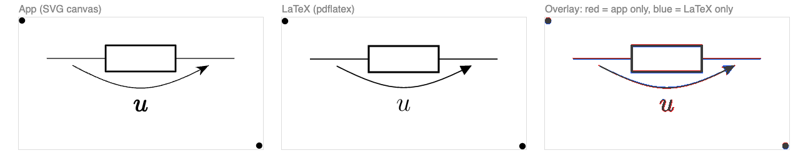

# How closely LaTeX matches the canvas

You draw in DiagramTeX, copy the code, paste it into Overleaf or your own `.tex` file and compile. This page
answers how close the result comes to what you saw, with measured numbers, side-by-side samples, and the
differences that are still there.

**In short:** across 45 test figures, **99.5 % of the ink lands within 0.5 mm** of where the canvas drew it,
and **99.9 % lands within 1 mm**. Every figure type now scores at least 97 % within 0.5 mm. Shapes, arrows,
symbols, plots, 3D figures and every block (quantum circuits, trees, commutative diagrams, circuits,
automata, timing diagrams, Karnaugh maps, chemistry) are drawn in the same places. What is left is mostly
the font: the canvas draws letters a little heavier than pdflatex does.

The test setup, per-commit fixes and every image are in [docs/latex-parity/](docs/latex-parity/README.md).

## How it was measured

1. Each test figure is exported with the same code the **Code** dialog and `.tex` export produce (standalone).
   It is compiled with **pdflatex** (TeX Live 2026, pgf 3.1, pgfplots 1.18) and rasterised by Ghostscript at
   100 px per cm.
2. The app's own PNG export of the same shapes is made at the same scale.
3. Both are cropped to two registration dots placed at the figure's corners, so they share one frame.
4. **Match score**: the share of all inked pixels, from both pictures, that have ink from the other picture
   within a given distance. 100 % means every line, letter and fill drawn by one is also drawn by the other,
   within that tolerance.

The 0.2 mm column is close to an exact pixel overlap, so anti-aliasing and the heavier canvas font pull it
down (text-heavy figures score lowest there). **Read the 0.5 mm column** as "looks the same on paper" and the
1 mm column as "same layout, maybe nudged".

Measured on DiagramTeX 1.21.0 with the fixes described below.

## Scores

| Figure type | Test figures | ≤ 0.2 mm | ≤ 0.5 mm | ≤ 1 mm | ≤ 0.5 mm in 1.21.0 |
| --- | ---: | ---: | ---: | ---: | ---: |
| Lines, arrow tips, dashes, ticked shafts | 5 | 98.9 % | 99.8 % | 100 % | 99.9 % |
| Shapes, fills, translucent shapes | 2 | 97.3 % | 98.9 % | 100 % | 97.5 % |
| Text and maths labels | 2 | 87.7 % | 98.9 % | 100 % | 98.9 % |
| Symbol library (basic, electrical, flowchart, physics) | 4 | 99.8 % | 100 % | 100 % | 100 % |
| Pie chart | 1 | 99.1 % | 99.9 % | 100 % | 99.9 % |
| 2D plots: function, line, scatter, area, bar, contour, heatmap | 7 | 98.7 % | 99.7 % | 99.9 % | 97.6 % |
| 3D plots: function, surface, mesh, parametric, curve, scatter | 6 | 97.7 % | 99.3 % | 99.8 % | 93.0 % |
| 3D solids, revolve, sketch | 6 | 98.9 % | 99.8 % | 99.9 % | |
| Quantum circuit (quantikz) | blk_qc | 99.2 % | 100 % | 100 % | 68.4 % |
| Tree (forest) | blk_forest | 91.7 % | 100 % | 100 % | 69.2 % |
| Commutative diagram (tikz-cd) | blk_cd | 97.9 % | 100 % | 100 % | 96.6 % |
| Karnaugh map | blk_kmap | 99.5 % | 100 % | 100 % | 85.2 % |
| Timing diagram (tikz-timing) | blk_timing | 99.1 % | 99.8 % | 100 % | 86.5 % |
| Automaton | blk_automata | 99.4 % | 100 % | 100 % | 98.5 % |
| Circuit (circuitikz) | blk_cz | 93.9 % | 98.4 % | 100 % | 97.7 % |
| Chemistry (chemfig) | blk_chem | 91.2 % | 100 % | 100 % | 100 % |
| ZX calculus | blk_zx | 100 % | 100 % | 100 % | 100 % |
| Bloch sphere | blk_bloch | 94.1 % | 97.7 % | 99.2 % | 97.7 % |
| Feynman diagram | blk_feynman | 90.9 % | 97.4 % | 100 % | 97.4 % |
| 3D geometry (tikz-3dplot) | blk_geo3d | 89.5 % | 97.0 % | 100 % | 97.0 % |
| **All 45 figures** (mean / median) | | 97.3 / 99.0 % | **99.5 / 99.9 %** | 99.9 / 100 % | |

Rows with several figures show the mean. The last column is the same figures scored on the 1.21.0 release,
before this round of fixes (blank where that figure wasn't scored then). On the 34 figures scored both times,
the 0.5 mm mean went from 95.0 % to 99.4 %.

Harder cases, scored separately (0.5 mm / 1 mm):

| Case | ≤ 0.5 mm | ≤ 1 mm |
| --- | ---: | ---: |
| Quantum: gate over several wires | 99.9 % | 100 % |
| Quantum: gate groups with labels | 97.8 % | 100 % |
| tikz-cd: tall and deep cells (∏, ∑) | 100 % | 100 % |
| forest: probability tree (per-node `grow`) | 100 % | 100 % |
| forest: syntax tree with roofs | 100 % | 100 % |
| forest: org chart (forked edges) | 97.1 % | 100 % |
| forest: folder tree | 87.6 % | 99.1 % |
| circuitikz: voltage arrows (`v=`) | 100 % | 100 % |
| circuitikz: labels and currents on one part | 94.1 % | 99.3 % |

## What changed in this round

- **Quantum circuits:** wires, gates and meters now land on LaTeX's (they were about 0.1 cm off). Gate height
  is the text's height plus quantikz's padding, the target circle and meters use TeX's real em, and the
  canvas measures the picture the way TeX does, so the exported figure centres on the same point.
- **Trees:** levels are spaced by forest's own rule (font-size based `l`, then pushed clear by `l sep`),
  node boxes are as tall as their letters rather than a whole line, and nodes sit on their baseline. Trees
  were about 18 % too tall. Each node can now turn its own children (`grow`), linguistics trees use
  `sn edges`, and forked and folder trees follow forest's spacing.
- **Commutative diagrams:** cells hang on their baseline with tikz-cd's spacing, so rows with tall or deep
  maths (∏, ∑, fractions) are spaced as in LaTeX.
- **Plots:** grid lines are as light as pgfplots', the top tick labels show, axis labels sit where pgfplots
  puts them, 3D plots draw their hidden box edges grey, and surface meshes are as faint as in the PDF.
- **Timing diagrams and Karnaugh maps:** row names, grids and variable names sit where the packages put
  them.
- **Circuits:** voltage arrows (`v=`) are drawn as circuitikz's curved arrow with the label under it,
  current arrows (`i=`) are bigger and in the right place, the `l_=`, `a_=`, `v_=`, `i_=` forms are shown,
  and top labels and node text (ground, supply, transistor) sit where circuitikz puts them.
- **Automata:** labels above an edge sit 0.09 cm lower, as in LaTeX.
- **Arrow tips:** re-derived from `arrows.meta`. Hooks were too big on the canvas (not in LaTeX), Square,
  Diamond, Bar, Bracket and Parenthesis tips now have LaTeX's size, and To, harpoon and reversed tips no
  longer overshoot the end of the line.
- **Ticked shafts** carry their ticks under the arrowhead, as LaTeX does.
- **Bricks** fill exports at the canvas's brick size and line width.
- **Translucent shapes** export as one faded group (`transparency group`), so arrowheads and outlines no
  longer get darker where they overlap the line or fill. Pasting that code back in keeps the opacity.
- **Bloch sphere** arrowheads have pdflatex's size.

## Samples

Each image is three panels: the app, LaTeX, and an overlay. In the overlay, **dark** is drawn by both, **red**
only by the app and **blue** only by LaTeX. A thin red/blue fringe is half-pixel noise or the heavier canvas
font. A doubled shape is a real shift.

**Quantum circuit: 100 % within 0.5 mm** (was 68 % in 1.21.0). Wires, gates and meters coincide.

**Tree: 100 % within 0.5 mm.** Levels, edges and labels coincide, including per-node growth. (The basic tree
figure went from 69 % to 100 %.)

**Circuit voltage arrow: 100 % within 0.5 mm.** The canvas now draws circuitikz's curved `v=` arrow.

**Timing diagram: 99.8 % within 0.5 mm** (was 86.5 %).

**3D plot: 98.6 % within 0.5 mm** (was 80.7 %). Grey hidden box edges and grid as in pgfplots.

**Arrow tips at 2 pt: 99.2 % within 0.5 mm.** Every tip in the library, thick enough to see its shape.

**Symbols: 100 % within 0.5 mm.** Every library symbol lands on the same pixels.

**Chemistry: 100 % within 0.5 mm.** Bond angles, double bonds and atom labels coincide.

## Quirks you may notice

### Everywhere

- **Fonts.** The canvas typesets maths with KaTeX/Temml in Latin Modern-like fonts. LaTeX uses Computer
  Modern, or whatever your preamble loads. Letter shapes are near-identical, but the canvas renders them
  slightly heavier. Character widths can differ by a hair, so a long label may end 0.5–1 mm earlier or later.
  This is now the largest remaining difference.
- **Your preamble wins.** If your document loads another font package (`times`, `libertine`, `fourier`…) or
  changes `\tikzset` defaults, LaTeX follows your document, not the canvas.
- **Packages.** The first lines of every export list what it needs (`% Requires: \usepackage{tikz}
  \usetikzlibrary{...}`). Copy them into your preamble. Older TeX distributions may lack `quantikz2`,
  `tikz-timing`, `chemfig` 1.6 or `zx-calculus`. Update TeX Live, or use Overleaf, which is current.
- **Wrapped text.** A text box with a fixed width breaks lines with LaTeX's own rules. The words per line can
  differ from the canvas in a long paragraph.

### Fills

- **Pattern position.** Lines, Hatch, Dots and Bricks have the same spacing and line width in LaTeX, but
  TikZ lines its pattern tiles up with the page corner, so the stripes or dots can be shifted inside the
  shape. The canvas can't predict where your page puts the picture.
- **Translucent symbols** (library symbols, balls, dots and text with opacity) still fade fill and outline
  separately in LaTeX, so overlaps look slightly darker.

### Plots (pgfplots)

- **3D plots:** axis-label positions were tuned at the default view (25°/30°). At other view angles a label
  can sit up to about 1 mm from where pgfplots puts it.

### Blocks

- **Quantum circuits (quantikz):** classical double wires show a clearer gap on the canvas. Loading
  `quantikz2` also restyles `tikz-cd` arrows, so put quantum and commutative diagrams in separate documents
  (or separate `standalone` files) if both must look exactly like the canvas.
- **Trees (forest):** folder trees can differ by 1–2 px per row. `tier`, `fit`, `calign` variants and growth
  at angles other than multiples of 90° are approximate on the canvas (LaTeX still applies them).
- **Circuits (circuitikz):** the `v=` arrow's curve was fitted on resistors and capacitors; on other parts it
  is close but not exact. Voltage labels on sources are plain text on the canvas. A part with a label, an
  annotation and a voltage at once doesn't overlap them the way circuitikz does. Op-amp `+`/`−` signs can
  sit slightly apart.
- **Automata:** `bend left` edges can be about 1 mm off, and the loop on accepting states has a slightly
  different shape.
- **Bloch sphere:** the ball shading darkens a little sooner at the upper-left rim.
- **Timing diagrams:** timing options the canvas doesn't model are kept in the code, so LaTeX still applies
  them, but the canvas doesn't preview them.
- **Chemistry:** submolecules (`\definesubmol`), `\chemmove` arrows and other code the canvas can't draw stay
  in the export, so LaTeX draws them even though the canvas doesn't.
- **Feynman diagrams** placed by hand (the editor's vertices) build with pdflatex and match. Automatic layout
  (`\feynmandiagram`, `\diagram*`) needs **LuaLaTeX**, and the canvas doesn't draw it. Give the vertices
  positions to see them on the canvas.
- **Automata and 3D geometry:** extra TikZ in the block source is passed through untouched.

### Documents (Page mode)

- Cross-references, the contents list and citations need **two compiles**, as with any LaTeX document.
- Page breaks are LaTeX's own and may fall in a different place from the canvas preview.

## Reproduce it

The harness is in [docs/latex-parity/tools/](docs/latex-parity/tools/):

- `parity_server.py` serves the app and compiles what the page posts.
- `harness.js` composes the three panels, `scenes.js` and `scenes-kit.js` hold the test figures.
- `cdp.mjs` drives a headless Chrome on that page: `CDP=<port> node cdp.mjs run blk_qc blk_forest …`.
- `match.py <figure.cmp.png …>` prints the scores at 0, 0.2, 0.5 and 1 mm.
