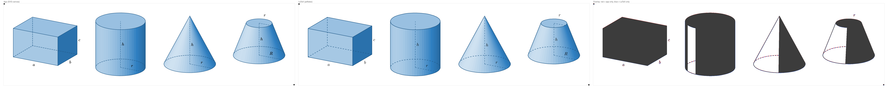
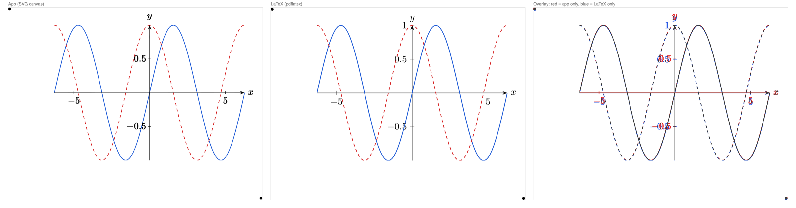
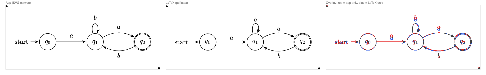
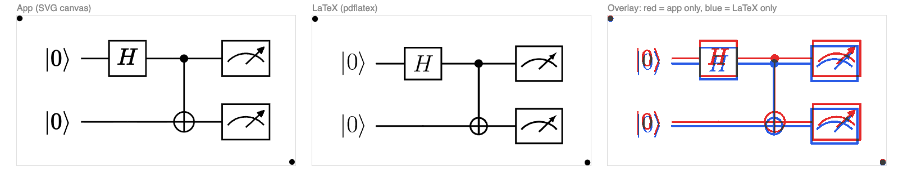
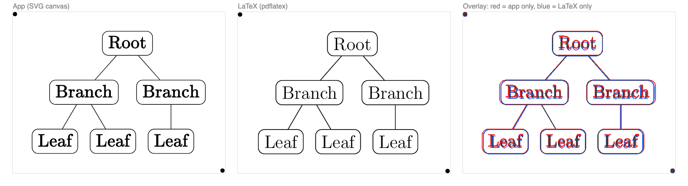

# How closely LaTeX matches the canvas

You draw in DiagramTeX, copy the code, paste it into Overleaf or your own `.tex` file and compile. This page
answers how close the result comes to what you saw, with measured numbers, side-by-side samples, and the
differences that are still there.

**In short:** across 44 test figures, **95 % of the ink lands within 0.5 mm** of where the canvas drew it, and
**98 % lands within 1 mm**. Half of the figures score 99.5 % or better. Shapes, arrows, symbols, 3D solids,
chemistry, automata and most plots match. The figures that drift are quantum circuits, forest trees and
commutative diagrams. They have the same parts in the same order, only spaced slightly differently.

The test setup, per-commit fixes and every image are in [docs/latex-parity/](docs/latex-parity/README.md).

## How it was measured

1. Each test figure is exported with the same code the **Code** dialog and `.tex` export produce (standalone).
   It is compiled with **pdflatex** (TeX Live 2026, pgf 3.1, pgfplots 1.18) and rasterised by Ghostscript at
   100 px per cm.
2. The app's own PNG export of the same shapes is made at the same scale.
3. Both are cropped to two registration dots placed at the figure's corners, so they share one frame.
4. **Match score**: the share of all inked pixels, from both pictures, that have ink from the other picture
   within a given distance. 100 % means every line, letter and fill drawn by one is also drawn by the other,
   within that tolerance.

The 0 mm column is an exact pixel overlap. It is mostly anti-aliasing and font-rendering noise: a perfect
1-pixel line offset by half a pixel already scores about 50 %. **Read the 0.5 mm column** as "looks the same
on paper" and the 1 mm column as "same layout, maybe nudged".

39 figures were measured on DiagramTeX 1.18.0. The 5 newer blocks (3D geometry, timing, automata, K-map,
chemistry) were measured on 1.20.0.

## Scores

| Figure type | Test figures | ≤ 0.2 mm | ≤ 0.5 mm | ≤ 1 mm | Verdict |
| --- | --- | ---: | ---: | ---: | --- |
| Lines, arrow tips, dashes, shafts | lines | 99.7 % | 100 % | 100 % | matches |
| Shapes, fills, patterns, gradients | shapes, region, plus | 98.1 % | 99.9 % | 100 % | matches |
| Text and maths labels | text, labels | 96.1 % | 99.9 % | 100 % | matches |
| Tick marks and rulers | ticks | 85.9 % | 97.0 % | 100 % | minor drift |
| Symbol library (basic, electrical, flowchart, physics) | 4 sheets | 99.9 % | 99.9 % | 100 % | matches |
| Pie chart | pie | 99.8 % | 100 % | 100 % | matches |
| 2D plots: function, area, bar, contour, heatmap | 5 plots | 98.1 % | 99.7 % | 99.8 % | matches |
| 2D plots: line, scatter, markers | 3 plots | 86.9 % | 90.2 % | 91.9 % | minor drift |
| 3D plots: function, surface, mesh, parametric | 4 plots | 98.1 % | 99.2 % | 99.5 % | matches |
| 3D plots: curve, scatter | 2 plots | 83.3 % | 91.9 % | 95.2 % | minor drift |
| 3D solids, revolve, sketch | 6 scenes | 99.0 % | 99.8 % | 99.9 % | matches |
| Circuit (circuitikz) | blk_cz | 89.5 % | 96.3 % | 98.3 % | matches |
| ZX calculus | blk_zx | 91.6 % | 99.6 % | 100 % | matches |
| Feynman diagram | blk_feynman | 86.7 % | 95.9 % | 99.8 % | matches |
| Bloch sphere | blk_bloch | 92.4 % | 95.2 % | 97.8 % | matches |
| Chemistry (chemfig) | blk_chem | 97.0 % | 100 % | 100 % | matches |
| Automaton | blk_automata | 96.6 % | 98.5 % | 100 % | matches |
| 3D geometry (tikz-3dplot) | blk_geo3d | 89.5 % | 97.0 % | 100 % | matches |
| Timing diagram (tikz-timing) | blk_timing | 56.9 % | 86.5 % | 97.8 % | minor drift |
| Karnaugh map | blk_kmap | 45.7 % | 85.2 % | 98.4 % | minor drift |
| Commutative diagram (tikz-cd) | blk_cd | 50.5 % | 70.8 % | 92.6 % | drift |
| Quantum circuit (quantikz) | blk_qc | 36.3 % | 54.0 % | 83.8 % | drift |
| Tree (forest) | blk_forest | 30.5 % | 53.3 % | 80.9 % | drift |
| **All 44 figures** (mean / median) | | 89.5 / 96.8 % | **94.9 / 99.5 %** | 98.0 / 99.9 % | |

Rows with several figures show the mean.

## Samples

Each image is three panels: the app, LaTeX, and an overlay. In the overlay, **dark** is drawn by both, **red**
only by the app and **blue** only by LaTeX. A thin red/blue fringe is half-pixel noise. A doubled shape is a
real shift.

**Symbols: 100 % within 0.5 mm.** Every library symbol lands on the same pixels.

**Chemistry: 100 % within 0.5 mm.** Bond angles, double bonds and atom labels coincide.

**3D solids: 99.8 % within 0.5 mm.** Projection, shading and hidden edges match.

**2D plot: 99.3 % within 0.5 mm.** Curves, axes and ticks coincide. Only the axis label sits slightly lower.

**Automaton: 98.5 % within 0.5 mm.** States and arrows coincide. Edge labels sit about 0.05 cm higher on the
canvas.

**Timing diagram: 86.5 % within 0.5 mm.** The waveforms line up horizontally, but the canvas draws the rows
about 0.06 cm higher.

**Quantum circuit: 54 % within 0.5 mm, 84 % within 1 mm.** It has the same gates in the same places, but the
LaTeX wires sit about 0.1 cm lower and the canvas gate boxes are slightly wider.

**Tree: 53 % within 0.5 mm.** forest spaces levels further apart, so the LaTeX tree is about 18 % taller.

## Quirks you may notice

### Everywhere

- **Fonts.** The canvas typesets maths with KaTeX/Temml in Latin Modern-like fonts. LaTeX uses Computer
  Modern, or whatever your preamble loads. Letter shapes are near-identical, but the canvas often renders them
  slightly heavier. Character widths can differ by a hair, so a long label may end 0.5–1 mm earlier or later.
- **Your preamble wins.** If your document loads another font package (`times`, `libertine`, `fourier`…) or
  changes `\tikzset` defaults, LaTeX follows your document, not the canvas.
- **Packages.** The first lines of every export list what it needs (`% Requires: \usepackage{tikz}
  \usetikzlibrary{...}`). Copy them into your preamble. Older TeX distributions may lack `quantikz2`,
  `tikz-timing`, `chemfig` 1.6 or `zx-calculus`. Update TeX Live, or use Overleaf, which is current.
- **Wrapped text.** A text box with a fixed width breaks lines with LaTeX's own rules. The words per line can
  differ from the canvas in a long paragraph.
- **Transparency.** Translucent arrows get slightly darker tips in the PDF, where the shaft and head overlap.

### Arrows and fills

- **Hooks** tips are about 1.5× bigger in LaTeX, and open **Square** tips about 1.3× bigger.
- The **Bricks** fill pattern has twice the brick size in LaTeX. Other patterns match.
- **Ticked** shafts get one extra tick under the arrowhead at the end of the path in LaTeX.

### Plots (pgfplots)

- The x-axis label sits about 0.1 cm lower on the canvas.
- The topmost y tick label (for example "1" on a 0–1 axis) is missing on the canvas. LaTeX prints it.
- Grid lines are lighter grey on the canvas. This is most of the gap in the line and scatter scores.
- **3D plots:** view angles are exact. Axis labels can be up to 0.2 cm off. The canvas draws every box edge
  black, where pgfplots draws the front ones grey, and draws the surface mesh slightly darker.

### Blocks

- **Quantum circuits (quantikz):** wires about 0.1 cm lower in LaTeX, and canvas gates about 0.08 cm wider.
  Loading `quantikz2` also restyles `tikz-cd` arrows, so put quantum and commutative diagrams in separate
  documents (or separate `standalone` files) if both must look exactly like the canvas.
- **Trees (forest):** LaTeX levels are about 18 % further apart (about 0.35 cm over two levels).
- **Commutative diagrams (tikz-cd):** same grid and arrows, with labels about 0.1 cm apart.
- **Circuits (circuitikz):** component labels sit about 0.13 cm higher in LaTeX.
- **Bloch sphere:** arrowheads about 1.5× bigger in LaTeX, and the ball shading darkens sooner at the rim.
- **Timing diagrams:** rows about 0.06 cm higher on the canvas. Timing options the canvas doesn't model are
  kept in the code, so LaTeX still applies them, but the canvas doesn't preview them.
- **Karnaugh maps:** the grid about 0.06 cm further left on the canvas, and the variable names (`CD`, `AB`)
  about 0.15 cm higher.
- **Chemistry:** submolecules (`\definesubmol`), `\chemmove` arrows and other code the canvas can't draw stay
  in the export, so LaTeX draws them even though the canvas doesn't.
- **Feynman diagrams** placed by hand (the editor's vertices) build with pdflatex and match. Automatic layout
  (`\feynmandiagram`, `\diagram*`) needs **LuaLaTeX**, and the canvas doesn't draw it. Give the vertices
  positions to see them on the canvas.
- **Automata and 3D geometry:** extra TikZ in the block source is passed through untouched.

### Documents (Page mode)

- Cross-references, the contents list and citations need **two compiles**, as with any LaTeX document.
- Page breaks are LaTeX's own and may fall in a different place from the canvas preview.

## Reproduce it

The harness is in [docs/latex-parity/tools/](docs/latex-parity/tools/). `parity_server.py` serves the app
and compiles what the page posts. `harness.js` composes the three panels. `scenes.js` holds the test figures.
To score a composite, take its overlay panel and count the ink pixels that have the other colour's ink within
the tolerance.
