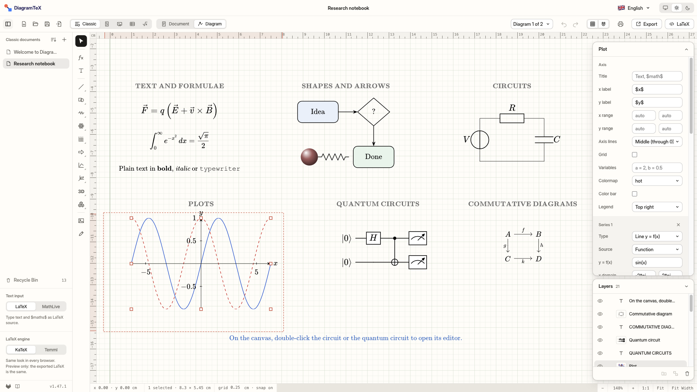
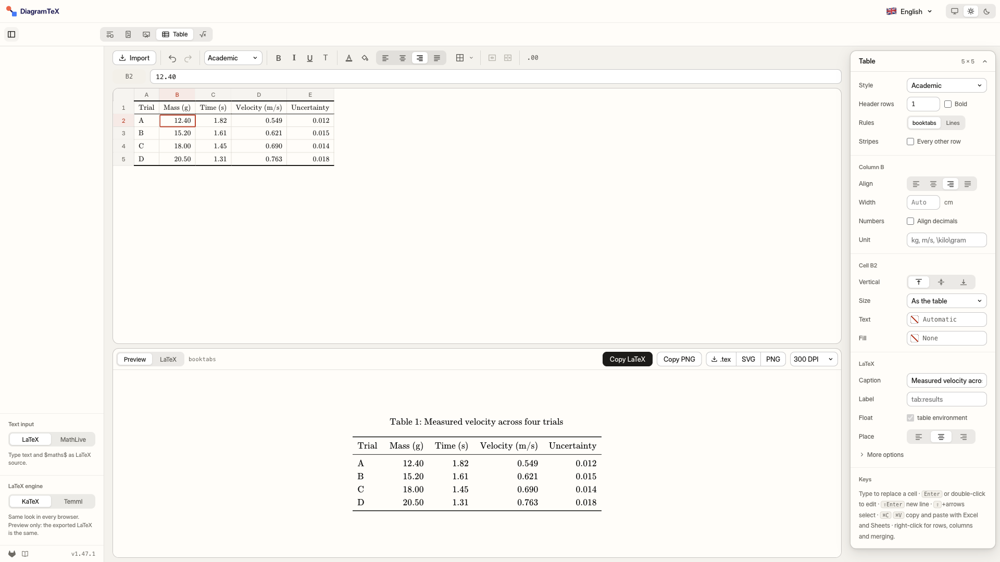
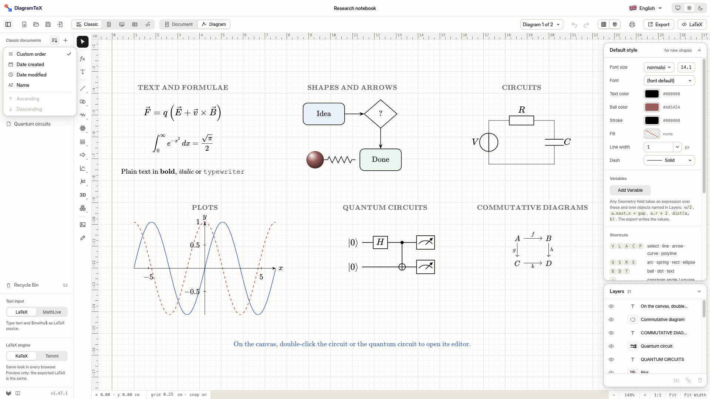
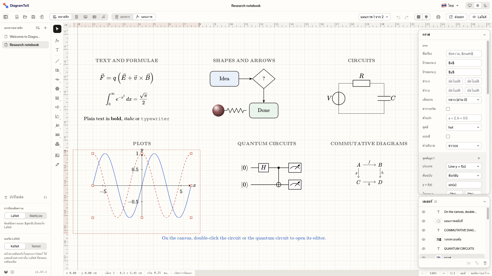

<p align="center">
  <a href="https://diagramtex.com/"></a>
</p>

# DiagramTeX: free online TikZ and LaTeX diagram editor

**DiagramTeX** lets you draw diagrams in your browser and export them as clean **TikZ**, **circuitikz**, **pgfplots**, **tikz-cd**, **xymatrix**, **quantikz**, **forest**, **zx-calculus**, **tikz-feynman**, **tikz-3dplot**, **tikz-timing**, **TikZ automata**, **TikZ graphs**, **pgf-umlcd**, **pgf-umlsd**, **karnaugh-map**, **bytefield**, **chemfig**, **blochsphere** and **booktabs** table code for LaTeX. Draw shapes, arrows, circuits, plots, commutative diagrams, quantum circuits, trees, ZX diagrams, Feynman diagrams, 2D and 3D geometry, timing diagrams, state machines, graphs, UML class and sequence diagrams, Karnaugh maps, bit fields, chemical structures and reaction schemes, Bloch spheres and data tables with the mouse, type labels in LaTeX maths (`$…$`), then paste the code into Overleaf or any LaTeX document.

It is **free and open source** ([GNU AGPLv3](LICENSE)), **works offline**, and needs **no sign-up, login or payment**. Your diagrams stay in your browser; nothing is uploaded.

**[Open DiagramTeX: diagramtex.com](https://diagramtex.com/)**



## Why DiagramTeX

- **Visual TikZ editor:** draw instead of guessing coordinates, and get readable `tikzpicture` code with the packages and libraries listed for you.
- **LaTeX maths everywhere:** labels render with KaTeX or Temml as you type, with LaTeX command suggestions and maths highlighting.
- **Optimised for maths-heavy diagrams, tested in Chromium, WebKit and Firefox (Gecko):** reusable vector previews, background maths generation and visible-element priority keep editing responsive while previews update. Both engines are covered by browser and visual parity tests, alongside generated stress bundles spanning all 40 element types. See [performance and browser compatibility](#performance-and-browser-compatibility).
- **Import existing TikZ:** open a `.tex` file or paste TikZ code to keep editing figures you already have. Supported reusable pics and numeric loops expand into native editable shapes, including gradients and transparency; source definitions remain export metadata.
- **Paste and drop from anywhere:** ⌘V (Ctrl+V) or drag in a picture (PNG, JPEG, SVG; GIF, WebP and the like go in as PNG), a `.tex` file, TikZ code, a block's environment (`quantikz`, `tikzcd`, `\chemfig{…}`, `\xymatrix{…}`, `forest`, a `tabular`…), cells from a spreadsheet, a Markdown table or a `.csv` / `.xlsx` file (a Table block), a formula or a symbol (`\alpha`, `x^2`, `\[ … \]`), or plain text. Each becomes what it is: an image, shapes, that block, a formula or a text object. A dropped one lands where you drop it; in the Document view each becomes a block. Shapes copied in another DiagramTeX window paste back as shapes.
- **LaTeX with its pictures:** when the code uses pictures, the LaTeX dialog also offers **Download .zip**: the `.tex` and every picture it names, ready to compile or upload to Overleaf. SVG pictures go in with `\includesvg` (the `svg` package). **Download .zip** leaves the conversion to Inkscape, which needs shell escape (Overleaf has both). Its arrow offers **SVG as PDF, no Inkscape**: the `.zip` then holds a vector PDF of each SVG where the package looks for it, and the package is told never to call Inkscape, so it compiles with plain pdflatex. Shapes, gradients, clip paths, transparency and text stay sharp; text is set in the nearest standard PDF font (Helvetica, Times or Courier), and an SVG with filters, masks, patterns, markers or embedded pictures goes in as a high-resolution picture instead.
- **Offline and private:** an installable web app (PWA). After the first visit it runs without an internet connection, and documents are saved in your browser.
- **Privacy-focused:** no account, no cookies, no ads, no analytics in the app (the host's own Cloudflare Workers analytics aside). See [Privacy](#privacy).
- **No account, no cost:** open the page and start drawing.
- **Static hosting:** compiled HTML, CSS and JavaScript, with no application server required.

## Performance and browser compatibility

Pan and zoom reuse rendered labels and cached geometry instead of recompiling equations on every movement. Shared SVG image resources reduce repeated work while keeping vector output sharp. Switching between **KaTeX and Temml** generates new previews in a background worker, starting with on-screen elements and the current page or diagram. Existing previews remain visible and fade into the completed output, so you can keep editing in either direction.

Automated tests exercise **Chromium, WebKit and Firefox (Gecko)** with both engines, covering editing, engine changes, scrolling, zooming, printing and exports. Direct visual comparisons check formula geometry and painted glyphs across browsers. Native Safari profiling also informs the optimisation work; measured improvements and test conditions are recorded in the [performance investigation](docs/rendering-performance.md).

Reproducible [stress bundles](tests/stress-fixtures/README.md) cover **Document, Diagram, Page and Whiteboard**, all **40 registered element types**, and varied maths. They range from **2,032 to 12,192 top-level elements** across four files, making large workloads and browser limits testable. These are stress datasets, not capacity guarantees: extreme Documents still have documented size/stall limits, and browser-native HTML text can still exhibit WebKit inline rounding. Mixed math/prose diagram labels use explicit vector glyphs to preserve baselines and repeated-word widths. See [stress results](tests/stress-fixtures/README.md#observed-extreme-case-limit) and [browser test coverage and known limitations](docs/browser-testing.md).

## What you can draw

- **Physics figures that are computed, not just drawn** (the **Physics** menu in the toolbar): pick a domain and the figure works out its own physics, with a visual editor and the results listed beside it, each marked exact, ideal, approx or schematic:
  - **Mechanics:** blocks on inclines with friction, applied forces, Atwood machines, springs, pendulums, projectiles, four-bar linkages and slider–cranks.
  - **Optics:** ray tracing through lenses, mirrors, prisms, slabs, interfaces (refraction and total internal reflection), polarisers, phase plates and beam splitters, with images and interferometers (Michelson, Mach–Zehnder).
  - **Fields:** electric field lines, equipotentials and null points of point charges, and magnetic field lines of currents.
  - **Waves:** two-source interference, single and double slits and gratings, superposition and beats, standing waves on strings and in pipes.
  - **Spacetime:** Minkowski diagrams with moving frames, events, world lines, light cones, simultaneity, intervals and invariant hyperbolas.
  - **Energy levels:** level diagrams, hydrogen-like levels, transitions and line spectra.
- **Physics symbols:** springs, waves, balls, axes, rulers, vectors, fields and force diagrams, in the same menu.
- **Circuit diagrams:** a drag-and-drop circuit editor with 415 `circuitikz` components (resistors, capacitors, inductors, sources, meters, diodes, transistors, op-amps and amplifiers, switches, logic gates including IEEE ones, flip-flops, ICs, vacuum tubes, antennas, block-diagram parts) that exports `circuitikz` code, plus 35 quick electrical symbols and waveforms. Pasting or importing `circuitikz` code (a `circuitikz` environment, or a `tikzpicture` drawn only with circuit parts) makes a Circuit block; circuitikz's short names (`R`, `L`, `C`, `V`, `I`, `D`, `R=$R_1$` …) are read in the circuit's style (`american voltages`, `\ctikzset{resistor=european}` …) and written back as they were.
- **Function plots and charts:** 2D and 3D pgfplots (functions, parametric, polar, implicit, inequalities, vector fields, contour, heatmap, bar, scatter) and pie charts.
- **3D figures for calculus, in plain TikZ:** all shaded or drawn as lines, with hidden edges dashed, turned with the view angles, and exported as plain TikZ with no extra package. Lower a solid colour's alpha in the colour picker to make the solid see-through.
  - **Solid regions** for multiple integrals: a solid E over a base D between z = u₁(x, y) and z = u₂(x, y), or along the x- or y-axis instead. The base is an ellipse, rectangle, polar curve or annular sector (a cylindrical wedge), with drop lines and labelled callouts. Riemann columns show the boxes over a grid on D.
  - **Solids of revolution:** the region between y = g(x) and y = f(x) turned about the x-axis (disks, washers) or the y-axis (shells). Sweep less than 360° to cut it open and show the region, or highlight one slice of width Δx.
  - **Basic solids:** box, cube, cylinder, cone, frustum, hollow cylinder, sphere, hemisphere, spherical cap, ellipsoid, torus, prism, hexagonal prism, pyramid, tetrahedron, octahedron and spherical wedge, with dimension labels, and a set of 3D axes on their own.
  - **3D geometry** (in the Blocks menu): a `tikz-3dplot` picture edited visually: turn the view by dragging, drag points (level, or up and down with Shift), and add axes, rotated frames, points by (x, y, z) or (r, θ, φ), vectors, segments, projections, planes (any plane a x + b y + c z = d), surfaces z = f(x, y) and (u, v), triangles, circles, spheres, boxes, space curves and angle arcs. The code is the figure and is exported as written.
- **2D geometry** (in the Blocks menu): a plain TikZ picture edited visually, for vectors and coordinate geometry: drag points given by (x, y) or (angle:radius) (Shift snaps to whole numbers or 15° along a line), drag a line, shape or circle's rim to move it whole, size a circle with the square at the top right of its rim, select everything with ⌘A (Ctrl+A) and drag any of it to move it all, and add axes, a grid, points, labels, segments, vectors, projections such as `(Q |- P)`, polygons, circles, angle and right-angle marks (the `angles` library), function, polar and parametric plots, and measures (Δx, Δy, length, angle) that print their value with `\pgfmathprintnumber`, so they update when a point moves. Values set to a number get a slider in the panel. The code is the figure and is exported as written.
- **Commutative diagrams:** a `tikz-cd` editor: type or drop objects on a grid, drag arrows from cell to cell, and pick each arrow's style, label, bend and shift, with the code live beside it. The same editor writes `xymatrix` code (the `xy` package) for the XyMatrix block.
- **Bloch spheres:** a `blochsphere` block drawn with the package's own geometry; set the radius, view angles, ball style and states in the panel.
- **Quantum circuits:** a drag-and-drop `quantikz` editor (gates, controls, CNOT/controlled-U/Toffoli/SWAP, meters, labels, wire types, slices, groups) with the code live beside it. With nothing selected, its panel sets the whole circuit's wire and step spacing (`row sep`, `column sep`), measured as the gap or from wire to wire (`between origins`).
- **Trees:** a `forest` editor for syntax trees, org charts, directory trees, decision and probability trees: add, move and restyle nodes by keyboard or drag, with templates and the code live beside it.
- **ZX diagrams:** a `zx-calculus` editor: drop Z and X spiders, Hadamard boxes and points on a grid, drag a node's handle to wire it to another, and pick each wire's shape from pictures.
- **Feynman diagrams:** a `tikz-feynman` editor: place vertices (dots, blobs, crossed dots, particles) on a centimetre grid, drag from one vertex to another to draw fermions, photons, gluons, scalars, ghosts and more, and set labels, momentum arrows, bends and insertions.
- **Timing diagrams:** a `tikz-timing` editor for clocks, signals and buses: paint high, low, high-impedance, unknown, data and clock values onto rows, drag transitions along the time axis, and draw setup, hold and delay arrows between edges.
- **Graphs:** a TikZ `graphs` editor for any graph of nodes and edges: place and drag nodes (several at once), draw edges, loops and bends with handles, label nodes and edges, add notes and text boxes, start from K₅, Petersen, trees, grids and more, lay everything out automatically, and paste an adjacency matrix, adjacency list, edge list, DOT, Mermaid or JSON to get the graph drawn.
- **State machines:** a TikZ `automata` editor: place states (initial, accepting), drag from one state to another for a labelled transition or back onto itself for a loop, move states and their transitions follow, and let **Auto layout** place every state in layers or on a circle.
- **Karnaugh maps:** a `karnaugh-map` editor for 2 to 6 variables with Gray-coded rows and columns: click cells through 0, 1 and don't care, drag across cells to group them (past an edge the group wraps round), and check each group against the cells, with the simplified function written out.
- **Bit fields:** a `bytefield` editor for packet and register layouts: add bit boxes, word boxes, single bits, skipped words and bit headers, drag the line between two fields to move it, split and merge fields, and group rows under a labelled brace on either side.
- **Chemistry:** a `chemfig` editor for structural formulas and reaction schemes: atoms, single, double, triple, wedge and hashed bonds, rings (benzene, aromatic circles, fused rings), functional groups, charges and lone pairs, and reaction arrows with conditions.
- **Flowcharts and block diagrams:** 28 flowchart symbols, 33 basic shapes and 27 block arrows.
- **Tables:** a **Table** mode that works like a spreadsheet: import from Excel, Sheets, CSV, Markdown, HTML or LaTeX, edit in a grid with merged cells, colours, borders and siunitx number alignment, and copy clean `booktabs` LaTeX, or take the table as SVG or PNG, or print it (⌘P). A big table stays responsive while its maths is drawn: the LaTeX can be copied at once, and the picture outputs wait until every formula is ready. In a diagram, a **Table** block puts one in the picture, as a `tabular` in a node.
- **Whole pages and documents:** lay out text, maths and figures on A4 or Letter pages and export a complete LaTeX `article`.

## Screenshots

Captured from v1.47.1 with the two-row toolbar, adjacent Classic view selectors and aligned centimetre rulers.

| | |
|---|---|
|  |  |
| **Gallery:** physics, optics, plots, 3D solids, Feynman, forest, ZX and Bloch blocks on one canvas | **Dark mode** follows the system, or pick it from the top bar |
|  |  |
| **Document view:** write text and maths around your figures, then export one `article` | **Quantum circuits** (`quantikz`): a three-qubit QFT with a gate group |
|  |  |
| **Circuits** (`circuitikz`): drag parts from the library, with the code live beside them | **Timing diagrams** (`tikz-timing`): paint values onto rows and mark setup, hold and delay |
|  |  |
| **Chemistry** (`chemfig`): benzene and acetic acid, drawn from the code on the right | **UML class diagrams** (`pgf-umlcd`): classes, relations and the code beside them |
|  |  |
| **Tables:** import, edit like a spreadsheet, copy `booktabs` LaTeX | **File sorting:** keep your own order, or sort by date or name |
|  | |
| **Interface languages:** Thai browsers start in Thai; other browsers start in English. Switch from the top bar; your choice is remembered and your document stays unchanged | |

How close does the exported LaTeX come to what you see? See [PARITY.md](PARITY.md).

## Quick start

1. Open **[diagramtex.com](https://diagramtex.com/)**.
2. Pick a tool from the left rail and draw. Type `$…$` in a label for maths.
3. Press **LaTeX** (**Ctrl/⌘+E**) to see the code: the TikZ picture, a standalone file or the whole document, to copy or download. **Ctrl/⌘+Shift+E** downloads the whole document as `.tex` at once.
4. Paste the code into your LaTeX document and compile.

The full user guide (every tool, block, mode, export and shortcut) is at **[diagramtex.com/guide/](https://diagramtex.com/guide/)**, and in the app behind the book icon at the bottom of the document list.

A new browser opens with a welcome file, a Classic document: what the app does, a list of everything you can draw and its four modes (Classic, Page, Whiteboard and Quick) on top, then a diagram with one example of each kind of object (text, formulae, shapes, a circuit, a quantum circuit, a plot, a commutative diagram), a second gallery (physics, optics, waveforms, a 3D surface plot, a solid of revolution, a 3D solid, a Feynman diagram, a tree, a ZX diagram and a Bloch sphere), then a short manual: drawing, text and maths, blocks, arranging, writing the document and getting the LaTeX out. Its shortcuts read Cmd on a Mac and Ctrl elsewhere.

To install it, use **Install** beside the language switcher when your browser offers it, or your browser's own install menu. The button is hidden in installed app windows and after installation. Browsers without a custom install prompt, including Safari, use their native installation menu.

### Run it locally

Use Node.js 22 or later. Install dependencies and start the local watcher:

```bash
npm ci
npm run dev
```

Open http://127.0.0.1:5173. The watcher compiles TypeScript and Svelte modules into `public/js/app.bundle.js`, with a source map. Reload the
browser after edits. The generated bundle is ignored by Git.

For a simple static server or direct-file use, run `npm run compile` first, then
serve `public/` (for example, `python3 -m http.server 5173 --directory public`).
Opening `public/index.html` directly also works in most browsers after compilation.
KaTeX, Temml, the SVG typesetter, MathLive and fonts remain local; no CDN is needed.

`npm run check` checks all application TypeScript modules and Svelte components.
`npm test` compiles and runs the same regression suite in Chromium, WebKit and Firefox (Gecko),
including real mouse/keyboard checks for the language picker, saved language,
themes and document controls. Install the browsers first with
`npx playwright install chromium webkit firefox` (an installed Chrome is also supported).
`npm run test:chromium`, `npm run test:webkit` and `npm run test:firefox` select one browser.
`npm run test:ux` checks the existing Chromium workflow benchmarks.
`npm run test:rendering` checks label painting in all three engines through scrolling, zooming,
block editing and standalone exports. `npm run test:document` checks fixed page
layout and dividers across zoom levels, resizing and printing in all three browsers.
`npm run test:parity` directly compares KaTeX and Temml across Chromium, WebKit and Firefox (Gecko),
writing paired screenshots and an HTML/JSON report. It fails on visual or layout
differences beyond its fixed tolerances. Passing these checks does not imply pixel-identical browser rendering. See [browser testing](docs/browser-testing.md) for coverage,
commands and how export snapshots differ from rendering parity. See [migration.md](docs/architecture/migration.md)
for boundaries, verification and the saved starting commit.

### Self-host on Cloudflare Workers

`wrangler.toml` publishes a static-assets-only Worker (no server code). Before
deployment, `scripts/build.js` compiles the module graph from `src/main.ts`, writes
one minified application script and stylesheet to `dist/`, and copies local vendor
assets and fonts. Production compilation writes only to `dist/`. The service
worker's precache is generated from those output files. `version.json` is fetched
from the network to detect newer releases and is excluded from the precache.
Wrangler watches both `src/` and `public/` during development.

```bash
npx wrangler deploy
```

`npx wrangler dev` previews it locally first.

To share a version before it goes live, upload a Preview. It is built the same way, gets its own workers.dev link, and leaves the production site alone. It is named after the current git branch unless you pass `--name`:

```bash
npx wrangler preview
```

`wrangler.toml` turns on Preview URLs (`preview_urls = true`) and holds an empty `[previews]` block, which wrangler requires. The app has no bindings or secrets to override. Preview URLs are switched on for the Worker by the next `npx wrangler deploy`. `npx wrangler preview delete` removes a Preview.

## Feature reference

### Drawing

- **Magnifying glass (`Z`):** inspect a local area of the live vector drawing without changing document zoom. Scroll over the canvas to adjust magnification; Escape returns to Select.
- **Fill bucket (`K`):** choose Fill in Properties. Activating the bucket fills eligible selected closed shapes immediately; clicking another closed shape fills it, including patterns and gradients. Choosing None clears the fill. Alt-click clears the fill; Shift-click applies it to selected closed shapes. Holes and locked objects are respected.
- **Construction guides and smart snapping:** drag horizontal/vertical guides from the rulers. The Guides button cycles **Show guide → Show and lock guide → No guide**. Double-click a guide to edit its position in centimetres (limited to the visible canvas), select it and press Delete, or right-click for Edit position, Delete guide or Delete all guides on the current canvas. Drag to reposition or drag off the canvas to delete; Escape cancels a gesture. Locked guides still snap; hidden guides do not. Guides persist per diagram/page and support undo, but stay out of exports. Whiteboard rulers remain visible independently of guide visibility. Automatic alignment and equal-gap snapping prefer nearby objects, with distant targets as a fallback; Alt bypasses snapping.
- **Snapping modes:** the magnet cycles **Objects, guides and anchors only → Grid only → Both → Off**. The current mode appears in its tooltip and the status bar and is saved for next time. Alt temporarily bypasses every snap target. Grid visibility is independent of grid snapping.
- **Grouping and layout:** Shift-click or drag a selection box to select several objects. Group with Ctrl+G, ungroup with Ctrl+Shift+G, and use Properties to align or distribute. Editor-created groups export as TikZ `scope` environments; grouped objects move together.
- **Native TikZ nodes:** text, rectangles and ellipses expose a **TikZ node** section for a unique node name, an external maths-capable label and a pin. Straight/curved connectors and springs expose start/end nodes and named anchors. Attachments follow the body when it moves or resizes; export uses named anchors such as `(input.east)`. Existing edge-label text, position and side controls remain available. Supported named shape nodes, labels, pins and explicit anchors can be imported back as editable objects; unsupported variants retain their original TikZ code.

- **Tool rail** (Mathcha-style; buttons with a small corner triangle open a flyout):
  - select, maths (`M`, a text object that starts in `$…$`), text (`T`)
  - **Lines** (in PowerPoint's order): line, arrow, double arrow, **elbow connector**, **curved connector**, Bézier curve, curved arrow; then freeform: **curvature pen**, **curve through points**, polyline, smooth closed curve, arc by centre, arc through three points, spring
  - **Two clicks or a drag:** every line tool draws by dragging from start to end, or by a click at the start and another at the end (the line follows the pointer in between; Esc or right-click cancels).
  - **Connectors:** any line can route **Straight**, **Elbow** (right angles) or **Curved** (Route in the panel), and **Direction** sets how it leaves and arrives: sideways or up/down at each end. Drag an elbow's middle handle to move its bend; when its ends are level (a straight run) the handle pulls out sideways into a U, and with the ends stacked it can go out and back (⊐). The middle stays where you put it when the shapes at its ends move; an end only pushes it along once it comes within 0.5 cm, and it springs back when the end moves away again. An elbow on its own can be flipped but not rotated, since it always runs at right angles. Their ends hold on to shapes like a line's. An elbow exports as `--` segments, a curved one as `to[out=…, in=…]` (drawn with TikZ's own control points, so the canvas matches the PDF). Arrowheads are set in the panel, as for any line.
  - **Arc by centre** (`O`): click the centre, then where the arc starts (that sets the radius), then where it ends. The arc follows the way you turn round the centre, so it can go either way and past 180°; Shift snaps the angles to 15°. **Arc through three points**: click both ends, then a point the arc passes through. Either tool's first step can be a drag instead of two clicks, guides show the points so far, and Esc cancels. Once drawn, the round handles on the arc (its two ends and its middle) and the square edge handles on its box are all you need: the two end handles change only the start and end angles (θ₁, θ₂), the handle halfway along the arc changes the radius, two edge handles on its box stretch it across or up and down into an elliptical arc (exported with `x radius` and `y radius`; Shift makes it round again), and the centre handle or the arc itself moves it. It rotates like any shape, by the zones outside its box or the Rotation field; an elliptical arc turns its axes (exported with `rotate around`).
  - **Shapes:** rectangle variants (rounded, snipped), 33 basic shapes led by the plain TikZ rectangle (`R`) and ellipse (`E`), and 28 flowchart symbols
  - **Electrical:** the common electrical symbols (resistor, capacitor, inductor, sources, diode, transistor, logic gates, ground…), a Waveforms group (sine, square, pulse, negative pulse, triangle, sawtooth, trapezoid, rectified and half-wave rectified sine, chopped). Waveforms repeat as you widen them; set the wavelength, start position, duty cycle (square, pulses) or firing angle (chopped) in the panel; and, at the bottom, Advanced Circuit Block (`circuitikz`), the circuit editor below
  - **Physics:** Mechanics (ground, ceiling, wall, block, incline, cart, pulley, pendulum) and Optics (convex and concave lenses, converging and diverging lens symbols, plane, concave and convex mirrors, prism, screen, slits, ray, parallel rays, point source, eye). Hatching, axles, bobs and angle marks keep their size when resized; the panel sets **Hatch spacing**, **Mount** (pulley, pendulum), **Angle mark** and **Angle label** (incline, pendulum; maths without `$`), and the number of **Slits**. A block starts holding `$m$`
  - **Misc:** axes, wave, brace, ruler, grid and more, ball, dot
  - **Draw modes for rectangles and ellipses:** rest the mouse on the Rectangle or Ellipse button (or right-click it) for a menu of how it draws; the choice is ticked, shown on the button and remembered, and `R` / `E` use it. Rectangle: **Corner to corner**, **From the centre**, or **Three points** (click a corner, the next corner, then how far the other side goes: a turned rectangle, exported with `rotate around`; Shift snaps the first side to 15°). Ellipse: **Corner to corner**, **From the centre**, **Circle from the centre**, **Circle by 2 points** (a diameter) or **Circle by 3 points**. Every mode but the three-point ones draws with a drag or with two clicks (the second corner, edge or diameter end follows the pointer until the second click), like the line tools; symbols still go in with one click. Shift keeps a box square; Esc cancels between clicks.
  - **Arrows:** 27 block arrows
  - **2D plots** and **3D**, **Image** (`I`, or paste or drop one: PNG, JPEG, GIF, WebP or SVG; exported with `\includegraphics`, an SVG with `\includesvg`), **Pencil** (`N`: freehand, smoothed and exported as Bézier curves)
  - Library symbols export as exact TikZ paths, can hold centred text, and can be rotated and flipped.
  - **Misc shapes keep their detail size when resized**, as in Mathcha: stretching a wave adds periods instead of widening them, a coil adds loops, a brace keeps its curls, and a ruler or grid adds ticks or cells. Their detail sizes are in the panel: wave **Period width** and **Start position**, coil **Loop pitch** / **Loop size**, axis **Tick spacing** and **Show numbers**, ruler **Tick spacing** / **Tick size**, grid **Cell size** / **Corner shift** / **Border**. Symbols also have **Rotation** and **Skew X**.
  - **Spring** has a **Loop pitch**, so a longer spring gets more coils. A **ticked** line shaft has tick spacing and size.
  - **Polyline points:** click a point to choose it, drag a **+** to add one, double-click to remove one (or use **Add point** / **Remove point** in the panel).
  - **Curve through points** and **smooth closed curve** are TikZ's own `plot[smooth]` and `plot[smooth cycle]` (tension 0.5), so the canvas and the PDF show the same curve, and they export as `plot[smooth] coordinates {…}`. A **Tension** field in the panel sets TikZ's `tension=` (0 is straight lines, 0.5 TikZ's default, higher rounder). Curves drawn with earlier versions keep their old shape. A `plot[smooth …] coordinates {…}` in imported TikZ comes back as one of these curves, with its tension.
  - **Curvature pen** (like Photoshop's): click points and the curve bends smoothly through each of them, with the next segment previewed as you move. Double-click (or Alt-click) to make a point a corner; two corners in a row make a straight segment. Click the first point to close the shape, or press Enter or Esc to leave it open. Its curve follows Photoshop's: each point's tangent is that of the circle through it and its neighbours, so four clicks round a square make a circle and other shapes come out as round as Photoshop draws them. Afterwards, with the path selected, drag its points, drag a **+** to add one on the curve (the shape stays the same), double-click a point to switch it between smooth (round handle) and corner (square handle), and press Delete to remove the chosen point. The panel has **Make Corner** / **Make Smooth**. It exports as a TikZ path of `.. controls ..` curves, with `--` for straight runs.
- **2D plots menu** (the plot button): you can click to place an item or drag out a box.
  - **2D plots (pgfplots):** function, line, scatter, area, bar, contour, heatmap.
  - **Pie chart:** one `label value [#color]` per line.
  - **2D Geometry:** a plain TikZ figure with points, vectors, angle marks and measures (see 2D geometry below).
- **3D menu** (the button with three axes, below 2D plots): eight tools, one for each kind of 3D object. Its variants are picked in its panel, not in the menu.
  - **3D plots:** Surface `z = f(x, y)` (set Type to Mesh for a wireframe), Parametric (x(u, v), y(u, v), z(u, v)), Space curve (x(t), y(t), z(t)) and Scatter 3D. The view angles follow pgfplots `view={az}{el}`.
  - **3D figures:** Solid region (Shape picks an ellipse, rectangle, polar curve or polar rectangle (a cylindrical wedge); Riemann columns turns it into boxes), Revolution (Lower g(x) makes washers, Turn about y-axis makes shells, Sweep cuts it open, Show a slice highlights Δx), Solid (Shape opens a grid of pictures: box, cube, cylinder, cone, frustum, hollow cylinder, sphere, hemisphere, spherical cap, ellipsoid, torus, prism, hexagonal prism, pyramid, tetrahedron, octahedron, spherical wedge) and 3D Geometry.
  - The 3D sketch from earlier test versions has been removed; a file that still holds one opens without it and says so. Points, vectors and planes in space use 3D Geometry.
- **Blocks menu** (the cube button below 3D, marked experimental): CD, XyMatrix, Bloch, Quantum, Circuit, Tree, ZX, Feynman, Timing, Automaton, Class, Sequence, K-map, Bit field and Chemistry. A new block starts with `large` labels, whatever the default text size is.
- **Grid editors** (Quantum, ZX, CD): point just left of a row or just above a column and a bin appears; click it to delete that row or column. Every field in an editor's panel updates the others as you type (a label and its code, an option and its buttons).
- **Plots:** each plot can have several series, given as expressions (`sin(x)*exp(-x/4)`, `x^2+y^2`, …) or as data. You can set axis labels, ranges, grid, legend, colormaps (hot, viridis, jet, cool, gray) and a colour bar. Expression errors show in the panel and on the canvas.
  - **Function plot series types** (Mathcha's set): regular `y = f(x)`, **inequality** (`y < f(x)`, `≤`, `>`, `≥`; shaded, with a dashed edge when strict), **bounded region** between `f` and `g`, **x in terms of y**, **parametric** `(x(t), y(t))`, **polar** `r(θ)`, **implicit** `F(x, y) = 0`, **points**, **vectors** (`x y` or `x y u v`), **vector field** `(P, Q)` and **phase portrait** (trajectories with arrows).
  - **Variables:** one line such as `a = 2, b = 0.5` per plot; every series can use them.
- **LaTeX labels:** text and path labels render `$…$` maths. Path labels use TikZ `auto` / `swap` placement, so the canvas matches the output.
- **LaTeX engine** (left sidebar, under the file list): choose how maths is previewed. It only changes the preview; the exported LaTeX is the same. The choice is saved in this browser.
  - **KaTeX** (default): its original HTML/CSS preview in every browser; exported LaTeX is unchanged.
  - **Temml**: more LaTeX coverage. Temml parses the source into MathML, then a bundled MathJax SVG layout produces the same geometry in each browser.
  - Mixed math/prose diagram labels use self-contained SVG images, with the bundled TeX glyphs converted to exact outlines. System fonts and unsupported scripts retain SVG text shaping and font fallback. Pan, zoom, rotation and exported SVGs transform that image as a whole; maths is not rasterised.
- **Styling:**
  - colour picker with presets, alpha and **Default** (**None** on fills). Every block editor (Quantum, Automaton, Bit field, CD, XyMatrix, Timing…) uses the same picker: a preset is written as its `xcolor` name (`red`, `blue!20`), any other colour as `rgb,255:red,…;green,…;blue,…`
  - **fills** with three tabs: Basic (a colour), **Gradient** (linear or radial, 12 presets, rotate, scale, centre and draggable colour stops; exported as pgf shadings) and **Pattern** (vertical, horizontal, grid, diagonal, crosshatch, bricks, dots, with size, line width and colour; exported with `patterns.meta`)
  - line width presets, dash presets (dotted, dashed, dash dot, densely dashed, long dashes…) or a custom `on off …` pattern in pt (`dash pattern=`), arrow tips, opacity
  - text boxes: drag the handle on a text's right edge (its left edge when it is aligned right, which keeps the right edge still) to give it a wrap width, then choose left / centre / right / justify (`text width=`, `align=`)
  - vertical alignment (**Vertical** in the panel: top, middle, bottom): top-aligned text grows downward as you add lines or enlarge the font, bottom-aligned grows upward, middle grows both ways. New text starts top-aligned. In a paragraph box it places the text at the frame's top, middle or bottom. The export anchors the same edge (`anchor=north`/`south`), so LaTeX keeps it still too
  - snapping: a text box moved with snap on lands on the grid by the point its **Align** and **Vertical** settings name (left + top → its top-left corner, right + bottom → its bottom-right, centre + middle → its centre)
  - math in text and Math objects: `$…$` is inline; `$$…$$` or `\[…\]` is display style (full-size fractions, sums and limits), exported as `$\displaystyle …$`, and imported back the same way. **Math style** (Inline / Display) in the properties panel switches every formula in the selected objects at once.
  - **command suggestions:** type `\` in the canvas text editor, the Text / Label fields or a Document text block, and matching LaTeX commands appear at the caret with a rendered preview. About 250 common ones (Greek, operators, arrows, `\frac`, `\sqrt`, matrices, `aligned`, `cases`…) come first, then everything else the selected engine supports, such as `\bra`, `\ket` and `\braket` (about 900 for KaTeX and 1,000 for Temml). Use ↑ ↓ to choose, Enter or Tab to insert (the caret lands in the first `{}`), and Esc to close.
  - font family, bold/italic, and font size: `\tiny` … `\Huge` or a custom px size (exported as `\fontsize`)
- **Rulers and status line:** the canvas has centimetre rulers in TikZ coordinates (y up). They show the selection's extent in red and the cursor position. The bottom status line shows the cursor (cm), the selection size, the grid and snap state, and zoom.
- **Precision:** 0.25 cm grid. Shapes snap to the grid and to other shapes' points; hold **Alt** to bypass snapping. **Shift** constrains to 15° angles and to squares/circles. The panel shows numeric geometry in TikZ cm.
- **Editing:** multi-select, move, resize handles, copy/paste/duplicate, undo/redo, arrow-key nudge.
- **Labels in boxes:** Enter, or a double-click on a rectangle, ellipse, ball or closed polyline, puts a text in its middle, grouped with it so they move together. Doing it again edits that text.
- **Copy and paste as TikZ:** Ctrl/⌘+C on shapes also puts their TikZ code on the clipboard as text, ready for a `.tex` file; with nothing selected it copies the whole diagram's code. Ctrl/⌘+V of TikZ or LaTeX copied from elsewhere imports it: straight into the diagram when every statement becomes shapes, otherwise through the import dialog, which says what stays code. Shapes copied in the app still paste as shapes.
- **Variables and expressions:** with nothing selected, the panel's **Variables** section holds named values (`gap = 0.5`, `w = 2*gap + 1`). Every Geometry field takes an expression over them and over objects named in Layers: `a.east.x + gap`, `b.width / 2`, `dist(a, b)`, `max(w, 2)`; anchors are `center`, `north`, `north east`… (`.x`, `.y`), plus `x`, `y`, `width`, `height` and the object's own fields. Functions take degrees, as in TikZ. The value follows when what it uses moves or changes; a field changed by hand lets go of its expression. Errors (an unknown name, a loop) show in red on the field. The export writes the values, not the expressions; code kept as written stays as written while the expression puts the shape where it was.
- **Components:** select two or more objects and choose **Make Component** (panel, right-click, or Ctrl/⌘+Alt+K). The objects become one part you can copy; copies are linked. **Edit Parts** opens one copy as a group, and **Save Component** writes the change to every copy in the diagram. **Detach** turns a copy back into plain objects. With nothing selected, the **Components** list shows each part, its copies and **Insert Copy**. The export defines each part once as a TikZ pic (`\tikzset{name/.pic={…}}`) and draws each copy with `\pic at (x,y) {name};`; parts can contain parts.
- **Free rotation:** hover just outside any corner of the selection and the cursor turns into a rotate arrow; drag to rotate (hold **Shift** for 15° steps). One shape rotates about its own centre; several rotate together about the selection's centre. Rectangles, ellipses, text, images and symbols keep a **Rotation** angle (also typed in the panel; exported with `rotate around`), and lines, curves, polylines, arcs, springs and regions have their points rotated. Resize handles follow the rotation, and the opposite side stays put while you drag one.
- **Combine** (select two or more closed shapes, then use the **Combine** row in the panel or right-click → Combine): **Unite**, **Intersect**, **Subtract** (the shapes above are cut out of the bottom one), **Exclude** (keeps the areas covered an odd number of times) and **Divide** (splits into every overlap piece). Works on rectangles (rounded too), ellipses, balls, dots, closed polylines and blobs, filled symbols, and earlier results. The result is a **Region**: a polygon path that can have holes, exported with `even odd rule`.
- **Right-click menu:** copy, copy TikZ code, copy text, cut, paste, duplicate, delete, group/ungroup, **Copy as Image** and **Save as Image** (the selection as **PNG (Background)** on white, **PNG (Transparent)**, or **SVG** with its maths fonts embedded, copied or saved alike; PNG at the export DPI; saved into the file's export folder when it has one, otherwise downloaded), and these submenus:
  - Combine: unite, intersect, subtract, exclude, divide
  - Arrange: front, forward, backward, back
  - Rotate: 90° either way, flip horizontally/vertically
  - Align: left, center, right, top, middle, bottom
  - Distribute: horizontally, vertically
- **Groups** (Ctrl+G, Ctrl+Shift+G): clicking any member selects the whole group; click a member of the selected group again to select it alone (then click its siblings to hop between them), so it moves, copies and edits on its own. A lone member pastes as a plain shape. Align/distribute move a group as one block. Plots and blocks are moved by rotate/flip but not rotated themselves, so one selected on its own offers no rotate cursor, rotate menu or rotate hint.
- **Layers panel** (under the properties panel, top first): click a row to select it, Shift-click for a range, Ctrl/⌘-click to add or remove. Drag rows to restack them; drop onto an open group to put a shape in it, or out of it to take it out. Groups fold open and closed. Each row has an eye (hide: not drawn or exported) and a lock (shown on canvas but can't be picked). Double-click a name to rename it; renaming a group renames the whole group. Hovering a row outlines it on the canvas. The footer groups, ungroups and deletes; right-click a row for Rename, Hide/Show, Lock/Unlock and the usual menu. Click the header to fold the panel away.

### Electrical circuits (circuitikz)
- **Electrical → Advanced Circuit Block** (or **Blocks → Circuit**) adds a circuit block; double-click it (or press Enter) to open the circuit editor in an overlay, so the tool rail stays uncluttered.
- **Parts:** 415 `circuitikz` components in searchable categories, including empty, full and stroke diodes, depletion MOSFETs, IEEE logic ports, instrumentation and fully differential amplifiers, cute switches, vacuum tubes and RF parts, each drawn as pdflatex draws it. **Recently used** and **Common** sections sit on top; the categories stay shut until you open them, and the palette remembers which ones you opened. Click a part and click the grid (it lands where the blue preview shows it), or drag it in; drag from start to end to set a two-terminal part's length.
- **Wires** (`W`) snap to part pins and stay attached when parts move. Nodes such as transistors, op-amps and ICs are auto-named (`Q1`, `U1`…), so wires export as `(Q1.B)`.
- **Properties:** label, annotation, voltage and current arrows, open/closed ends (`*-o`), rotation, mirroring (X left to right, Y top to bottom, from the right-click menu or the keys) and extra options. Labels take maths: `$R_1$`, `$10\,\mathrm{k\Omega}$`. Double-click a part to edit its label (a node's text) in place, in LaTeX or MathLive as set under Text input. A part is picked by clicking anywhere on its body, not only on its lines.
- **Code, side by side:** the `circuitikz` source sits on the right of the editor and follows the drawing as you work. Type in it and the drawing follows after a short pause; lines the editor can't draw are kept and exported as written.
- **Voltages, currents and colour from the code:** the drawing follows circuitikz's direction forms (`v^=`, `v<=`, `v_>=`, `i<=`, `i>_=`, `i_<=`…), the voltage styles (`american`, `european`, `straight` or `raised voltages` on a part, or `\ctikzset{voltage=american}` for the whole circuit) and a part's colour (`color=red`, `blue!70!black`). Voltage sources draw their straight arrow, or `+`/`−` in American style. Paths may use `++(3,0)` and `+(0,2)`, corners (`-|`, `|-`) and named `\coordinate`s.
- **Saving:** Done (⌘/Ctrl+Enter) writes the circuit back and closes; ⌘/Ctrl+S writes it back and keeps the editor open, so Esc afterwards closes without asking. This applies to the quantum editor too.
- Export: the circuit goes into the picture as a `scope` and the preamble gets `\usepackage{circuitikz}`. **Copy circuitikz Code** in the panel gives a standalone `circuitikz` environment.

### Quantum circuits (quantikz)
- **Blocks → Quantum** adds a circuit. Double-click it, press Enter or use **Edit Circuit…** in the panel to open the quantum circuit editor.
- **Editor:** the circuit sits on a grid of cells (wires × steps). Drag an element from the palette onto a cell, or click it to place it in the selected cell. Keys place the common ones and step right: `H X Y Z S T U`, `C` control, `O` open control, `+` target, `M` meter. Drop on the dashed row or column to add a wire or a step. Right-click a cell (or a selected range) to insert wires above or below, insert steps before or after, move a step (or the selected steps) left or right, delete wires or steps, or clear cells.
- Controls link to the nearest gate or target in their step; drag the blue handle to link another wire. Drag an element to move it (Alt copies); drag from anywhere else in a cell, or Shift-click, to select a range (the cursor turns to a move arrow over an element); ⌘C/⌘V copy and paste cells. The panel edits labels, spans, links, wire types, slices and groups; a group's **Border** switch (Shown | None) hides its box (`style={draw=none}`) so only its label shows, above a gate or a run of gates (the editor still outlines its box with a dashed blue line, which isn't exported), and **Label above** in the palette's Annotations adds one ready-made. Right-click a cell or a selected range for **Group Selection** or **Label Above Selection** (a group or a borderless label sized to the range), and **Delete Group** for each group whose box covers that cell. **Group** and **Label above** in the palette also work on a selected range, or, clicked first, by dragging across the cells to cover. Select any cell a group covers and the panel shows that group's fields (Label, **Label at** Top | Bottom | Both with a **Bottom label** for Both, Wires, Steps, Fill, Border, Line, and × to delete it), one section for each group over the cell, and its box shows a bar on each edge: drag one to another wire or step to resize the group (its code moves to the new top-left cell); inserting or deleting wires and steps keeps links and spans pointing at the same wires. A slice's section has Label, **Label at** (Top, Bottom, or Both with a second **Bottom label**, written as a borderless `\slice` beside it), **From wire** / **To wire** (the line covers only those wires: `shorten <=` / `>=` measured from the layout, kept in step as rows change height, with the label moved along with the cut end) and Colour. A selected gate has a handle on its corner: drag it, or type in **Min width** / **Min height**, to set the gate's minimum size (`\gate[][width][height]{…}`, which widens its column as in quantikz). Drag the handle back to the gate's own size, or up or left, and it goes back to auto. Drag the bar on a gate's top or bottom edge to stretch it up or down over neighbouring wires (`\gate[n]`); it stops at the first wire that already has something in that step. Double-click a gate (or any element with a label, such as a stick or a meter), or a slice's or a group's label (top or bottom), to edit that label in place, in LaTeX or MathLive as set under Text input.
- The `quantikz` code is live on the right, both ways. Cells you didn't touch keep the code you wrote, and commands the editor doesn't draw are kept as written. It is exported inside `\begin{quantikz}` with `\usetikzlibrary{quantikz2}`.
- The canvas draws an approximation of quantikz's layout: gates, controls and targets, swaps, meters, wire labels (`\lstick`, `\rstick`), slices, gate groups, bundles and classical wires.
- Maths inside gate arguments and `$…$` in labels is highlighted green, and typing `\` suggests quantikz commands as well as LaTeX ones.
- Every label field says what it takes in its placeholder: **Maths, without $** (gate, phase, meter and other labels quantikz sets as maths; the whole field is green, except inside `\text{…}`) or **Text, $math$** (sticks, slices, groups, and the labels of the other block editors and panels). A `$…$` typed round a maths label is taken off rather than doubled.
- In maths (the green parts of any LaTeX field, and the Quick formula), `(`, `[` and `{` type their closing partner too, or wrap a selection in the pair (`\{` pairs with `\}`); typing the closer steps over it and Backspace between an empty pair removes both. The closer is added only when nothing, a space or the closing `$` follows the caret.

### ZX diagrams (zx-calculus)
- **Blocks → ZX** adds a diagram. Double-click it, press Enter or use **Edit ZX…** in the panel to open the ZX editor.
- **Editor:** the diagram sits on a grid of cells. Drag a spider, Hadamard box, point, loop or text from the palette onto a cell, or select a cell and type `Z`, `X`, `H`, `N` (point) or `L` (loop). Drop on the dashed row or column to grow the diagram. Right-click a cell to insert or delete rows and columns, add a loop or clear it; right-click a wire to delete it.
- **Wires:** hover or select a node and drag the blue handle on its right to another cell (an empty end gets a `\zxN{}` point). Click a wire to choose its shape from pictures (straight, the package's `o` / `s` / `C` curves and more), put an H, Z or X marker on it, or make it classical, bold or dashed.
- **Nodes:** the panel sets a spider's colour, phase (plain or a fraction, with its sign), where the phase goes (in the node or in a label beside it), the gap before its column, and lists the wires leaving it. Double-click a spider or press Enter to type its phase.
- The `zx-calculus` code is live on the right, both ways; cells you didn't touch keep the code you wrote. It is exported inside `\begin{ZX}` with `\usepackage{zx-calculus}`, and **Import LaTeX/TikZ** turns a `ZX` environment back into a diagram.

### 2D geometry (TikZ)
- **Blocks → 2D Geometry** adds a figure: a vector v from P to Q at `(\vang:\vlen)` on a grid, with Δx and Δy printed from the values, and its angle θ marked. Double-click it, press Enter or use **Edit 2D Geometry…** in the panel to open the editor. The panel has a slider for each value set to a number (`\pgfmathsetmacro{\vlen}{4}`) and the scale.
- **Editor:** the 3D geometry editor seen straight on, with a unit grid. Drag across empty space to select, as on the canvas: left to right takes what lies wholly inside the box, right to left anything it touches, and Shift adds to the selection. Hold Space and drag, or use the arrow keys, to move the view. Drag a point to move it on the 0.05 grid (Alt places it freely); hold Shift to snap to whichever is nearer: a whole-number point, or a multiple of 15° from the point a line joins it to (its length on the 0.05 grid; Alt keeps only the angle); a point given as (angle:radius) keeps that form and snaps to 1° and 0.05. A circle moves by its rim or its centre; hovering the rim shows a square at its top right that sets the radius (snapped to 0.05; Alt sizes it freely): a number, a length in cm or mm, or the value it names (`circle (\r)`) is rewritten. Drag a line, edge or filled shape (a circle: its rim) to move the whole object by one step (0.05; Alt free): every literal point it uses moves, and a named point moves in its `\coordinate` (or the values it names), so anything else built on it follows; a path through computed points (`|-`, `$…$`, loops, plots) and grids don't move. ⌘A (Ctrl+A) selects every command: dragging any of them moves them all by one step (the grid too, both corners), a value they share is written once, ⌫ deletes them and Esc or a click on empty space clears the selection. A point whose coordinates are values (`\vlen`, `\vang`) writes the new values there, so everything that uses them follows. Click a line or label to select the command that drew it; double-click to label it; right-click to duplicate, change the draw order or delete. ⌘C / ⌘X copy or cut the selected commands (also to the system clipboard, as TikZ) and ⌘V pastes them at the end of the picture, offset by half a unit each time, with clashing point names renamed.
- **Palette:** axes, a grid, points (x, y) and (r, θ), labels, segments (between two selected points), vectors (to the selected point), projections onto the axes, polygons, circles, angle and right-angle marks (at the middle point of a selected path through three named points, such as `(A) -- (B) -- (C)`, or, with nothing like that selected, the corner you click next: click inside the angle where two lines meet and it is marked, its points named with `\coordinate` if they have no name; Esc cancels; a selected mark shows a square that sets its size, `angle radius`, and its label drags in or out along the middle of the angle, `angle eccentricity`; the panel sets the size, label, distance and colour), plots y = f(x), polar r(θ) and parametric, and measures. Keys `A G P T S V C M F`.
- **Measures** (Δx, Δy, Length, Angle) need two named points: select a segment between them, or a point (measured from the origin). Points written as numbers become `\pgfmathsetmacro` values first, so the measure is computed in the code (`veclen`, `atan2`) and printed with `\pgfmathprintnumber`; dragging a point updates it.
- The drawing reads `(A |- B)` and `(A -| B)`, `grid`, `\pic{angle}` and `\pic{right angle}` with quoted labels, nodes with `pos=`, and `\pgfmathprintnumber` with `fixed`, `precision` and `zerofill`, plus everything 3D geometry reads. Exported with the libraries it uses (`angles`, `quotes`, `arrows.meta`, `calc`); the picture's options go on a shifted `scope`.

### 3D geometry (tikz-3dplot)
- **Blocks → 3D Geometry** adds a figure: axes and a point P given by \tdplotsetcoord, with its φ and θ angles. Double-click it, press Enter or use **Edit 3D Geometry…** in the panel to open the editor. The panel also turns the view (tilt θ and turn φ, as in `\tdplotsetmaincoords`) and sets the scale.
- **Editor:** drag empty space to turn the view; arrow keys turn it by 5° (Shift: 15°). Drag a point to move it level with the xy-plane; hold Shift to move it up and down, Alt to place it off the 0.05 grid. A point whose coordinates are `\def` values (such as `\rvec`, `\thetavec`) writes the new values there, so everything that uses them follows. Click a line, face or label to select the command that drew it; double-click to label it; right-click to duplicate, change the draw order or delete (deleting a point also deletes what draws it).
- **Palette:** axes, a rotated frame, a grid plane, points (x, y, z) and (r, θ, φ), labels, vectors (from the origin to the selected point), segments, projections (dashed lines from the selected point to the xy-plane and the axes), space curves, planes (level, or any plane a x + b y + c z = d with its normal), surfaces z = f(x, y) and parametric surfaces (u, v) built from patches, triangles, a graph z = f(x, y) over a shaded region (with the height of a point marked), circles, spheres, boxes, an angle in the xy-plane and an angle from z (in the selected point's theta plane). Keys `A R P T V S L C B`.
- **Panel:** the selected command's points, colour, fill and opacity, line, width, arrow, frame (main, rotated or screen coordinates), label and its position, and other options; a point's name (renaming updates every reference), coordinates or r, θ, φ.
- The drawing follows tikz-3dplot's own projection and reads `\foreach` loops (lists, `a,b,...,c` ranges, `x/y` pairs, nested), scopes with their options, `declare function`, `\tdplotsetmaincoords`, `\tdplotsetcoord`, `\tdplotdrawarc`, `\tdplotsetrotatedcoords`, `\tdplotsetthetaplanecoords`, `\def`/`\pgfmathsetmacro` values, `\coordinate`, `\node`, and `\draw`/`\fill`/`\filldraw`/`\shade` paths with `--`, `cycle`, `circle`, `ellipse`, `arc`, `rectangle`, `plot` and nodes, including `double` lines and left/right, top/bottom and inner/outer shadings. Anything else is kept in the code and listed as not drawn. Exported with `\usepackage{tikz-3dplot}`; the picture's options go on a shifted `scope`.

### Feynman diagrams (tikz-feynman)
- **Blocks → Feynman** adds a diagram (e⁻e⁺ → μ⁻μ⁺ to start from). Double-click it, press Enter or use **Edit Feynman…** in the panel to open the Feynman editor.
- **Vertices:** click a vertex kind in the palette and click the grid to place it (snaps to 0.25 cm; ⌥ places freely), or drag it onto the grid. Drag a vertex to move it; arrow keys nudge it. With a vertex selected, a palette kind restyles it. Keys `V D T` place a vertex, dot or particle.
- **Lines:** select a vertex and drag the blue handle beside it to another vertex, or to an empty spot for a new vertex. The line takes the propagator picked in the palette (fermion, antifermion, photon, gluon, scalar, charged scalar, ghost, Majorana, boson, charged boson, plain; keys `F P G S M B L`); with a line selected, a palette kind changes it.
- **Panel:** a line has its type, label and side, momentum (side, along or against), bend (left/right with an angle, or a half circle), an insertion cross and any other options; a vertex has its name, shape, label and position. Right-click for Edit Label, Reverse Direction, Bend and Delete. Double-click a vertex or line to type its label.
- The `tikz-feynman` code is live on the right, both ways; a diagram you didn't touch keeps the code you wrote. Vertices placed with `above right=of …` are drawn where TikZ puts them and get coordinates only when moved. It is exported in a `feynman` environment with `\usepackage[compat=1.1.0]{tikz-feynman}` and builds with pdfLaTeX (vertices need positions; `\feynmandiagram`'s automatic layout needs LuaLaTeX and is not drawn). **Import LaTeX/TikZ** turns a `feynman` environment back into a diagram.

### Timing diagrams (tikz-timing)
- **Blocks → Timing** adds a table (a clock, a data line and an output, with setup, hold and clock-to-output arrows to start from). Double-click it, press Enter or use **Edit Timing…** in the panel to open the timing editor.
- **Values:** click a value in the palette (High, Low, High-Z, Unknown, Data, Unknown data, Clock, Toggle, Metastable, Glitch, Gap, Hatched; keys `H L Z X D U C T M G S W`), then drag along a row to paint it over whole periods (⌥ paints freely), click a segment to change it, or click past a row's end to extend it. With a segment selected and nothing armed, a palette value changes that segment. Painting a data value opens its text.
- **Colours and hatching:** a selected data cell (Data or Unknown data) has a **Fill**: Yellow, Orange, Blue, Green, Red, Purple, Grey or Hatched. It is written as tikz-timing's own background style, kept to that cell by a group: `{[timing/d/background/.style={fill=yellow!40}]2D{head}}`; hatching adds `\usetikzlibrary{patterns}` to the export. **Hatched** in the palette paints hatched unknown data, like WaveDrom's `x`.
- **Clock width:** select a step of a clock (or toggle) and set **Clock width** in the panel: every step of that clock becomes that wide over about the same time (2 writes `8{2C}` for 16 periods). **Step width** changes one step. Painting Clock next to a clock continues it at its width.
- **Transitions:** drag an edge along the row to move it (snaps to half periods; ⌥ places freely). The neighbouring segment gives or takes the time; with ⇧ the rest of the row moves along. Arrows ending on that edge follow it. Drag a segment to move it between its neighbours.
- **Rows:** the **+ Signal row**, **+ Clock row**, **+ Bus row** and **+ Blank row** buttons under the table add a row at the bottom; the same items under **Rows** in the palette add one below the selected row. Right-click a name for Insert Row Above, Insert Row Below, Move Up, Move Down, Duplicate Row and Delete Row (or right-click empty space to add a row); double-click a name to rename it. Click a name to select the row: the panel has its name, the state it starts from and its characters as code. Arrows move with their row when rows are added, moved or deleted (an arrow belongs to the row it sits on or in the gap below it, and goes when that row is deleted). A **blank row** (`& \\`) is an empty line between rows, for spacing.
- **Annotations:** **Interval** (`<->`) and **Delay** (`->`) draw one arrow from one edge to another (ends snap to transitions on any row), ask for its label, and put the tool down; **Marker line** adds a help line at a time (`\vertlines`). An arrow's panel sets its label, tips, label side, dashed line, ends and height; drag it to move it or its ends to retime it. **Break** (key `B`) puts `//` marks across every signal row at a time (WaveDrom's `|`), written in the extra code as one `\foreach` line; drag it to move it, and it follows rows as they are added or removed.
- **Table:** with nothing selected, the panel sets the row distance, the slope and a grid (`\tablegrid` / `\fulltablegrid`); changing the row distance keeps each arrow where it was on its own row.
- **Text you type** in names, data and arrow labels is written so it can't break the table: `_ % # & ^`, a lone `$` and an unmatched brace come out escaped (`x_1` is written `x\_1`); write `$x_1$` for a subscript. A half-typed brace in a row's **Characters** waits until it is closed.
- The `tikztimingtable` code is live on the right, both ways; rows and lines you didn't touch keep the code you wrote. It is exported unchanged in a node with `\usepackage{tikz-timing}` and builds with pdfLaTeX. **Import LaTeX/TikZ** turns a `tikztimingtable` back into a timing block.
- **Drawn here:** `H L Z X D U T C M G S`, lower case (half width), widths (`2.5H`), repeats (`8{C}`), groups, `D{text}` and `D{}` (a new value), an initial state (`[L]`), `B`/`F` width changes, `\slope`-style widths; the `timing/slope`, `lslope`, `dslope`, `zslope`, `rowdist` and `coldist` table options; and in the extra code `\draw` arrows between two points (with a node label), `\vertlines`, `\horlines`, `\tablegrid` and `\fulltablegrid`. Other options in a row (`[blue]`, `[[…]]`, `N(…)` nodes), other table options and other extra code are kept in the code and warned about but not drawn.

### Graphs (TikZ graphs)
- **Blocks → Graph** adds a graph (four nodes to start from). Double-click it, press Enter or use **Edit Graph…** in the panel to open the editor. Unlike Tree (forest), it draws any graph, and it draws quickly on the page.
- **Nodes:** click a shape in the palette (Circle, Box, Rounded, Ellipse, Diamond, Point, Text box) and click the grid, drag it onto the grid, or double-click the grid. Drag nodes to move them (snaps to 0.25 cm; ⌥ places freely); ⇧-click or drag a box to select several and move, restyle, align or join them. Double-click a node to edit its label (⇧Enter starts a new line; written `\\` with `align=center`); right-click for a note beside it, a loop, a shape, copy, duplicate or delete.
- **Edges:** drag a selected node's blue handle to another node (onto itself for a loop, onto empty grid for a new node). Line, Arrow and Both ways set the kind; edges between the same two nodes fan out so all of them show; drag a selected edge's middle handle to bend it. Double-click an edge to label it; right-click to reverse it, move the label to the other side, change its ends or bend.
- **From text:** paste (⌘V) onto the canvas, or use **Import From Text…**: an adjacency matrix (0/1 or weights, with or without names), an adjacency list (`a: b c`), an edge list (`a b`, `a -> b`, `1 2 5`), DOT (`digraph { a -> b }`), Mermaid (`graph TD; A --> B`), JSON or a TikZ `\graph`. Arrows or an unsymmetric matrix make a directed graph; weights become edge labels. It replaces the sample graph, or goes beside your own.
- **Auto layout:** Spread Out (springs), On a Circle, In Layers or On a Grid places every node as one undo step.
- Exported as `\graph[no placement] { a/$a$ [at={(0,0)}]; … a -> b; };` in a shifted `scope` with `\usetikzlibrary{graphs}` (plus `quotes`, `arrows.meta`, `shapes.geometric` when used); builds with pdfLaTeX. A pasted `tikzpicture` holding one `\graph` comes back as a Graph block. Copied with a scale, it (like every block) pastes back as the same block with the same scale; a picture the block can't draw is read as separate TikZ objects instead.

### State machines (TikZ automata)
- **Blocks → Automaton** adds a state machine (three states to start from). Double-click it, press Enter or use **Edit State Machine…** in the panel to open the editor.
- **States:** click a kind in the palette (State, Initial, Final, Both) and click the grid to place it (snaps to 0.25 cm; ⌥ places freely), or drag it onto the grid. New states are named `q0`, `q1`, … with the label $q_0$, $q_1$, …. Drag a state to move it; its transitions follow, and arrow keys nudge it. With a state selected, a palette kind restyles it, and `I`, `A` and `L` toggle initial, toggle accepting and add a loop. Key `S` places a state.
- **Transitions:** select a state and drag the blue handle beside it to another state (or to an empty spot for a new state), or back onto the same state for a self-loop; type the label as it appears (⇧Enter starts a new line, written `\\` with `align=center`). The palette picks Straight or Bent for new transitions (keys `T B`); transitions between the same two states fan out so all of them show (±30° for two, ±49° for three, out to 60° beyond). **Loops** (Above, Below, Left, Right) go on the selected state, or click a state while one is picked.
- **Auto layout** (the toolbar button, or In Layers / On a Circle in the panel with nothing selected) places every state: in columns by distance from the initial state, or round a circle in the order they are reached. Transitions that would cross a state get the smallest bend that clears it, opposite pairs bend apart, and loops turn to the freest side. It is one undo step.
- **Panel:** a state has its name, label, Initial (and which side its arrow comes from, and its start text), Accepting, position and other options; a transition has its label and side, bend and angle (or a loop's side) and options. Right-click for Edit Label, Make Initial/Accepting, Add Loop, Reverse Direction, Bend and Delete.
- The code is live on the right, both ways; a machine you didn't touch keeps the code you wrote. States placed with `right of=q0` or `right=of q0` (positioning, with or without `on grid`) are drawn where TikZ puts them and get coordinates only when moved. The drawing follows the automata library: states 2.5em across, accepting states doubled, the initial arrow 3ex with its `start` text, loops with looseness 8, `bend left/right`, `auto` and `swap` label sides, `pos`/`near start`, `->`, `>=Stealth`/`Latex`/`to`, `shorten >`, line widths, dashes and colours. It is exported as a shifted `scope` with `\usetikzlibrary{automata}` (plus `positioning` and `arrows.meta` when the code uses them) and builds with pdfLaTeX. Not drawn (kept in the code): `accepting by arrow`, Moore-style `state with output`, `--`/`to` paths under `\path` without `draw` (drawn anyway), several labels on one transition, and anything outside `\node` and `\path`/`\draw … edge` statements.

### UML class diagrams (pgf-umlcd)
- **Blocks → UML** adds a class diagram (an abstract Shape with two subclasses to start from). Double-click it, press Enter or use **Edit Class Diagram…** in the panel to open the editor.
- **Elements:** class, interface, abstract class, static class, object (an instance of a class) and note. Pick one in the palette (or press its key) and click the grid, drag it from the palette, or drag a box's knob onto empty grid for a linked one. Double-click a name to rename it (every reference follows), or an attribute or operation to edit it in place (in an empty compartment, a new one; emptied, it goes). The panel edits them all, one per line (start an operation with `*` to make it virtual, `\operation[0]`). Double-click a line to edit its label (on a relation, the role at the nearer end), and drag a line's label along it or to either side: it is written as `pos=…` with `above`, `below left` and so on.
- **Relations:** inheritance, implementation, association, unidirectional association, aggregation, composition, dependency and note link. Drag from a box's knob to another box; the relation picked in the palette is the kind it gets (picking one with a relation selected changes that relation). Inheritance and implementation are written as `\inherit` / `\implement` on the child; the rest as `\association`, `\aggregation`, `\composition`, `\unidirectionalAssociation` or a dashed `\draw`. The panel sets the role names and multiplicities, reverses or changes the kind of a relation.
- The `pgf-umlcd` code is live on the right, both ways; a diagram you didn't touch keeps the code you wrote. Boxes are measured as the package draws them (text width, compartments, packages and notes). It is exported in a shifted `scope` with `\usepackage{pgf-umlcd}` and builds with pdfLaTeX. **Import LaTeX/TikZ** turns a picture of pgf-umlcd classes back into a class diagram.
- **Routed lines and the grid:** a hand-written `\draw` with several steps (`--`, `-|`, `|-`, relative `+(…)` / `++(…)` points, a label on any step, `sloped` labels) is drawn as TikZ draws it; it follows its classes when they move, and its route and labels are edited in the code. `[show background grid]` on the picture draws the dashed grid behind it; since it does nothing inside a `scope`, the export writes the grid out on the background layer and the import takes it back to the option. The pgf-umlcd manual's Abstract Factory example matches pdfLaTeX's output.

### UML sequence diagrams (pgf-umlsd)
- **Blocks → Sequence** adds a sequence diagram (a client thread calling a server, which queries a database). Double-click it, press Enter or use **Edit Sequence Diagram…** in the panel to open the editor.
- **Lifelines:** instances (`\newinst`, passive until called) and threads (`\newthread`, active from the start, in their own colour). Pick one in the palette (or press `I` / `T`) to add it after the selected one; drag an instance sideways to reorder. The panel sets its text, the name messages use (renaming it renames them), the gap before it or the thread's colour.
- **Messages:** call (with a return), self call, message and call without a return (`messcall`). Pick the kind (keys `C S M A`) and drag from one lifeline to another; on one lifeline, drag down for a self call. A message drawn inside an activation goes inside that call, so nesting follows where you draw it. Picking a kind with a message selected changes it; the panel sets its ends, text, return value, length or delay (a delayed message slopes down). Deleting a call keeps what it holds; deleting an instance takes out its messages.
- **Blocks:** `B` puts a frame (`sdblock`) round the selected message, with a caption, a comment and a caption colour. ⌥↑ / ⌥↓ move a message among its neighbours. Double-click any text (an instance's, a message's, a return value, a caption) to edit it in place.
- The `pgf-umlsd` code is live on the right, both ways; a diagram you didn't touch keeps the code you wrote. It is drawn as the package draws it: levels, activation bars, the empty nodes arrows stop at, its arrow tips, drop shadows, `\prelevel` / `\postlevel`, `\setthreadbias`, `\tikzstyle{inststyle}` (colours, shading, rounded corners, font size), `instcolor` styles, `\unitfactor` and blocks sized round what they hold. The package's demos match pdfLaTeX's output. The environment opens a picture of its own, so it is exported in a node with the outer picture interrupted, with `\usepackage{pgf-umlsd}`; it builds with pdfLaTeX. **Import LaTeX/TikZ** reads a `sequencediagram` back into one, inside a picture or not.
- A message's text names nodes in pgf-umlsd, so commands and round brackets in it don't compile; the panel warns. A call's text can have them.

### Karnaugh maps (karnaugh-map)
- **Blocks → K-map** adds a 4-variable map with two groups to start from. Double-click it, press Enter or use **Edit Karnaugh Map…** in the panel to open the editor.
- **Sizes:** the palette has the package's six maps: 2 × 2 (2 variables), 4 × 2 and 2 × 4 (3), 4 × 4 (4), 4 × 4 × 2 (5) and 4 × 4 × 4 (6, four sub maps). Rows and columns are in Gray code order (00, 01, 11, 10). Changing the size keeps the cells and groups that still fit.
- **Cells:** click a cell to turn it through 0, 1 and don't care (⇧-click goes back). Pick One, Zero, Don't care or Empty in the palette to paint cells by clicking or dragging; keys `1 0 D E` set the cell under the pointer. Right-click a cell to set its value.
- **Groups:** drag across cells to draw a group; drag past an edge to wrap round to the other side, or into another sub map to put it on both. Drag a group's outline to move it (it wraps round too) and its side handles to resize it; arrow keys move the selected group and ⇧ arrows resize it. With Group picked in the palette (`G`), a click makes a one-cell group. Shapes the package can't draw (a wrap more than one row deep) are not offered.
- **Check:** the panel checks every group against the cells, grouping the 1s (sum of products) or the 0s (product of sums): a block of 1, 2, 4, 8… cells covering no 0 (or 1) is valid, and it says when one could be larger or adds nothing. It lists the term for each group, writes out the function they give and lists the cells left out. **Find Groups** replaces the groups with a smallest cover.
- **Panel:** the variable names (bit 0 first, as the package numbers them), labels at the sides or in the corner (`label=corner`), and coloured or outlined groups (`karnaugh-map*`). Groups take the package's colours in order: red, green, yellow, cyan, blue, magenta.
- The `karnaugh-map` code is live on the right, both ways; a map you didn't touch keeps the code you wrote. Cells are written as `\minterms`, `\maxterms`, `\indeterminants` (and `\autoterms[0]` when most of a full map is 0); groups as `\implicant`, `\implicantedge` and `\implicantcorner`. It is exported unchanged with `\usepackage{karnaugh-map}` and builds with pdfLaTeX.

### Bit fields (bytefield)
- **Blocks → Bit field** adds an IPv4-style header to start from. Double-click it, press Enter or use **Edit Bit Field…** in the panel to open the editor. The block is its `bytefield` code (version 2 of the package), with any `\bytefieldsetup{…}` written before it.
- **Fields:** the palette has Bit box (`B`), Word box (`W`), Bits (`I`, one box per bit with `\bitboxes`), Skipped (`K`, `\skippedwords`) and Header (`H`, `\bitheader`). A new field goes after the selection, or in a new row when its row is full. Click a field to select it; drag its right edge to move the line between it and the next field (it snaps to bits; ⌥ resizes the field alone), drag a word box's bottom to change its height in rows. Double-click or Enter edits the label in place; `S` splits a field in half (or a word box into rows), `M` and `⇧M` merge it with the next or previous field, arrow keys move between fields.
- **Selecting:** press on a field and drag across others, ⇧-click another field, or ⇧-arrow, to select every field in the rectangle between them; ⌘A selects every field. ⌫ deletes the selected fields (whole rows when the selection takes every field of its rows), as one undo step.
- **Groups:** select fields in the rows you want, then Right (`R`) or Left (`L`) to put a brace and label round them (`rightwordgroup`, `leftwordgroup`). Groups can be nested and moved to the other side. Click a brace and drag the handle at its top or bottom to another row to change which rows it covers; groups on the same side stay nested, so one can't be dragged across another (it wraps a group it now covers). A label breaks onto more lines with `\\`, and a `\parbox`, `tabular` or `\shortstack` round it is shown with its own width and alignment.
- **Right-click** a field for Edit Label, Split, Merge, Insert Field Before or After, Insert Row Above or Below, Group Rows and Delete; a brace for Edit Label, Move to the other side and Delete Group.
- **Panel:** a field's label, width in bits (or height in rows), borders (`[lrtb]`), fill (`bgcolor`) and other options such as `boxformatting`; a header's numbers, endianness and lowest bit; the whole field's width in bits, `bitwidth` (`auto` too), `bitheight`, endianness, `lsb`, `bitformatting` and `boxformatting`.
- The canvas follows the package's measurements under pdfLaTeX: bit widths and heights, the bit header above its row, skipped words, and the braces TeX picks for each group. Version 1 `\wordgroupr`/`\wordgroupl` are read and written back as the version 2 environments.
- The code is live on the right, both ways; code you didn't touch is kept as you wrote it, comments and spacing included, and an edit rewrites only the fields it changed. It is exported unchanged with `\usepackage{bytefield}` and builds with pdfLaTeX; a `bytefield` in an imported document (in a figure or in a TikZ node) comes back as a Bit field block.

### Tables in a diagram (booktabs)
- **Blocks → Table** adds a small table to start from. Paste cells copied from Excel, Google Sheets or Numbers onto the canvas (or a Markdown table, or drop a `.csv`, `.tsv` or `.xlsx` file) and they become a Table block; so does a LaTeX `tabular`, `tabularx` or `table` float pasted on its own, or a `tabular` inside a TikZ node in imported code.
- Double-click it, press Enter or use **Edit Table…** in the panel to edit it in the **Table** workspace, with the whole grid, toolbar and settings. A strip at the top says it is the diagram's table: **Done** (⌘S to keep editing) puts it back as one undo step, and so does leaving Table for Classic, Page or Whiteboard; **Cancel** drops the changes. The workspace's own table is put aside meanwhile and comes back untouched.
- The panel shows the table's LaTeX, editable (the table follows once the code reads as a whole table), with **Copy Table Code**.
- It is exported as a `tabular` in a node, `\node[inner sep=0pt] at (x,y) {\begin{tabular}…\end{tabular}};`, with the packages it needs. A node can't hold a float, so the block has no caption, label or float position (the workspace hides those while editing one), a longtable is written as a tabular, and `\rowcolors` stripes are written row by row. Arrows can connect to its sides.

### Chemistry (chemfig)
- **Blocks → Chemistry** adds a molecule (acetic acid to start from). Double-click it, press Enter or use **Edit Chemistry…** in the panel to open the Chemistry editor. The block is its `chemfig` code: one `\chemfig{…}`, several joined by `\+`, or a `\schemestart … \schemestop` reaction scheme.
- **Atoms and bonds:** click an atom to pick it and drag its blue handle out to grow a bond (it snaps to 15°; ⌥ for any angle), or click the handle for a bond in the free direction, zigzagging along a chain. Drag an atom to turn and stretch the bond that leads to it. Type `C H N O S P F I` to relabel the picked atom, or double-click it to type any label (`H_3C`, `NH_2`, `{(CH_2)_3}`). Double-click a bond to step it single → double → triple; keys `1 2 3` set the kind new bonds get.
- **Palette:** Atoms, Bonds (single, double, triple, wedge, hashed, hollow wedge, reversed), Rings (benzene, aromatic circle, 3 to 7 sides), Groups (OH, NH₂, CH₃, OCH₃, CHO, COOH, NO₂, CN, SH, written the right way round when they point left), Charges (+, −, lone pair, radical, δ+, δ−) and Reactions (arrow, equilibrium, resonance, no reaction, plus, merge, curved arrow). With an atom picked, a ring or group is attached to it by a bond; with a ring's side picked, a ring is fused onto that side. With nothing picked, the item is armed: click an atom or bond to apply it.
- **Panel:** an atom has its label, a + or − charge and lone pairs above, right, below or left; a bond its type, angle, length and TikZ options; an arrow its type, the conditions above and below, angle, length, ends (`.mid east--.mid west`) and style. In a scheme, a molecule can be named (`\chemname`), put in brackets (`\chemleft[ … \chemright]`), grouped with the next step into a `\subscheme` (with the angle its arrows default to) or ungrouped, or deleted. Right-click for bond types, Edit Label, Delete Atom, Bond, Ring, Molecule or Arrow.
- **Reactions:** Arrow, Equilibrium, Resonance or No reaction turns the drawing into a `\schemestart … \schemestop` scheme and adds the arrow and a copy of the molecule after it, ready to change into the product. Drag an arrow's head to turn and stretch it (15° steps; ⌥ for any angle). **Merge** joins the last two compounds into a new one below (`\merge`); its panel sets the direction, conditions, the compounds it comes from and the name it goes to.
- **Curved arrows:** pick **Curved arrow**, click the atom or bond it starts from, then the one it goes to. The ends are named for you (`@{e1}`) and a `\chemmove` is added. Drag its two blue handles to bend it (angles in 15° steps, pull in 0.05 cm); the panel sets the tips, solid, dashed or dotted line, colour, the leave and arrive angles and pulls, or the whole TikZ path. Click a curved arrow to pick it, ⌫ to delete it.
- The code is live on the right, both ways, and is drawn by chemfig's own rules (atom sep 3em, ring and branch angles, double bonds inside rings, Cram wedges, arrow lengths), so the canvas matches the PDF. Code you didn't touch is kept as written. It is exported unchanged in a node with `\usepackage{chemfig}` and builds with pdfLaTeX. Also drawn: `\definesubmol` (with arguments, `!{name}{arg}`, `!0`), `\setchemfig` (atom sep, angle increment, cram width, bond offset, fixed length…), atoms split with `|`, `\printatom`, `\phantom`, text between molecules, scheme arrows with labels (molecules, sizes and `*{angle}` too), from anchors (`\arrow(.mid east--.mid west){<->}`) and between named compounds (`\arrow(@a--@b)`, `c1`, `c2`…), `\subscheme`, `\merge`, `\chemname`, `\chemleft[ … \chemright]` brackets with charges, paragraphs (`\par` or a blank line), `\hreac … \endhreac`, and `\chemmove` curved arrows between `@{name}` atoms and bonds (`--`, `|-`, `-|`, `..controls … and ..`, `to[bend left]`, polar anchors, shorten, tips, dashed and dash patterns, colour). Submolecule atoms are edited in their `\definesubmol`, not on the canvas. Not drawn (kept in the code and warned about): the `-U>` arrow's arc and `\chemfig`'s optional arguments.

### Commutative diagrams (tikz-cd)
- **Blocks → CD** adds a diagram. Double-click it, press Enter or use **Edit Diagram…** in the panel to open the CD editor. Diagrams from the old grid editor open as CD blocks.
- **Editor:** the diagram sits on a grid of cells. Select a cell and type to write its object, or drop one from the palette (A, 0, ℤ, A ⊕ B, Hom(A, B), …). Drag from one cell to another to draw an arrow in the style picked in the palette (arrow, maps to, inclusion, onto, into, dashed, implies, equal, both ways, line, harpoon, squiggly). Drag a cell to move it (Alt copies); right-click for rows and columns.
- **Arrows:** the panel sets the label (Side and At apply once it has one), the head (pictures), the line (solid, dashed, dotted, squiggly), a crossing gap, bend and shift, each on its own so none undoes another, and shows the arrow's options as written; **Reverse** swaps its ends. Picking Dashed or Squiggly in the palette changes only the line.
- The `tikz-cd` code is live on the right, both ways; cells you didn't touch keep the code you wrote. The canvas sizes cells as tikz-cd does. It is exported inside `\begin{tikzcd}` with `\usepackage{tikz-cd}` (and `decorations.pathmorphing` for squiggly arrows).
- **quiver:** code exported from [quiver](https://github.com/varkor/quiver) draws as it does with `quiver.sty`: arrows written by position (`from=1-1, to=1-2`) or to a named label (2-cells between arrows), `curve={height=…}`, `between={0.2}{0.8}`, `nfold`, `tail reversed`, `2tail`, `no body`, loops (`loop, in, out, distance`), markings (`\shortmid`, `\bullet`, `\circ`), pullback and pushout corners, and colours written as `{rgb,255:red,…;green,…;blue,…}` on arrows, labels and `\textcolor`. The editor moves arrows written by position into their cells as `\arrow[r]`; arrows to a name stay as written. Exported with `\usepackage{quiver}` when the code uses its keys. 3-fold and higher arrows are drawn double, with a hint.

### Commutative diagrams (xymatrix)
- **Blocks → XyMatrix** adds a diagram written for the `xy` package. It opens in the same editor as CD, with the same palette, grid and arrow panel, but the live code is `\xymatrix{…}`: `\ar@{->>}[r]^{f}`, hooks `@{^{(}->}`, curves `@/^1pc/`, shifts `@<.5ex>`, labels `^`, `_`, `|` with a position such as `^(.3)`, and `@R=`/`@C=`/`@M=` spacing.
- The canvas uses xy's geometry: 2pc between entries, 3pt object margins, labels in script size 2.5pt from the arrow, xy's arrow tip, and `@/^/` curves .5pc deep. xy code with no tikz-cd counterpart is kept as written.
- It is exported unchanged, as `$\xymatrix{…}$` in a node, with `\usepackage[all]{xy}`. It builds with pdfLaTeX alongside tikz-cd.
- **Convert to xymatrix** (in a CD block's panel) and **Convert to tikz-cd** (in an XyMatrix block's panel) rewrite the block in the other package: spacing, arrow styles, labels and their positions, bends and curves, shifts, framed objects, and xy turns `` `[ul] `[l]… `` as tikz-cd `to path`s with rounded corners. Converting back before you edit gives your original code exactly. What the other package can't say (`crossing over`, colours, named coordinates) is approximated or dropped, and the hint lists it.

### Bloch spheres (blochsphere)
- **Blocks → Bloch** adds a sphere. Its `blochsphere` code is the object: the canvas draws it with the package's projection, circles, shaded ball and state vectors.
- **Panel:** radius; **Tilt** and **Rotation** sliders (click the degree value to type one); the ball as Shaded, Outline or None; **Colours** for the ball, lines (grid and axes), states and labels, written as the package's own `color`, `style`, `statecolor` and each label's `\node` colour (named xcolor colours, since the package does not take hex); and a **States** table with each state's label (maths), θ and φ, a bin to delete it and **Add State**. The code below is editable too; commands the panel doesn't cover are kept as written.
- Exported with `\usepackage{blochsphere}`.

### Physics figures
- **Physics** (experimental: check the results) in the toolbar opens a menu with one entry per domain (Mechanics, Optics, Fields, Waves, Spacetime, Energy levels) above the mechanics and optics symbols. Click an entry, then the canvas, to place a figure of that domain (it starts from an example). Double-click it, press Enter or use **Edit Physics…** in the panel to open the Physics editor.
- **Editor:** the palette on the left lists the domain's objects by group, with its examples below (an example replaces the figure; ⌘Z brings it back). Click an object, then the grid, to place it; Esc when done. Select an object to change it on the right, or drag its handles: a square moves, a circle turns, a diamond sets a size or focal length (⌥ turns snapping off). Arrows nudge by 0.25 cm (⇧ for 1 cm), Tab walks the objects, ⌘D duplicates, ⌫ deletes, 0 fits the view. With nothing selected, the right side lists every result. The domain is the one chosen from the menu.
- **Drawing in a figure:** below the physics objects, the palette has the main editor's drawing tools: text and maths, lines, arrows, curves, polylines, the pencil, rectangles, ellipses, basic and flowchart shapes, block arrows and the mechanics, optics, electrical and waveform symbols (no blocks or plots). They draw, reshape and style as on the main canvas, and export with the figure. Drag on an empty spot for a marquee (left to right takes what is wholly inside, right to left what it touches; ⇧ adds), ⇧-click to add or remove one, ⌘A for all; the selection moves, nudges, duplicates and deletes together. Space-drag, the middle button or the trackpad moves the view.
- **Results:** each computed value is tagged **exact** (from the model as stated), **ideal** (exact for a stated idealisation, such as a thin lens or a massless string), **approx** (an approximation, such as small angles) or **schematic** (drawn, not computed). Hover a result for its model. Impossible setups (a linkage that cannot close, β ≥ 1, a ray that never reaches a lens) are warnings, not silent errors.
- **Source:** the figure is a short source, one object per line (`\lens[f=2](3)`), live beside the editor in both directions. Values take units (`500nm`, `30deg`, `2kg`, `5nC`); a plain number is in the unit the field shows. Comments, options and lines it does not know, plain TikZ included, are kept as written. This is DiagramTeX's own syntax, not LaTeX: it does not compile on its own. Export, or **Copy TikZ Code** in the panel, gives the LaTeX. A drawn shape is a `\shape{…}` line holding the shape as JSON.
- **Export:** plain TikZ with `arrows.meta`, the same drawing as the canvas. The models, their assumptions and limits, and what is left out are in [docs/physics.md](docs/physics.md).

### Three kinds of file
- On your first visit a short **welcome tour** shows the left, top and right of the window, and reminds you that work kept in the browser is lost if the browser's data is cleared, so save what matters as a `.diagramtex` file. Open it again any time from the command search (**Welcome Tour**).
- The top bar's main switch is **Classic | Page | Whiteboard | Table | Quick**. Hover it to see every name. The Blocks menu shows Tensor network, String diagram and Braid as greyed-out, dashed tiles for blocks still to come.
- **Page** files: one free-form sheet, described below.
- **Whiteboard** files: one endless canvas with no page and no edges. Draw anywhere; scroll (two fingers on a trackpad) to move around, pinch, Ctrl/⌘+scroll or Ctrl/⌘ + and − to zoom from 3% to 800%, and use the **Hand** tool (`H`) or Space-drag to grab the board. A dot grid replaces the rectangular grid and stays evenly spaced at any zoom. Rulers remain visible even when construction guides are hidden. **Fit** brings everything into view. Export, TikZ code and import work as for a Classic diagram, sized to what you drew; files save as `.diagramtex`, like the other kinds.
- **Quick** is not a kind of file: it is one formula, turned into a picture. Type LaTeX (or edit it in MathLive) and the preview updates as you type; parse errors show beneath it. **Copy PNG** (Ctrl/⌘+Enter) puts a PNG on the clipboard, ready to paste into slides, documents or chats; **Copy SVG** copies the SVG source; the **PNG** and **SVG** buttons download `formula.png` / `formula.svg`. Choose the size (Normal, Large, Huge), how sharp the PNG is (4×, 8×, 16× or 32× the formula's pixels; 8× by default, which stays crisp when pasted into chats or slides, while documents such as Word still place it at the formula's true size) and a transparent background. The PNG embeds the maths fonts; the SVG keeps the maths as text, loading its fonts from the web. The formula and options are remembered in the browser, and the file you had open stays open: choose Classic, Page or Whiteboard to return to it.
- **Table** is not a kind of file either: it is one table to make and take away. **Import** it: paste cells copied from Excel, Google Sheets or Numbers (Ctrl/⌘+V anywhere in Table), drop or open a CSV, TSV, Excel (`.xlsx`), Markdown, HTML or LaTeX file, or paste their text (a LaTeX `tabular`, `tabularx` or `longtable` with booktabs rules, `\multicolumn`, `\multirow`, `\cellcolor`, `\rowcolor`, `\rowcolors`, `\textcolor` and siunitx `S` columns reads back as it was, so a snippet copied out comes back in; so do double rules (`||`, `\hline\hline`, `\hhline`), `m{}` and `b{}` columns, `\newcolumntype`, `\arrayrulewidth` and `\arrayrulecolor`, a `\multirow` width, `\\[len]` row spacing, the float placement, tabular's `[t]`/`[b]`, and a longtable's head and foot rows). Merged cells, bold, italic, colours, fills, borders and alignment come along where the source has them; `$…$` in cells stays maths, while `$5 and $10` stays money. Paste a whole page and the table is taken out of it: the first Markdown table (prose, code blocks and quote marks around it are left out), the data table of an HTML page (not the layout tables around it; its caption and `<th>` header come too), or the first table environment in a LaTeX document (`tabular`, `tabularx`, `tabulary`, `longtable`, `NiceTabular`, `tblr`), with its float's caption, label, size, `\rowcolors` stripes, `\textbf` / `\emph` / `\bfseries` / `\color` / `\cellcolor` and siunitx columns.
  - **Edit** in a grid like a spreadsheet: arrows, Tab and Enter move; Shift extends the range; type to replace a cell, or Enter, F2 or double-click to edit it (Shift+Enter for a new line); Delete clears; Ctrl/⌘ + B, I, U, Z, Shift+Z, A, C, X and V do what they do in a spreadsheet, and cells copied out paste into Excel and Sheets with their formats. The bar above the grid edits the active cell's LaTeX. Right-click for inserting, deleting and moving rows and columns, merging and splitting, header rows and clearing. Drag a column header's right edge to give it a width (it wraps, as `p{…}`); double-click the edge for automatic. Hover past the last column or under the last row for a **+** that adds one. Ctrl/⌘+V pastes cells (from a spreadsheet, or CSV, TSV, Markdown, HTML or LaTeX text) with their top-left at the active cell, growing the table when they run past its edge; only **Import** replaces the whole table. Cells are edited as LaTeX (with suggestions and maths in green) or in MathLive, as set under Text input, and may hold environments such as `pmatrix` or `cases` (amsmath is added for them).
  - **Format** from the toolbar (style, bold, italic, underline, monospace, text colour, fill, alignment, borders, merge, numbers) and the panel on the right: the table (style: Academic with booktabs rules, Minimal, Grid, Striped or Plain; header rows; rules), the column (alignment, width, decimal alignment with significant figures or decimal places, and siunitx's number format: digit grouping (thin space, comma, point, space or none, from how many digits, decimals too), a decimal point or comma, × or · before the power of ten, scientific or engineering exponents, + on positive numbers and the numbers' position in the column (numbers typed `1,599.99` or `1.599,99` align too, and the column starts out printing them that way; the menu beside **.00** in the toolbar sets grouping and the marker), scientific notation, uncertainties as 1.23(4) or 1.23 ± 0.04, a siunitx unit shown after the header), the cell (vertical alignment, size, colours) and the LaTeX (caption, label, float, placement; under More options: tabular, tabularx or longtable, footer rows for a longtable, width, font size, padding, row height, rule width and colour, and how units follow the header). Borders can be none, thin, thick or double; Striped colours alternate rows with `\rowcolors`, with a colour for the other rows too. Uncertainties round up, never to zero.
  - **Take it away**: the pane under the grid shows the preview, drawn by the same renderer as the pictures, or the LaTeX with the packages it needs. **Copy LaTeX** (Ctrl/⌘+Shift+C) copies the table with a comment naming its packages (or click the LaTeX and press Ctrl/⌘+A, then C: that selects only the code, not the page); **.tex** downloads a document that compiles on its own; **SVG** downloads a vector picture with the maths fonts embedded; **PNG** downloads one at 150, 300 or 600 DPI, and **Copy PNG** puts it on the clipboard. The LaTeX is plain and minimal: only the packages used, `\multicolumn` only where a cell differs from its column, numbers rounded before siunitx reads them.
  - The table stays in the browser until the next import; it is not saved in files. The file you had open stays open: choose Classic, Page or Whiteboard to return to it.
- **Classic** files: diagrams, plus a document view that arranges them with text, as in Mathcha. While Classic is selected, a second switch, **Document | Diagram**, appears beside it; files open in Document view unless they were left in Diagram view.
- Choosing Page, Classic or Whiteboard opens the last file of that kind, or starts a new one. The sidebar lists only files of the current kind, and **New** makes a file of that kind.
- The properties panel floats over the top right of the canvas: click its heading to fold it up, and again to open it. The button at the left end of the top bar folds the file list away.
- **Zoom keys:** Ctrl/⌘ + and − zoom the canvas, the whiteboard and the Document view in and out, and Ctrl/⌘ 0 returns to 100%. They zoom the drawing, not the browser's page.
- **Fit** (status bar, or right-click the empty canvas) zooms the whole page or drawing into view; **Fit Width** fits its width and shows it from the top. In Page mode and the Classic diagram, both use the space left of the properties panel, so nothing ends up underneath it.
- **Save** (Ctrl+Shift+S) saves a `.diagramtex` file: JSON inside, recording its kind (`"kind": "page"`, `"classic"` or `"board"`). **Open** (Ctrl+O) loads it back into the right mode. Files saved by older versions (`.json`, `.page.json`, `.board.json`) still open; a `.json` with no kind opens as Classic.
- **Drag and drop project files:** drop one or more `.diagramtex` files anywhere in the app to open them, including backup bundles. Their file kinds and contents are preserved; your current file stays in the file list. Where supported, a dropped file remains linked for later saves.
- **Export All Files…** (right-click the empty part of the file list) saves every file, Pages, Classic and Whiteboard, into one `.diagramtex` bundle. **Open** a bundle to bring them all back: each file goes into its own kind, a file that is already here unchanged is skipped, and a name that is taken gets "copy" added.
- **Saving to the same file** (Chrome, Edge and other Chromium browsers): the first **Save** asks where to put the file. After that the document is *linked* to it: Ctrl+S and **Save** write straight to it, with no dialog. From then on every change is also written to the file a second after you stop, and the top bar says **Autosave is enabled (File)**. If something else changes the file on disk, autosave stops writing to it (a hint says so) until the next Ctrl+S. The top bar shows the file's name, with an amber dot while there are changes not yet saved to it. A file opened with **Open** is linked the same way. Opening a linked file again switches to its document, and picks up the file if it changed on disk. After a reload the browser asks once to allow editing the file again (until then, autosave keeps changes in the browser); choose **Allow on every visit** to stop the question. The file list's right-click menu has **Save to Another File…** and **Unlink**. Safari and Firefox lack this feature, so there each Save downloads a copy, as before.
- **Opening files from the system** (installed app, Chromium): `.diagramtex`, `.json`, `.tex` and `.tikz` files can be opened with DiagramTeX from Finder or Explorer (Open With). They open in the window that is already running.
- Older browser-stored files that held both kinds of content are split into two files the first time the app loads.

### Page mode
- **Page** is a free-form sheet of paper: place text, maths, shapes, plots and images anywhere on it, in one step. It is the thing Mathcha doesn't have.
  - The paper size, orientation and margins come from the page setup (shared with Document view). Margins are blue dashed guides; page corners, margins and centre lines are snap points.
  - **Multiple pages** stack down the canvas; anything outside the paper is dimmed.
  - With nothing selected, the right panel lists every page with a thumbnail and its object count. Click a page to jump to it. Each page can be moved up or down, duplicated or deleted, and you can insert a blank page after it. **+ Add page** adds one at the end (up to 50).
  - An object belongs to the page under its centre, so moving, duplicating or deleting a page takes its objects with it. All page actions can be undone.
  - The status bar shows **Page k / n**, with ‹ › buttons and **+ Page** (inserts after the current page). PgUp / PgDn also move between pages.
  - Rulers measure from the paper's top-left corner.
  - The **Hand** tool (`H`) drags the view around, as on a whiteboard; Space-drag does the same with any tool.
- **LaTeX / TikZ export** writes a complete `article`: one overlay `tikzpicture` per page, placed at the paper's top-left corner with `eso-pic`, so every object keeps its exact position. One compile is enough.
- **Export** (see below) saves each page as PNG, SVG or PDF, and **Print / PDF** prints each page at true size.

### Documents
- Each file is a **document** made of text blocks and diagram blocks. Use **Diagram / Document** in the top bar to switch views.
  - Text blocks support `# Heading`, `$inline$` and `$$display$$` math, `\textbf{}` and `\emph{}`.
  - **Undo and redo** (the top bar's buttons, or ⌘Z / ⇧⌘Z, Ctrl on Windows and Linux) work on the whole page: typing, adding, moving and deleting blocks, table cells, picture sizes and the page setup. Undoing typing reopens the block with the caret where it was. Diagrams keep their own undo on the canvas, and the page's undo never takes back a diagram edit.
  - Text blocks are edited in place, as they look on the page. Type `$x^2$` and the formula appears as you close it; click a formula to edit it in LaTeX or MathLive. Start a line with `# `, `- `, `1. ` or `[ ] ` for a section, bullet, numbered item or checkbox; Enter, Tab and Shift+Tab work in lists. The `</>` button on the toolbar shows the LaTeX source instead.
  - While a text block is edited, a toolbar at the top of the view (the same controls as Table's) sets the paragraph style and size, bold, italic, underline, strikethrough, colour, highlight, links, inline maths, lists and alignment. It disappears when you stop editing. Text colour and highlight (and a table's text colour and fill) are split buttons: the button applies the last colour picked, the arrow opens the colour picker with your preset colours; a colour that is an `xcolor` name is written by name.
  - Double-click a diagram block, or press **Edit**, to open it on the canvas. In diagram view, a selector picks between diagrams.
- **Page setup** (right panel in document view): paper (A4, A5, B5, US Letter, US Legal, custom), orientation, margins, font size (10/11/12 pt) and whether to show a title. The title is the file's name: double-click it to rename the file, with maths between `$` signs typeset. The page preview is true to scale and marks approximate page breaks; it centres beside the side panel. **Fit Width** fits it to that space and **100%** shows it at true size; zoom from 25% to 400% with pinch, Ctrl/⌘+scroll, Ctrl/⌘ + and −, or the − and + buttons (Ctrl/⌘ 0 returns to 100%), and scroll to move around.
  - Diagrams wider than the text width are scaled down, both in the preview and in the export (`\resizebox{\linewidth}{!}{…}`).
- Documents are autosaved in the browser (IndexedDB). The top bar says where: **Autosave is enabled (browser)**, **Autosave is enabled (File)** for a document linked to a file on disk, or **Autosave is unsupported** in a browser without IndexedDB. A block editor's edits join the document on Done or ⌘S; reloading or closing the tab with edits not yet applied makes the browser ask first. The top bar has one-click buttons:
  - new, open (Ctrl+O, `.diagramtex` / `.tex`), save file (Ctrl+Shift+S), import LaTeX/TikZ
  - print / PDF (Ctrl+P), **Export** (PNG / SVG / PDF), **TikZ** (Ctrl+E), **LaTeX** (Ctrl+Shift+E), HTML
- The ◧ button at the far left hides the document list.
- **Sorting**: the sort button beside **+** in the file list sorts by **Custom order** (your own: drag files up and down to rearrange them), **Date created**, **Date modified** or **Name**, each either way round. While sorted, dragging only moves files into or out of folders.
- **Folders**: a slash in a name files it in a folder, as in cloud storage: `Physics/Lab 1` shows as *Lab 1* inside *Physics*. Drag a file onto a folder (or the empty part of the list) to move it; right-click a folder to add to it, rename, fold or delete it.
- **Recycle Bin** (under the file list): deleting a file or a folder moves it there. Ctrl+Z (⌘Z on a Mac) brings it straight back, and Ctrl+Shift+Z deletes it again. Undo history is kept per file, so switching files no longer loses it. Restore it from the bin, or delete it for good; anything in the bin for 30 days is removed automatically.
- **Recovery Copies** (right-click a file, or search "Recovery" in the command search): while you edit, the browser keeps earlier states of the file on its own, at most one every 10 minutes, and the newest 3 of them, plus one more taken every 5 minutes in between (the next one replaces it), so 4 at most. Restore one in place of the file (what it held before becomes a copy too), or open it as a new file. How often a copy is kept (or never) and how many are kept are set in the same dialog.
- **Share links**: right-click a file → **Copy Share Link**. A small file travels inside the link itself (compressed, with coordinates cut to 6 significant digits, after `#`, so it never reaches a server); whoever opens it gets their own copy. A file too large for a link (over about 8,000 characters) has to be sent as a `.diagramtex` file.
- **Search** (`/`): one field for every tool and shape, the commands (Save, Export, Add Page…), the modes and your files. ↑↓ choose, Enter runs, Esc closes.

### Export and import
- **Export** button (top bar, Page and Classic diagram views) opens a small menu:
  - **PNG** at a chosen DPI (72, 96, 150, 300, 600 or any value from 24 to 2400). The DPI is written into the file, so it opens at true size. A transparent background is available for Classic diagrams.
  - **SVG**: vector, with the maths stylesheet included.
  - **Save to** (Chromium browsers): pick a folder for this file's exports once. PNG, SVG, web page and `.tex` exports then go straight into it, replacing the previous copy of the same name, which suits a paper's `figures/` folder. The × goes back to downloading.
  - **PDF**: one page per Page-mode sheet (true paper size), or the diagram's size in Classic. By default it is vector with selectable text, saved from the print window (choose Save as PDF). Turn on **Flatten** to make each page one picture at a DPI you choose (300 to start with); that PDF is written directly, like a PNG.
  - The menu shows the output size in px and cm, and remembers your choices.
- **Export TikZ** (Ctrl/⌘+E): a `tikzpicture` snippet or a `standalone` document, for everything or only the selection. The header comment lists the needed packages and libraries (`pgfplots`, `arrows.meta`, …).
  - **Code and canvas together:** the code is shown with line numbers. The lines of the selected objects are marked, and a click on a line selects what it draws (Shift adds). Lines LaTeX would stop on are underlined in red, with the message as the tooltip, and lines changed since you last copied or downloaded the code get a blue bar.
- **Export LaTeX:** writes the whole document as an `article` with `geometry` page settings, and each diagram in a `tikzpicture`. The LaTeX holds no copy of the diagrams, so importing it again brings back lines, shapes and text, but plots, most blocks and library symbols come back as TikZ code; the export says so. To keep editing, keep the `.diagramtex` file. Files exported by earlier versions carry a `% diagramtex-data:` comment and still re-import exactly.
- **Import LaTeX/TikZ:** paste code or open a `.tex` file.
  - **Nothing is lost.** Statements that become shapes are re-exported exactly as you wrote them until you edit them; an edited shape rewrites only its own statement. Everything else (a `\foreach`, a pgfplots `axis`, a node placed with `right=1cm of a`, a path ending at a named node, `\tikzset`, `\definecolor`, comments) is kept as **TikZ code**: drawn as a preview in a dashed frame tagged with its first command, exported unchanged inside the scopes it sat in, and moved with a `shift` scope when dragged. Its panel shows the code (editable, the preview follows) and **Convert to Shapes**. Preamble definitions (`\usepackage`, `\usetikzlibrary`, `\tikzset`, `\newcommand`, colours) go back into the exported preamble, and the picture's own `>=Stealth` stays on it.
  - **As Written or Editable Shapes:** a switch in the dialog's head chooses what happens to statements that can't be read exactly (it remembers your choice). **As Written** keeps them as TikZ code, as above. **Editable Shapes** turns them into ordinary shapes, as drawn in the preview: exported from the shapes, so details the shapes can't hold (a picture-wide `very thick`, a macro) are written out instead of kept. The preview reads picture-wide widths and colours, `shorten <`/`shorten >`, and gives labels their path's colour.
  - **Insert into Diagram** (the default button) adds each picture as one group, so it moves as one, in the middle of the canvas left of the panels; in the Document view it adds the code as new blocks after the active diagram (a diagram per picture). **Import as New Document** opens it in a new file. ⌘V in the Document view does the same with TikZ or copied shapes.
  - **Report as you type:** the dialog lists, by line, each statement that will be kept as code and why (a named point, an estimated position, an option the model has no field for…), plus the LaTeX checks below.
  - **Smart import:** definitions before a standalone picture are read too; the import dialog accepts an optional preamble for a pasted figure. Unresolved node positions, transforms and dependent layout stay as source without invented previews, including in Editable Shapes mode. Nested coordinate projections, interpolation and offsets are supported. Explicit library declarations travel with the imported figure on export. A label-only edit of a supported text node patches its original statement, preserving names and formatting. See [implementation and remaining limits](docs/architecture/smart-tikz-import.md).
  - **Structure kept:** `\coordinate (A)` becomes a named point, and lines drawn from or to it are written with `(A)`. `right=1cm of a` and the other `positioning` placements are read and kept. A `\foreach` is drawn as its shapes and written as the loop until one of them is edited. `\tikzset` styles, and styles and `node distance` set on the picture, are written by name while the shapes still match them; fixed and single-argument styles (including defaults and append/prefix handlers) are evaluated within their scopes. Unsupported handlers stay code.
  - Transforms: `rotate`, `rotate around`, `shift`, `xshift`, `yshift` on paths, nodes and (nested) scopes; `transform shape` decides whether text in a rotated scope turns too. `even odd rule` paths with several parts become a Region with holes.
  - Supported: `\draw`, `\fill`, `\filldraw`, `\node`, `\coordinate`.
  - Path operations: `--`, `..controls..`, `|-`, `rectangle`, `circle`, `ellipse`, `arc`, `to[bend]`, `grid`, inline nodes.
  - Options: colours (including `red!50`), widths, dashes, arrows, `scale`, and polar and relative coordinates.
  - Document text becomes text blocks, and `\documentclass` / `geometry` options become the page setup.
- **LaTeX checks:** the TikZ/LaTeX code dialog, the import dialog and a TikZ code object's panel point out, by line, unbalanced braces and `\begin`/`\end`, a TikZ library or package the code uses but doesn't load (`patterns`, `positioning`, `arrows.meta`, `calc`, `decorations.*`, `amssymb` for `\mathbb`…), quantikz2 next to tikz-cd or ZX, LuaLaTeX-only code, and maths commands the preview can't draw (LaTeX is unaffected if they are defined).

## Privacy

DiagramTeX is privacy-focused by design:

- **Your work never leaves your device.** Documents, settings and the clipboard live in your browser's storage. There is no server-side storage, so there is nothing to upload, sync or leak.
- **No account.** No sign-up, login, email or payment, ever.
- **No tracking.** No analytics, telemetry, cookies, ads or third-party scripts in the app. The one exception is the host's own Cloudflare Workers analytics: aggregate, server-side request counts (such as requests, errors and rough country) that Cloudflare keeps for the site's owner. It runs on Cloudflare's side, sets no cookie, adds no script to the page and never sees your documents, which stay on your device. The app, its maths engines (KaTeX, Temml, MathLive) and fonts are served from the same site, and after the first visit the app runs fully offline.
- **Files stay yours.** Save, Open, Import and Export work on files on your own computer. The app never contacts another site: everything it uses is served with it, a Content-Security-Policy blocks any other origin, and SVG, HTML, PNG and PDF exports embed the maths fonts instead of linking them, so opening an export requests nothing either.
- **Open source.** Every line is in this repository ([GNU AGPLv3](LICENSE)), and you can self-host it as plain static files.

## Use of generative AI

DiagramTeX was built with the help of generative AI: much of its code, tests and documentation were written with AI coding assistants, directed, reviewed and tested by the author. The app itself uses no AI: nothing you draw is sent to an AI service or anywhere else.

## Coordinates

1 cm in TikZ is 40 px on the canvas. The y axis is flipped: canvas y points down, TikZ y points up. The faint cross on the canvas marks the TikZ origin.

## FAQ

**Is DiagramTeX free?**
Yes. It is free and open source, with no paid tier, account or login.

**Does it work offline?**
Yes. It is a progressive web app: after the first visit it works without a connection, and you can install it like a desktop app.

**How do I know there is a newer version?**
When a newer release is on the site you opened the app from, an amber dot appears before the version number at the bottom of the file list. Click it to reload into the new version. The app asks once per load, and only that same site (a small `version.json`); offline, nothing changes.

**Does it work on phones and tablets?**
Tablets, yes, including a phone opened flat or turned sideways. A phone held upright shows a notice asking you to continue on a bigger screen: the editor needs the room.

**How large can a drawing get?**
Tens of thousands of objects. Only what is near the view is drawn, so panning, zooming and editing stay smooth at 20,000 objects; showing all of them at once when zoomed right out is slower. Dragging a large selection slides it as one piece and moves the objects once when you let go, and undo keeps only what each step changed. Files are kept in IndexedDB, which holds far more than the few megabytes of local storage; if the browser still runs out of room, autosave says so: use **Save** to keep the file.

**Where are my diagrams stored?**
In your browser: files in IndexedDB, settings in local storage. Files saved by older versions move to IndexedDB the first time the app opens. Nothing is sent to a server. Use **Save** to keep a `.diagramtex` copy as a file.

**Can I use the output in Overleaf?**
Yes. Open the TikZ code (Ctrl/⌘+E), copy it and paste it into your Overleaf project. The comment at the top lists the packages and TikZ libraries to load.

**Can I edit TikZ code I already have?**
Yes: use **Import LaTeX/TikZ** and paste the code or open the `.tex` file. Plain `\draw`, `\fill`, `\node` and `\coordinate` paths become shapes; anything else is kept as TikZ code and exported exactly as written, so a figure you import and export again comes back unchanged. Files exported by DiagramTeX re-import exactly, plots included.

**Which LaTeX packages does the output need?**
TikZ, plus `circuitikz` for circuits, `pgfplots` for plots, `tikz-cd` or `xy` for commutative diagrams, the `quantikz2` TikZ library for quantum circuits, `forest` for trees, `zx-calculus` for ZX diagrams, `tikz-feynman` for Feynman diagrams, `tikz-3dplot` for 3D geometry (2D geometry is plain TikZ), `tikz-timing` for timing diagrams, the TikZ `automata` library for state machines, the TikZ `graphs` library for graphs, `karnaugh-map` for Karnaugh maps, `bytefield` for bit fields, `chemfig` for chemistry and `blochsphere` for Bloch spheres. The export lists what each figure needs. quantikz2 restyles every `tikz-cd` diagram in the same document, so when a quantum circuit shares a figure with a commutative or ZX diagram, the export adds a few preamble lines that keep those diagrams as they look on their own (a snippet lists them in its header comment).

## Project structure

- `src/index.html`, `src/ui/AppShell.svelte`: static document template and prerendered Svelte shell
- `src/domain/shapes.ts`: basic shape types (geometry, handles, SVG, TikZ), colours, fonts, preamble
- `src/domain/fills.ts`: gradient and pattern fills (SVG defs, TikZ shadings and patterns, picker tabs), dash and width presets
- `src/ui/services/colorpicker.ts`: colour picker popover (Basic / Gradient / Pattern tabs)
- `src/domain/symbols.ts`: symbol library (141 shapes as one box-based `sym` type), image objects
- `src/domain/boolean.ts`: Combine (shape booleans): outlines, edge splitting and the region builder
- `src/domain/rotate.ts`: free rotation (the `angle` property, rotated handles, `TD.rotateShape`)
- `src/domain/quantum.ts`: quantum circuits: quantikz parser, canvas drawing and export
- `src/domain/circuit.ts`: the circuit block (`cz` type): item model, canvas drawing, circuitikz export and parser
- `src/editors/czeditor.ts`: the overlay circuit editor (palette, drag-and-drop stage, properties and live code)
- `src/editors/qceditor.ts`: the overlay quantum circuit editor (palette, cell grid, properties and live quantikz code)
- `src/domain/zx.ts`: ZX diagrams: zx-calculus parser, layout, canvas drawing and export
- `src/editors/zxeditor.ts`: the overlay ZX editor (palette, cell grid, wire handles and shapes, live zx-calculus code)
- `src/domain/feynman.ts`: Feynman diagrams: tikz-feynman parser and writer, layout, canvas drawing and export
- `src/editors/fyeditor.ts`: the overlay Feynman editor (palette, centimetre grid, vertex handles, properties and live code)
- `src/domain/physics.ts`: physics figures: source model that keeps unknown lines, units, the scene shared by preview and TikZ export, results and warnings
- `src/domain/phys-optics.ts`, `phys-fields.ts`, `phys-waves.ts`, `phys-spacetime.ts`, `phys-levels.ts`, `phys-mechanics.ts`: one physics domain each (objects, solver, drawing, handles, examples)
- `src/editors/phyeditor.ts`: the overlay Physics editor (palette by domain, handles, inspector with results, keyboard, live code)
- `src/domain/geo2d.ts`: the 2D geometry block: plain TikZ read by geo3d.ts seen straight on, its panel sliders and export
- `src/domain/geo3d.ts`: 3D geometry: tikz-3dplot reader (statements with their spans), projection, canvas drawing, code edits and export
- `src/editors/g3editor.ts`: the overlay 3D geometry editor (palette, orbiting view, draggable points, properties and live code); it also edits 2D geometry in a flat mode with its own palette
- `src/domain/timing.ts`: timing diagrams: tikz-timing parser and writer, layout, canvas drawing and export
- `src/editors/tmeditor.ts`: the overlay timing editor (value palette, painting, draggable transitions, arrows between edges, properties and live code)
- `src/domain/automata.ts`: state machines: TikZ automata parser and writer, layout, auto layout, canvas drawing and export
- `src/domain/graph.ts`: graphs: TikZ graphs parser and writer, readers for matrix/list/DOT/Mermaid/JSON, auto layout, drawing and export
- `src/editors/grapheditor.ts`: the overlay graph editor (palette, grid, handles, import, properties and live code)
- `src/editors/fsmeditor.ts`: the overlay state machine editor (palette, centimetre grid, state handles, auto layout, properties and live code)
- `src/domain/kmap.ts`: Karnaugh maps: karnaugh-map parser and writer, Gray-code layout, canvas drawing, group checking and solving, export
- `src/editors/kmeditor.ts`: the overlay Karnaugh map editor (sizes and values palette, cell clicks, group drawing with wrap-round, check panel and live code); its styles are in `public/css/kmap.css`
- `src/domain/bytefield.ts`: bit fields: bytefield parser and writer that keeps the code as written, layout to the package's measurements, canvas drawing, export
- `src/editors/bfeditor.ts`: the overlay bit field editor (fields and groups palette, edge drags, split and merge, word groups, context menu and live code); its styles are in `public/css/bytefield.css`
- `src/domain/chemfig.ts`: chemistry: chemfig parser and writer, chemfig's layout rules (bonds, rings, schemes), canvas drawing and export
- `src/editors/cfeditor.ts`: the overlay Chemistry editor (palette, atom handles, properties and live chemfig code)
- `src/ui/services/tooltip.ts`: the app's own tooltips (every `title` becomes a styled `data-tip`)
- `src/domain/czcore.ts`: circuitikz part registry and drawing API; parts live in `czparts-wires.ts`, `czparts-passive.ts`, `czparts-semi.ts`, `czparts-sources.ts`, `czparts-switch.ts` and `czparts-blocks.ts`
- `src/ui/services/texhighlight.ts`: maths highlighting in the LaTeX text fields
- `src/ui/services/mathinput.ts`: the canvas text editor's LaTeX and MathLive input modes
- `src/ui/services/dialog.ts`, `src/ui/services/selectmenu.ts`: in-app dialogs and dropdown menus
- `src/ui/services/texcomplete.ts`: LaTeX command suggestions while typing
- `src/ui/services/quick.ts`: Quick mode: one formula, copied or downloaded as PNG or SVG
- `src/domain/table/`: the table engine (`TD.table`): the model and its operations (`model.ts`), numbers and siunitx (`numbers.ts`), the LaTeX writer (`latex.ts`), the importers for CSV, TSV, Markdown, HTML, LaTeX and `.xlsx` (`import.ts`) and the renderer behind the preview, SVG and PNG (`render.ts`)
- `src/ui/services/table.ts`, `css/table.css`: Table mode: the grid, toolbar, panel, preview and output
- `src/domain/texcommands.ts`: every command KaTeX and Temml support, with its number of arguments. It is generated, so do not edit it; rebuild with `node scripts/gen-texcommands.js` after updating either engine.
- `src/domain/mathengine.ts`: the maths renderer (`TD.math.render`), switching between KaTeX and Temml
- `src/domain/plots.ts`: expression parser, 2D/3D plot and pie rendering, pgfplots export
- `src/domain/view3d.ts`: the shared 3D engine: projection, shaded meshes with hidden edges, fitting into the box, SVG and plain TikZ output
- `src/domain/solid3d.ts`, `src/domain/figures3d.ts`: solid regions, basic solids and solids of revolution
- `src/domain/cd.ts`: commutative diagrams: tikz-cd parser, layout, canvas drawing and export
- `src/editors/cdeditor.ts`: the overlay CD editor (palette, cell grid, arrows, live tikz-cd or xymatrix code)
- `src/domain/xy.ts`: the XyMatrix block: xymatrix to tikz-cd and back, xy's geometry, export
- `src/domain/bloch.ts`: Bloch spheres: blochsphere parser, canvas drawing, panel and export
- `src/ui/services/segthumb.ts`: the sliding knob of segmented switches
- `src/domain/tikzimport.ts`: LaTeX/TikZ importer
- `src/domain/rawtikz.ts`: TikZ code kept as written (the `tikz` object: preview, dashed frame, export inside its scopes)
- `src/domain/texlint.ts`: LaTeX checks (`TD.lint`): brackets, environments, missing libraries and packages, engine clashes
- `src/domain/params.ts`: variables and expressions in geometry fields (`TD.params`: parse, evaluate, solve)
- `src/domain/components.ts`: components (the `comp` object: a part's shapes, linked copies, export as a TikZ pic)
- `tests/bench.mjs`: workflow benchmark. Common tasks are done with real mouse and key input, counting clicks, drags, keys and switches between mouse and keyboard; it fails when a task gets longer than in `tests/bench.json` (`--update` writes it)
- `tests/`: `node tests/run.mjs [filter] [--chromium | --webkit | --firefox] [--no-tex]` runs the suites in `tests/suites/` in Chromium, WebKit and Firefox (Gecko) against `tests/golden/` (TikZ of every parity figure, round trips, lossless import, lint) and compiles each export with pdfLaTeX (cached); `--chromium --update` rewrites the shared reviewed golden files; all three browsers must match them. `node tests/probe.mjs script.js` runs a script in the loaded app and prints what it returns
- `src/platform/storage.ts`: files and the file list in IndexedDB (read into memory at start, written in the background, shared between tabs)
- `src/application/app.ts`: editor state, interaction, history, properties panel, storage, menu, export
- `src/application/docview.ts`: document view and whole-document LaTeX export
- `public/css/style.css`: existing UI styles; `public/index.html`: generated static shell
- `public/fonts/`: Inter Display, the UI typeface (SIL Open Font License, `Inter-LICENSE.txt`)
- `public/sw.js`, `public/manifest.webmanifest`: offline cache and install manifest
- `design/logo/`: logo kit and usage guide
- `wrangler.toml`: Cloudflare Workers deployment (builds and serves `dist/`)
- `src/main.ts`: application module entry point; `src/core/`: checked document, history, block, editor-session and file-codec services
- `src/ui/`: Svelte shell, properties, editor frames and inspectors; `src/register-*.ts`: shared service registrations
- `scripts/compile.js`, `scripts/prerender.js`, `scripts/dev.js`: compilation, static shell prerendering and watch server
- `scripts/build.js`: compiles and minifies the static site into `dist/` and generates its precache (run by wrangler before deploy)
- `scripts/gen-texcommands.js`: regenerates `src/domain/texcommands.ts`
- `scripts/cz-sheet.js`: draws every circuitikz part with its pins on one SVG sheet, for checking part drawings by eye
- `.interface-design/system.md`: design direction, tokens and measurements for the UI ("drafting table")
- `public/vendor/katex/`: KaTeX 0.19.1 (MIT license, `.woff2` fonts only)
- `public/vendor/mathlive/`: MathLive, for the canvas editor's interactive maths input mode
- `public/vendor/temml/`: Temml 0.14.0 (MIT license): `temml.min.js`, `Temml-Latin-Modern.css`, `Temml.woff2`, and `latinmodernmath.woff2` (Latin Modern Math, GUST font license; taken from the Temml repository because the npm package does not include it)

## Contributing

Bug reports and ideas are welcome in the [issue tracker](https://gitlab.com/igniting-space/diagramtex/-/issues). If `pdflatex` reports a problem with exported code, please include the code and the error.

## License

DiagramTeX is released under the [GNU Affero General Public License v3.0](LICENSE) (`AGPL-3.0-only`). © 2026 Vivatsathorn Thitasirivit.

### Licensing of generated content

DiagramTeX is licensed under the GNU Affero General Public License v3.0.

Diagrams, LaTeX code, images, PDFs, and other content created using DiagramTeX are not subject to the AGPL solely because they were produced with DiagramTeX. Users may use their original creations in academic publications, commercial projects, proprietary documents, and other works without additional licensing obligations imposed by DiagramTeX.

Third-party assets or content incorporated into an output may remain subject to their own licenses.

The compiled UI includes Svelte, clsx and esm-env (MIT; notices in `public/vendor/svelte/LICENSE.txt`). It also bundles KaTeX (MIT), Temml (MIT), MathLive (MIT), MathJax and its TeX font data (Apache-2.0; notices in `public/vendor/mathjax/`), the Latin Modern Math font (GUST Font License) and Inter Display (SIL Open Font License); see their licence files in `public/vendor/` and `public/fonts/`.

