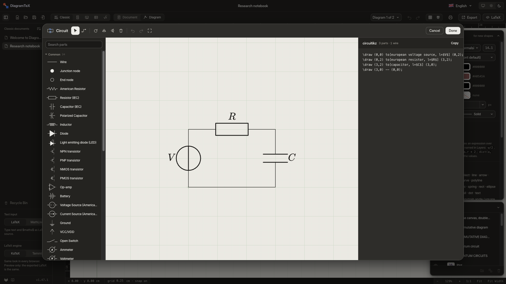
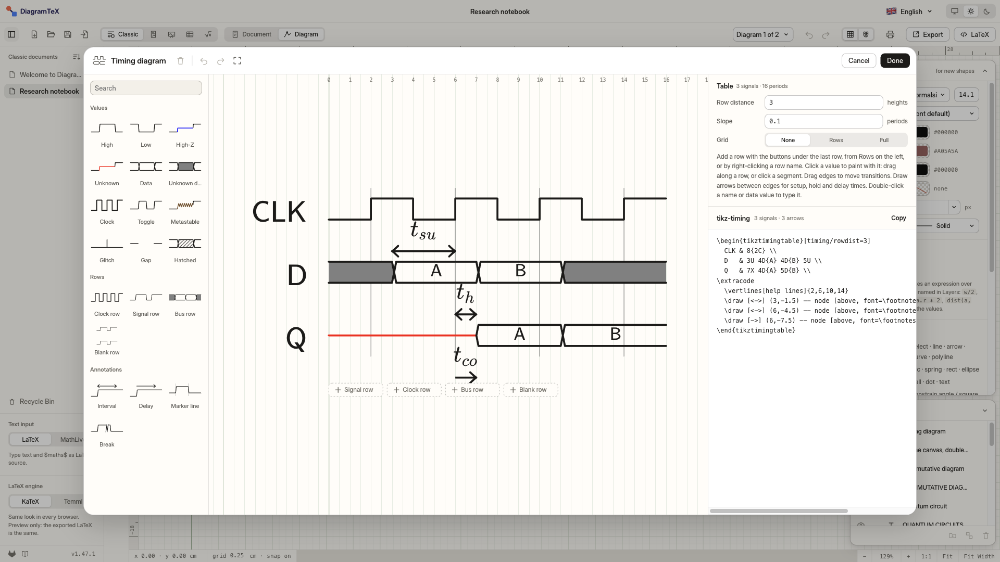
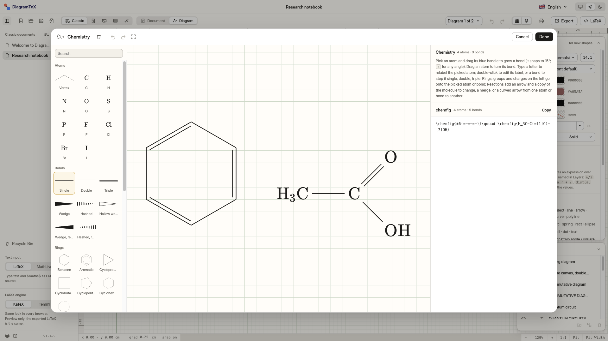
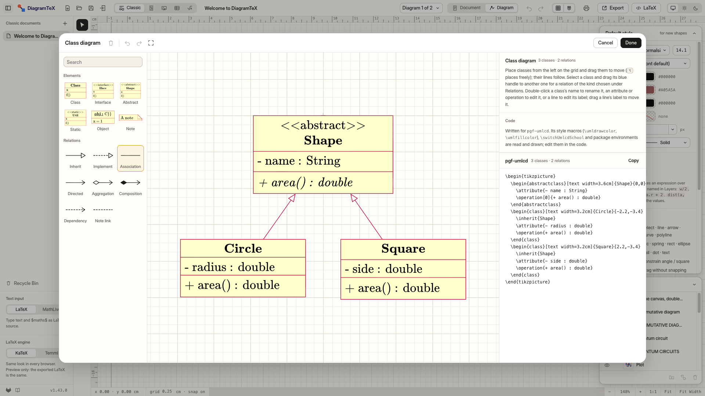

<p align="center">
  <a href="https://diagramtex.com/"></a>
</p>

# DiagramTeX: free online TikZ and LaTeX diagram editor

**DiagramTeX** lets you draw diagrams in your browser and export them as clean **TikZ** code for LaTeX, together with **circuitikz**, **pgfplots**, **tikz-cd**, **xymatrix**, **quantikz**, **forest**, **zx-calculus**, **tikz-feynman**, **tikz-3dplot**, **tikz-timing**, **TikZ automata** and **graphs**, **tikz-network**, **pgf-umlcd**, **pgf-umlsd**, **karnaugh-map**, **bytefield**, **chemfig**, **tikz-chemlab**, **blochsphere** and **booktabs**. Draw with the mouse, type labels in LaTeX maths (`$…$`), then paste the code into Overleaf or any LaTeX document.

It is **free and open source** ([GNU AGPLv3](LICENSE)), **works offline**, and needs **no sign-up, login or payment**. Your diagrams stay in your browser; nothing is uploaded.

**[Open DiagramTeX: diagramtex.com](https://diagramtex.com/)** · **[User guide](https://diagramtex.com/guide/)**


## Why DiagramTeX

- **Visual TikZ editor:** draw instead of guessing coordinates, and get readable `tikzpicture` code with the packages and libraries it needs listed for you.
- **LaTeX maths everywhere:** labels render with KaTeX or Temml as you type, with command suggestions and maths highlighting.
- **Import existing TikZ:** open a `.tex` file or paste code. What can be read becomes editable shapes; everything else is kept as TikZ code and exported exactly as written.
- **Paste and drop anything:** pictures, `.tex` files, TikZ, block environments (`quantikz`, `tikzcd`, `\chemfig{…}`, `tabular`…), spreadsheet cells, CSV/XLSX, Markdown tables or formulae. Each becomes what it is.
- **Live code, both ways:** every block editor shows its package's code beside the drawing; edit either one and the other follows.
- **Offline, private, no account:** an installable PWA with no cookies, ads or analytics, served as plain static files. See [Privacy](#privacy).
- **Fast and tested across browsers:** tested in Chromium, WebKit and Firefox with both maths engines, with stress bundles of up to 12,000 elements. See [performance and browser compatibility](docs/rendering-performance.md) and [browser testing](docs/browser-testing.md).

## What you can draw

- **Shapes and flowcharts:** 33 basic shapes, 28 flowchart symbols, 27 block arrows, connectors (straight, elbow, curved), arcs, Bézier and smooth curves, a curvature pen, freehand, images, gradients and patterns.
- **Circuits** (`circuitikz`): a drag-and-drop editor with 415 components; existing circuitikz code imports as a Circuit block.
- **Plots and charts** (`pgfplots`): 2D and 3D functions, parametric, polar, implicit, inequalities, vector fields, contour, heatmap, bar, scatter and pie charts.
- **3D figures for calculus** (plain TikZ): solid regions, solids of revolution and basic solids, shaded with hidden edges dashed.
- **2D and 3D geometry** (TikZ, `tikz-3dplot`): points, vectors, projections, angles, planes, surfaces and measures that update as you drag.
- **Commutative diagrams** (`tikz-cd`, `xymatrix`, including quiver's output) and **Bloch spheres** (`blochsphere`).
- **Quantum circuits** (`quantikz`), **ZX diagrams** (`zx-calculus`) and **Feynman diagrams** (`tikz-feynman`).
- **Trees** (`forest`), **graphs** (TikZ `graphs`, also from adjacency matrices, edge lists, DOT, Mermaid or JSON) **state machines** (TikZ `automata`) and **networks** (`tikz-network`, with CSV data files and 3D multilayer networks), with automatic layout.
- **UML** class (`pgf-umlcd`) and sequence (`pgf-umlsd`) diagrams.
- **Digital logic:** timing diagrams (`tikz-timing`), Karnaugh maps (`karnaugh-map`, with group checking) and bit fields (`bytefield`).
- **Chemistry** (`chemfig`): structural formulas, rings, charges, reaction schemes and curved arrows.
- **Chemistry lab apparatus** (`tikz-chemlab`): glassware, liquids, burners, titrations, reflux, gas collection and distillation, and every part, fitting and substance the package draws, with its line widths and flame, drawn as pdflatex draws them.
- **Physics figures that are computed:** mechanics, optics (ray tracing), fields, waves, Minkowski diagrams and energy levels, each result marked exact, ideal, approx or schematic. See [docs/physics.md](docs/physics.md).
- **Tables:** a spreadsheet-like **Table** mode that imports from Excel, Sheets, CSV, Markdown, HTML or LaTeX and writes `booktabs` LaTeX, SVG or PNG.
- **Whole documents:** text, maths and figures on A4 or Letter pages, exported as a complete LaTeX `article`.

The app has five modes: **Classic** (diagrams plus a document view), **Page** (free-form sheets), **Whiteboard** (an endless canvas), **Table** and **Quick** (one formula or block, copied as PNG, SVG or TikZ). Every tool, block, mode, export and shortcut is described in the **[user guide](https://diagramtex.com/guide/)**, also available in the app from the book icon below the file list.

## Screenshots

| | |
|---|---|
|  |  |
| **Gallery:** physics, plots, 3D solids, Feynman, forest, ZX and Bloch blocks | **Dark mode** follows the system, or pick it from the top bar |
|  |  |
| **Document view:** text and maths around your figures, exported as one `article` | **Quantum circuits** (`quantikz`) |
|  |  |
| **Circuits** (`circuitikz`) | **Timing diagrams** (`tikz-timing`) |
|  |  |
| **Chemistry** (`chemfig`) | **UML class diagrams** (`pgf-umlcd`) |
|  |  |
| **Tables:** edit like a spreadsheet, copy `booktabs` LaTeX | **Interface languages:** English and Thai |

How close does the exported LaTeX come to what you see? See [PARITY.md](PARITY.md).

## Quick start

1. Open **[diagramtex.com](https://diagramtex.com/)**.
2. Pick a tool from the left rail and draw. Type `$…$` in a label for maths.
3. Press **LaTeX** (**Ctrl/⌘+E**) to see the code, then copy or download it. **Ctrl/⌘+Shift+E** downloads the whole document as `.tex`.
4. Paste the code into your LaTeX document and compile.

To install the app, use **Install** in the top bar when your browser offers it, or the browser's own install menu.

### Run it locally

Use Node.js 22 or later:

```bash
npm ci
npm run dev        # watch build, served at http://127.0.0.1:5173
npm run compile    # one-off build into public/; serve public/ with any static server
npm run check      # type-check TypeScript and Svelte
npm test           # regression suite in Chromium, WebKit and Firefox
```

Install the test browsers first with `npx playwright install chromium webkit firefox`. `npm run test:chromium`, `test:webkit` and `test:firefox` run one browser; `test:rendering`, `test:document`, `test:parity` and `test:ux` cover label painting, page layout, KaTeX/Temml parity and workflow benchmarks. See [browser testing](docs/browser-testing.md) and [migration.md](docs/architecture/migration.md).

### Self-host on Cloudflare Workers

`wrangler.toml` publishes a static-assets-only Worker. `scripts/build.js` builds the minified site and its service-worker precache into `dist/` before deployment.

```bash
npx wrangler deploy    # publish
npx wrangler dev       # preview locally
npx wrangler preview   # upload a Preview with its own workers.dev link (named after the branch unless --name)
```

Any static host serving `dist/` works as well.

## Privacy

- **Your work never leaves your device.** Documents and settings live in your browser (IndexedDB and local storage); there is no server-side storage.
- **No account and no tracking.** No sign-up, analytics, telemetry, cookies, ads or third-party scripts. The only exception is the host's aggregate, server-side Cloudflare Workers request counts, which set no cookie and never see your documents.
- **Nothing is fetched from elsewhere.** Maths engines and fonts are served with the app, a Content-Security-Policy blocks other origins, and exports embed their fonts. After the first visit the app runs fully offline.
- **Share links** carry a small file after the `#` in the URL, so it never reaches a server.

## Use of generative AI

DiagramTeX was built with the help of generative AI: much of its code, tests and documentation were written with AI coding assistants, directed, reviewed and tested by the author. The app itself uses no AI: nothing you draw is sent to an AI service or anywhere else.

## FAQ

**Is it free?** Yes: free and open source, with no paid tier, account or login.

**Does it work offline?** Yes. After the first visit it works without a connection, and you can install it like a desktop app.

**Does it work on phones and tablets?** Tablets, yes. On a phone, or in a window under 600 × 500 pixels, the editor needs more room, but you can still type a formula and copy it as PNG or SVG.

**Where are my diagrams stored?** In your browser. Use **Save** to keep a `.diagramtex` file; in Chromium browsers the file then stays linked and autosaves.

**Can I edit TikZ I already have?** Yes. **Import LaTeX/TikZ** turns plain `\draw`, `\fill`, `\node` and `\coordinate` paths into shapes and keeps everything else as code, so a figure you import and export again comes back unchanged.

**Which packages does the output need?** TikZ, plus the package of each block you use. The header comment of every export lists the packages and libraries it needs.

**How large can a drawing get?** Tens of thousands of objects; only what is near the view is drawn, so editing stays smooth at 20,000.

## Project structure

- `src/main.ts`: application entry point; `src/core/`: document, history, block, editor-session and file-codec services
- `src/application/`: editor state and interaction (`app.ts`), document view and LaTeX export (`docview.ts`)
- `src/domain/`: the model for each kind of object: shapes, fills, symbols, plots, 3D, every block's parser, layout, drawing and export (`circuit.ts`, `quantum.ts`, `cd.ts`, `chemfig.ts`, `physics.ts`…), the TikZ importer (`tikzimport.ts`), LaTeX checks (`texlint.ts`) and the table engine (`table/`)
- `src/editors/`: the overlay block editors (circuit, quantum, CD, ZX, Feynman, geometry, timing, graph, automata, network, K-map, bit field, chemistry, physics…)
- `src/ui/`: Svelte shell, panels and services (colour picker, maths input, suggestions, Table and Quick modes); `src/platform/storage.ts`: files in IndexedDB
- `public/`: static shell, styles, fonts, vendored KaTeX, Temml, MathLive and MathJax, service worker and the user guide
- `scripts/`: compile, prerender, dev server, production build and generators; `tests/`: browser suites, golden files and benchmarks
- `design/logo/`: logo kit; `.interface-design/system.md`: UI design direction and tokens; `wrangler.toml`: Cloudflare deployment

## Contributing

Bug reports and ideas are welcome in the [issue tracker](https://github.com/vtneil/diagramtex/issues). If `pdflatex` reports a problem with exported code, please include the code and the error.

## License

DiagramTeX is released under the [GNU Affero General Public License v3.0](LICENSE) (`AGPL-3.0-or-later`). © 2026 Vivatsathorn Thitasirivit.

Diagrams, LaTeX code, images, PDFs and other content you create with DiagramTeX are not covered by the AGPL just because DiagramTeX produced them. You may use your own creations in academic, commercial or proprietary work with no licensing obligations from DiagramTeX. Third-party assets included in an output may keep their own licences.

The compiled UI bundles Svelte, clsx and esm-env (MIT), KaTeX (MIT), Temml (MIT), MathLive (MIT), MathJax and its TeX font data (Apache-2.0), the Latin Modern Math font (GUST Font License) Atkinson Hyperlegible Next and Mono and Sarabun (SIL Open Font License); their licence files are in `public/vendor/` and `public/fonts/`.
