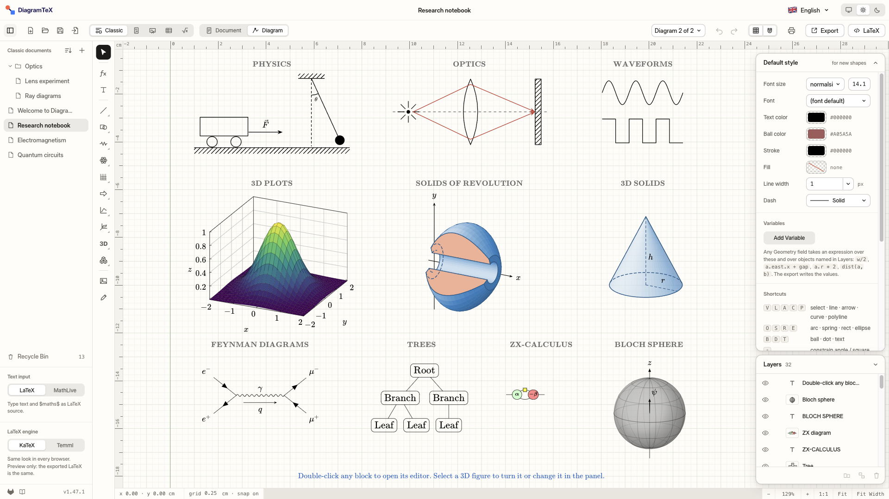
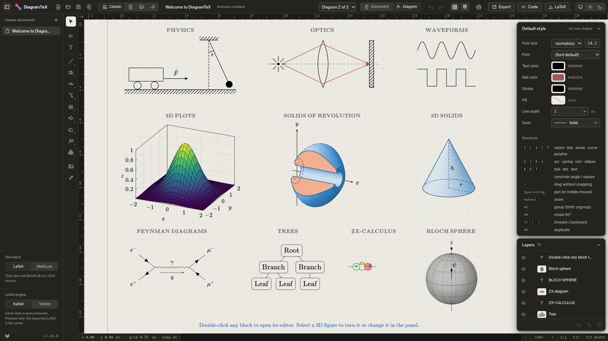
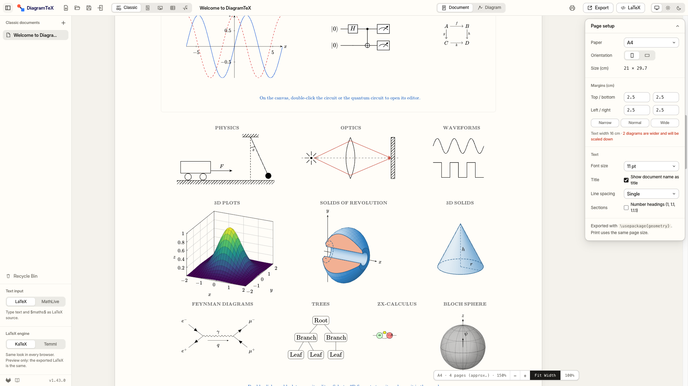
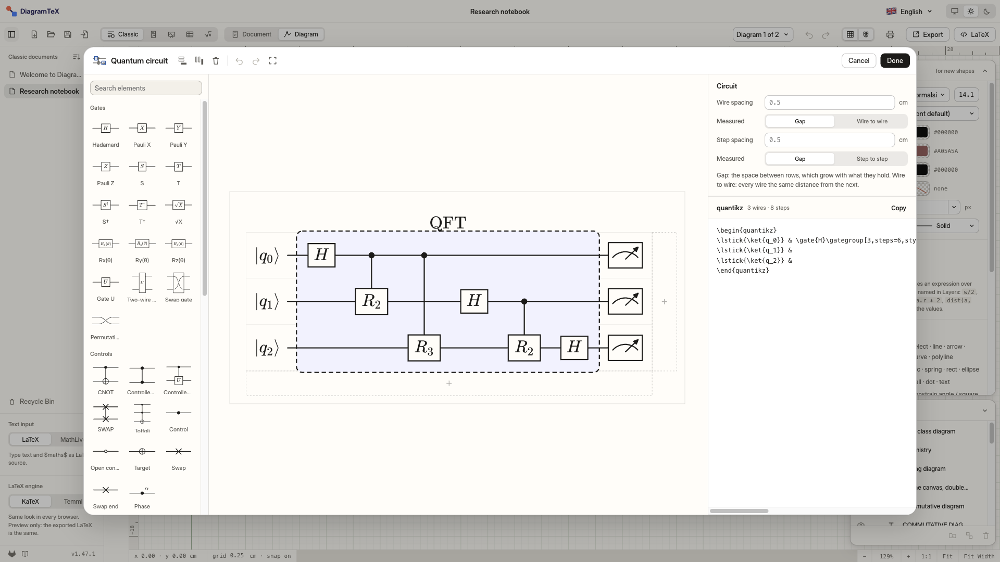

<p align="center">
  <a href="https://diagramtex.igniting.space/"></a>
</p>

# DiagramTeX: free online TikZ and LaTeX diagram editor

**DiagramTeX** lets you draw diagrams in your browser and export them as clean **TikZ**, **circuitikz**, **pgfplots**, **tikz-cd**, **xymatrix**, **quantikz**, **forest**, **zx-calculus**, **tikz-feynman**, **tikz-3dplot**, **tikz-timing**, **TikZ automata**, **karnaugh-map**, **chemfig** and **blochsphere** code for LaTeX. Draw shapes, arrows, circuits, plots, commutative diagrams, quantum circuits, trees, ZX diagrams, Feynman diagrams, 3D geometry, timing diagrams, state machines, Karnaugh maps, chemical structures and reaction schemes, and Bloch spheres with the mouse, type labels in LaTeX maths (`$…$`), then paste the code into Overleaf or any LaTeX document.

It is **free and open source** ([MIT License](LICENSE)), **works offline**, and needs **no sign-up, login or payment**. Your diagrams stay in your browser; nothing is uploaded.

**[Open DiagramTeX: diagramtex.igniting.space](https://diagramtex.igniting.space/)**


## Why DiagramTeX

- **Visual TikZ editor:** draw instead of guessing coordinates, and get readable `tikzpicture` code with the packages and libraries listed for you.
- **LaTeX maths everywhere:** labels render with KaTeX or Temml as you type, with LaTeX command suggestions and maths highlighting.
- **Import existing TikZ:** open a `.tex` file or paste TikZ code to keep editing figures you already have.
- **Offline and private:** an installable web app (PWA). After the first visit it runs without an internet connection, and documents are saved in your browser.
- **Privacy-focused:** no account, no analytics, no cookies, no ads. See [Privacy](#privacy).
- **No account, no cost:** open the page and start drawing.
- **No build step:** plain HTML, CSS and JavaScript, easy to self-host.

## What you can draw

- **Physics diagrams:** springs, waves, balls, axes, rulers, vectors, fields and force diagrams.
- **Circuit diagrams:** a drag-and-drop circuit editor with 415 `circuitikz` components (resistors, capacitors, inductors, sources, meters, diodes, transistors, op-amps and amplifiers, switches, logic gates including IEEE ones, flip-flops, ICs, vacuum tubes, antennas, block-diagram parts) that exports `circuitikz` code, plus 35 quick electrical symbols and waveforms.
- **Function plots and charts:** 2D and 3D pgfplots (functions, parametric, polar, implicit, inequalities, vector fields, contour, heatmap, bar, scatter) and pie charts.
- **3D figures for calculus, in plain TikZ:** all shaded or drawn as lines, with hidden edges dashed, turned with the view angles, and exported as plain TikZ with no extra package. Lower a solid colour's alpha in the colour picker to make the solid see-through.
  - **Solid regions** for multiple integrals: a solid E over a base D between z = u₁(x, y) and z = u₂(x, y), or along the x- or y-axis instead. The base is an ellipse, rectangle, polar curve or annular sector (a cylindrical wedge), with drop lines and labelled callouts. Riemann columns show the boxes over a grid on D.
  - **Solids of revolution:** the region between y = g(x) and y = f(x) turned about the x-axis (disks, washers) or the y-axis (shells). Sweep less than 360° to cut it open and show the region, or highlight one slice of width Δx.
  - **Basic solids:** box, cylinder, cone, frustum, sphere, prism, pyramid and spherical wedge, with dimension labels.
  - **3D geometry** (in the 3D menu): a `tikz-3dplot` picture edited visually: turn the view by dragging, drag points (level, or up and down with Shift), and add axes, rotated frames, points by (x, y, z) or (r, θ, φ), vectors, segments, projections, planes (any plane a x + b y + c z = d), surfaces z = f(x, y) and (u, v), triangles, circles, spheres, boxes, space curves and angle arcs. The code is the figure and is exported as written.
- **Commutative diagrams:** a `tikz-cd` editor: type or drop objects on a grid, drag arrows from cell to cell, and pick each arrow's style, label, bend and shift, with the code live beside it. The same editor writes `xymatrix` code (the `xy` package) for the XyMatrix block.
- **Bloch spheres:** a `blochsphere` block drawn with the package's own geometry; set the radius, view angles, ball style and states in the panel.
- **Quantum circuits:** a drag-and-drop `quantikz` editor (gates, controls, CNOT/controlled-U/Toffoli/SWAP, meters, labels, wire types, slices, groups) with the code live beside it.
- **Trees:** a `forest` editor for syntax trees, org charts, directory trees, decision and probability trees: add, move and restyle nodes by keyboard or drag, with templates and the code live beside it.
- **ZX diagrams:** a `zx-calculus` editor: drop Z and X spiders, Hadamard boxes and points on a grid, drag a node's handle to wire it to another, and pick each wire's shape from pictures.
- **Feynman diagrams:** a `tikz-feynman` editor: place vertices (dots, blobs, crossed dots, particles) on a centimetre grid, drag from one vertex to another to draw fermions, photons, gluons, scalars, ghosts and more, and set labels, momentum arrows, bends and insertions.
- **Timing diagrams:** a `tikz-timing` editor for clocks, signals and buses: paint high, low, high-impedance, unknown, data and clock values onto rows, drag transitions along the time axis, and draw setup, hold and delay arrows between edges.
- **State machines:** a TikZ `automata` editor: place states (initial, accepting), drag from one state to another for a labelled transition or back onto itself for a loop, move states and their transitions follow, and let **Auto layout** place every state in layers or on a circle.
- **Karnaugh maps:** a `karnaugh-map` editor for 2 to 6 variables with Gray-coded rows and columns: click cells through 0, 1 and don't care, drag across cells to group them (past an edge the group wraps round), and check each group against the cells, with the simplified function written out.
- **Chemistry:** a `chemfig` editor for structural formulas and reaction schemes: atoms, single, double, triple, wedge and hashed bonds, rings (benzene, aromatic circles, fused rings), functional groups, charges and lone pairs, and reaction arrows with conditions.
- **Flowcharts and block diagrams:** 28 flowchart symbols, 33 basic shapes and 27 block arrows.
- **Whole pages and documents:** lay out text, maths and figures on A4 or Letter pages and export a complete LaTeX `article`.

## Screenshots

| | |
|---|---|
|  |  |
| **Gallery:** physics, optics, plots, 3D solids, Feynman, forest, ZX and Bloch blocks on one canvas | **Dark mode** follows the system, or pick it from the top bar |
|  |  |
| **Document view:** write text and maths around your figures, then export one `article` | **Quantum circuits** (`quantikz`): a three-qubit QFT with a gate group |
|  |  |
| **Circuits** (`circuitikz`): drag parts from the library, with the code live beside them | **Timing diagrams** (`tikz-timing`): paint values onto rows and mark setup, hold and delay |
|  | |
| **Chemistry** (`chemfig`): aspirin, drawn from the formula on the right | |

How close does the exported LaTeX come to what you see? See [PARITY.md](PARITY.md).

## Quick start

1. Open **[diagramtex.igniting.space](https://diagramtex.igniting.space/)**.
2. Pick a tool from the left rail and draw. Type `$…$` in a label for maths.
3. Press **LaTeX** (**Ctrl/⌘+E**) to see the code: the TikZ picture, a standalone file or the whole document, to copy or download. **Ctrl/⌘+Shift+E** downloads the whole document as `.tex` at once.
4. Paste the code into your LaTeX document and compile.

The full user guide (every tool, block, mode, export and shortcut) is at **[diagramtex.igniting.space/guide/](https://diagramtex.igniting.space/guide/)**, and in the app behind the book icon at the bottom of the document list.

A new browser opens with a welcome file, a Classic document: what the app does, a list of everything you can draw and its four modes (Classic, Page, Whiteboard and Quick) on top, then a diagram with one example of each kind of object (text, formulae, shapes, a circuit, a quantum circuit, a plot, a commutative diagram), a second gallery (physics, optics, waveforms, a 3D surface plot, a solid of revolution, a 3D solid, a Feynman diagram, a tree, a ZX diagram and a Bloch sphere), then a short manual: drawing, text and maths, blocks, arranging, writing the document and getting the LaTeX out. Its shortcuts read Cmd on a Mac and Ctrl elsewhere.

To use it offline, install it from your browser (the install icon in the address bar, or **Add to Home Screen** on a phone).

### Run it locally

The site lives in `public/`; serve that folder. KaTeX 0.19.1, Temml 0.14.0 and MathLive are in `public/vendor`, so no CDN is needed. Opening `public/index.html` directly also works in most browsers.

```bash
python3 -m http.server 5173 --directory public
```

Then open http://localhost:5173.

### Self-host on Cloudflare Workers

`wrangler.toml` publishes a static-assets-only Worker (no server code). Before each deploy, wrangler runs `scripts/build.js`, which copies `public/` to `dist/` with the JS and CSS minified by esbuild, and serves `dist/`. To keep the number of requests low, the build also joins the app's scripts into `js/bundle.js` and its stylesheets into `css/app.css` (in the order `index.html` loads them), and writes the service worker's precache list from the files in `dist/`. `public/` is never changed, so local development still serves one file per script:

```bash
npx wrangler deploy
```

`npx wrangler dev` previews it locally first.

To share a version before it goes live, upload a Preview. It is built the same way, gets its own workers.dev link, and leaves the production site alone. It is named after the current git branch unless you pass `--name`:

```bash
npx wrangler preview
```

`wrangler.toml` turns on Preview URLs (`preview_urls = true`) and holds an empty `[previews]` block, which wrangler requires. The app has no bindings or secrets to override. Preview URLs are switched on for the Worker by the next `npx wrangler deploy`. `npx wrangler preview delete` removes a Preview.

## Feature reference

### Drawing
- **Tool rail** (Mathcha-style; buttons with a small corner triangle open a flyout):
  - select, maths (`M`, a text object that starts in `$…$`), text (`T`)
  - **Lines:** line, curve, arrow, curved arrow, polyline, smooth closed blob, arc (angle mark), spring
  - **Shapes:** rectangle variants (rounded, snipped), 33 basic shapes and 28 flowchart symbols
  - **Electrical:** Circuit… (the circuit editor, below), the common electrical symbols (resistor, capacitor, inductor, sources, diode, transistor, logic gates, ground…) and a Waveforms group (sine, square, pulse, negative pulse, triangle, sawtooth, trapezoid, rectified and half-wave rectified sine, chopped). Waveforms repeat as you widen them; set the wavelength, start position, duty cycle (square, pulses) or firing angle (chopped) in the panel
  - **Physics:** Mechanics (ground, ceiling, wall, block, incline, cart, pulley, pendulum) and Optics (convex and concave lenses, converging and diverging lens symbols, plane, concave and convex mirrors, prism, screen, slits, ray, parallel rays, point source, eye). Hatching, axles, bobs and angle marks keep their size when resized; the panel sets **Hatch spacing**, **Mount** (pulley, pendulum), **Angle mark** and **Angle label** (incline, pendulum; maths without `$`), and the number of **Slits**. A block starts holding `$m$`
  - **Misc:** axes, wave, brace, ruler, grid and more, ball, dot
  - **Arrows:** 27 block arrows
  - **2D plots** and **3D**, **Image** (`I`: PNG, JPEG, GIF, WebP or SVG; exported with `\includegraphics`), **Pencil** (`N`: freehand, smoothed and exported as Bézier curves)
  - Library symbols export as exact TikZ paths, can hold centred text, and can be rotated and flipped.
  - **Misc shapes keep their detail size when resized**, as in Mathcha: stretching a wave adds periods instead of widening them, a coil adds loops, a brace keeps its curls, and a ruler or grid adds ticks or cells. Their detail sizes are in the panel: wave **Period width** and **Start position**, coil **Loop pitch** / **Loop size**, axis **Tick spacing** and **Show numbers**, ruler **Tick spacing** / **Tick size**, grid **Cell size** / **Corner shift** / **Border**. Symbols also have **Rotation** and **Skew X**.
  - **Spring** has a **Loop pitch**, so a longer spring gets more coils. A **ticked** line shaft has tick spacing and size.
  - **Polyline points:** click a point to choose it, drag a **+** to add one, double-click to remove one (or use **Add point** / **Remove point** in the panel).
- **2D plots menu** (the plot button): you can click to place an item or drag out a box.
  - **2D plots (pgfplots):** function, line, scatter, area, bar, contour, heatmap.
  - **Pie chart:** one `label value [#color]` per line.
- **3D menu** (the button with three axes, below 2D plots): eight tools, one for each kind of 3D object. Its variants are picked in its panel, not in the menu.
  - **3D plots:** Surface `z = f(x, y)` (set Type to Mesh for a wireframe), Parametric (x(u, v), y(u, v), z(u, v)), Space curve (x(t), y(t), z(t)) and Scatter 3D. The view angles follow pgfplots `view={az}{el}`.
  - **3D figures:** Solid region (Shape picks an ellipse, rectangle, polar curve or polar rectangle (a cylindrical wedge); Riemann columns turns it into boxes), Revolution (Lower g(x) makes washers, Turn about y-axis makes shells, Sweep cuts it open, Show a slice highlights Δx), Solid (Shape picks box, cylinder, cone, frustum, sphere, prism, pyramid or spherical wedge) and 3D Geometry.
  - Files with a 3D sketch from earlier versions still open, draw and export as before; new figures with points, vectors and planes use 3D Geometry.
- **Blocks menu** (the cube button below 3D, marked experimental): CD, XyMatrix, Bloch, Quantum, Circuit, Tree, ZX, Feynman, Timing, Automaton, K-map and Chemistry. A new block starts with `large` labels, whatever the default text size is.
- **Grid editors** (Quantum, ZX, CD): point just left of a row or just above a column and a bin appears; click it to delete that row or column. Every field in an editor's panel updates the others as you type (a label and its code, an option and its buttons).
- **Plots:** each plot can have several series, given as expressions (`sin(x)*exp(-x/4)`, `x^2+y^2`, …) or as data. You can set axis labels, ranges, grid, legend, colormaps (hot, viridis, jet, cool, gray) and a colour bar. Expression errors show in the panel and on the canvas.
  - **Function plot series types** (Mathcha's set): regular `y = f(x)`, **inequality** (`y < f(x)`, `≤`, `>`, `≥`; shaded, with a dashed edge when strict), **bounded region** between `f` and `g`, **x in terms of y**, **parametric** `(x(t), y(t))`, **polar** `r(θ)`, **implicit** `F(x, y) = 0`, **points**, **vectors** (`x y` or `x y u v`), **vector field** `(P, Q)` and **phase portrait** (trajectories with arrows).
  - **Variables:** one line such as `a = 2, b = 0.5` per plot; every series can use them.
- **LaTeX labels:** text and path labels render `$…$` maths. Path labels use TikZ `auto` / `swap` placement, so the canvas matches the output.
- **LaTeX engine** (left sidebar, under the file list): choose how maths is previewed. It only changes the preview; the exported LaTeX is the same. The choice is saved in this browser.
  - **KaTeX** (default): HTML and CSS, so it looks the same in every browser.
  - **Temml**: MathML set in Latin Modern Math by the browser. It covers more LaTeX and looks closer to MathJax / TeX, but fine details (accent widths, stretchy brackets) vary a little between browsers.
  - Exported SVGs carry the stylesheet for the engine in use. Temml SVGs keep real MathML.
- **Styling:**
  - colour picker with presets, alpha and "No colour"
  - **fills** with three tabs: Basic (a colour), **Gradient** (linear or radial, 12 presets, rotate, scale, centre and draggable colour stops; exported as pgf shadings) and **Pattern** (vertical, horizontal, grid, diagonal, crosshatch, bricks, dots, with size, line width and colour; exported with `patterns.meta`)
  - line width presets, dash presets (dotted, dashed, dash dot, densely dashed, long dashes…) or a custom `on off …` pattern in pt (`dash pattern=`), arrow tips, opacity
  - text boxes: drag the handle on a text's right edge to give it a wrap width, then choose left / centre / right / justify (`text width=`, `align=`)
  - vertical alignment (**Vertical** in the panel: top, middle, bottom): top-aligned text grows downward as you add lines or enlarge the font, bottom-aligned grows upward, middle grows both ways. New text starts top-aligned. In a paragraph box it places the text at the frame's top, middle or bottom. The export anchors the same edge (`anchor=north`/`south`), so LaTeX keeps it still too
  - math in text and Math objects: `$…$` is inline; `$$…$$` or `\[…\]` is display style (full-size fractions, sums and limits), exported as `$\displaystyle …$`, and imported back the same way. **Math style** (Inline / Display) in the properties panel switches every formula in the selected objects at once.
  - **command suggestions:** type `\` in the canvas text editor, the Text / Label fields or a Document text block, and matching LaTeX commands appear at the caret with a rendered preview. About 250 common ones (Greek, operators, arrows, `\frac`, `\sqrt`, matrices, `aligned`, `cases`…) come first, then everything else the selected engine supports, such as `\bra`, `\ket` and `\braket` (about 900 for KaTeX and 1,000 for Temml). Use ↑ ↓ to choose, Enter or Tab to insert (the caret lands in the first `{}`), and Esc to close.
  - font family, bold/italic, and font size: `\tiny` … `\Huge` or a custom px size (exported as `\fontsize`)
- **Rulers and status line:** the canvas has centimetre rulers in TikZ coordinates (y up). They show the selection's extent in red and the cursor position. The bottom status line shows the cursor (cm), the selection size, the grid and snap state, and zoom.
- **Precision:** 0.25 cm grid. Shapes snap to the grid and to other shapes' points; hold **Alt** to bypass snapping. **Shift** constrains to 15° angles and to squares/circles. The panel shows numeric geometry in TikZ cm.
- **Editing:** multi-select, move, resize handles, copy/paste/duplicate, undo/redo, arrow-key nudge.
- **Labels in boxes:** Enter, or a double-click on a rectangle, ellipse, ball or closed polyline, puts a text in its middle, grouped with it so they move together. Doing it again edits that text.
- **Copy and paste as TikZ:** Ctrl/⌘+C on shapes also puts their TikZ code on the clipboard as text, ready for a `.tex` file; with nothing selected it copies the whole diagram's code. Ctrl/⌘+V of TikZ or LaTeX copied from elsewhere imports it: straight into the diagram when every statement becomes shapes, otherwise through the import dialog, which says what stays code. Shapes copied in the app still paste as shapes.
- **Variables and expressions:** with nothing selected, the panel's **Variables** section holds named values (`gap = 0.5`, `w = 2*gap + 1`). Every Geometry field takes an expression over them and over objects named in Layers: `a.east.x + gap`, `b.width / 2`, `dist(a, b)`, `max(w, 2)`; anchors are `center`, `north`, `north east`… (`.x`, `.y`), plus `x`, `y`, `width`, `height` and the object's own fields. Functions take degrees, as in TikZ. The value follows when what it uses moves or changes; a field changed by hand lets go of its expression. Errors (an unknown name, a loop) show in red on the field. The export writes the values, not the expressions; code kept as written stays as written while the expression puts the shape where it was.
- **Components:** select two or more objects and choose **Make Component** (panel, right-click, or Ctrl/⌘+Alt+K). The objects become one part you can copy; copies are linked. **Edit Parts** opens one copy as a group, and **Save Component** writes the change to every copy in the diagram. **Detach** turns a copy back into plain objects. With nothing selected, the **Components** list shows each part, its copies and **Insert Copy**. The export defines each part once as a TikZ pic (`\tikzset{name/.pic={…}}`) and draws each copy with `\pic at (x,y) {name};`; parts can contain parts.
- **Free rotation:** hover just outside any corner of the selection and the cursor turns into a rotate arrow; drag to rotate (hold **Shift** for 15° steps). One shape rotates about its own centre; several rotate together about the selection's centre. Rectangles, ellipses, text, images and symbols keep a **Rotation** angle (also typed in the panel; exported with `rotate around`), and lines, curves, polylines, arcs, springs and regions have their points rotated. Resize handles follow the rotation, and the opposite side stays put while you drag one.
- **Combine** (select two or more closed shapes, then use the **Combine** row in the panel or right-click → Combine): **Unite**, **Intersect**, **Subtract** (the shapes above are cut out of the bottom one), **Exclude** (keeps the areas covered an odd number of times) and **Divide** (splits into every overlap piece). Works on rectangles (rounded too), ellipses, balls, dots, closed polylines and blobs, filled symbols, and earlier results. The result is a **Region**: a polygon path that can have holes, exported with `even odd rule`.
- **Right-click menu:** copy, copy TikZ code, copy text, cut, paste, duplicate, delete, group/ungroup, and these submenus:
  - Combine: unite, intersect, subtract, exclude, divide
  - Arrange: front, forward, backward, back
  - Rotate: 90° either way, flip horizontally/vertically
  - Align: left, center, right, top, middle, bottom
  - Distribute: horizontally, vertically
- **Groups** (Ctrl+G, Ctrl+Shift+G): clicking any member selects the whole group, and align/distribute move a group as one block. Plots and blocks are moved by rotate/flip but not rotated themselves, so one selected on its own offers no rotate cursor, rotate menu or rotate hint.
- **Layers panel** (under the properties panel, top first): click a row to select it, Shift-click for a range, Ctrl/⌘-click to add or remove. Drag rows to restack them; drop onto an open group to put a shape in it, or out of it to take it out. Groups fold open and closed. Each row has an eye (hide: not drawn or exported) and a lock (shown on canvas but can't be picked). Double-click a name to rename it; renaming a group renames the whole group. Hovering a row outlines it on the canvas. The footer groups, ungroups and deletes; right-click a row for Rename, Hide/Show, Lock/Unlock and the usual menu. Click the header to fold the panel away.

### Electrical circuits (circuitikz)
- **Electrical → Circuit…** (or **Blocks → Circuit**) adds a circuit block; double-click it (or press Enter) to open the circuit editor in an overlay, so the tool rail stays uncluttered.
- **Parts:** 415 `circuitikz` components in searchable categories, including empty, full and stroke diodes, depletion MOSFETs, IEEE logic ports, instrumentation and fully differential amplifiers, cute switches, vacuum tubes and RF parts, each drawn as pdflatex draws it. **Recently used** and **Common** sections sit on top; the categories stay shut until you open them, and the palette remembers which ones you opened. Click a part and click the grid (it lands where the blue preview shows it), or drag it in; drag from start to end to set a two-terminal part's length.
- **Wires** (`W`) snap to part pins and stay attached when parts move. Nodes such as transistors, op-amps and ICs are auto-named (`Q1`, `U1`…), so wires export as `(Q1.B)`.
- **Properties:** label, annotation, voltage and current arrows, open/closed ends (`*-o`), rotation, mirroring (X left to right, Y top to bottom, from the right-click menu or the keys) and extra options. Labels take maths: `$R_1$`, `$10\,\mathrm{k\Omega}$`. Double-click a part to edit its label (a node's text) in place, in LaTeX or MathLive as set under Text input. A part is picked by clicking anywhere on its body, not only on its lines.
- **Code, side by side:** the `circuitikz` source sits on the right of the editor and follows the drawing as you work. Type in it and the drawing follows after a short pause; lines the editor can't draw are kept and exported as written.
- **Voltages, currents and colour from the code:** the drawing follows circuitikz's direction forms (`v^=`, `v<=`, `v_>=`, `i<=`, `i>_=`, `i_<=`…), the voltage styles (`american`, `european`, `straight` or `raised voltages` on a part, or `\ctikzset{voltage=american}` for the whole circuit) and a part's colour (`color=red`, `blue!70!black`). Voltage sources draw their straight arrow, or `+`/`−` in American style. Paths may use `++(3,0)` and `+(0,2)`, corners (`-|`, `|-`) and named `\coordinate`s.
- **Saving:** Done (⌘/Ctrl+Enter) writes the circuit back and closes; ⌘/Ctrl+S writes it back and keeps the editor open, so Esc afterwards closes without asking. This applies to the quantum editor too.
- Export: the circuit goes into the picture as a `scope` and the preamble gets `\usepackage{circuitikz}`. **Copy circuitikz Code** in the panel gives a standalone `circuitikz` environment.

### Quantum circuits (quantikz)
- **Blocks → Quantum** adds a circuit. Double-click it, press Enter or use **Edit Circuit…** in the panel to open the quantum circuit editor.
- **Editor:** the circuit sits on a grid of cells (wires × steps). Drag an element from the palette onto a cell, or click it to place it in the selected cell. Keys place the common ones and step right: `H X Y Z S T U`, `C` control, `O` open control, `+` target, `M` meter. Drop on the dashed row or column to add a wire or a step. Right-click a cell (or a selected range) to insert wires above or below, insert steps before or after, delete wires or steps, or clear cells.
- Controls link to the nearest gate or target in their step; drag the blue handle to link another wire. Drag a cell to move it (Alt copies), Shift-click or drag to select a range, ⌘C/⌘V copy and paste cells. The panel edits labels, spans, links, wire types, slices and groups; inserting or deleting wires and steps keeps links and spans pointing at the same wires. A selected gate has a handle on its corner: drag it, or type in **Min width** / **Min height**, to set the gate's minimum size (`\gate[][width][height]{…}`, which widens its column as in quantikz). Drag the handle back to the gate's own size, or up or left, and it goes back to auto. Drag the bar on a gate's top or bottom edge to stretch it up or down over neighbouring wires (`\gate[n]`); it stops at the first wire that already has something in that step. Double-click a gate (or any element with a label, such as a stick or a meter) to edit its label in place, in LaTeX or MathLive as set under Text input.
- The `quantikz` code is live on the right, both ways. Cells you didn't touch keep the code you wrote, and commands the editor doesn't draw are kept as written. It is exported inside `\begin{quantikz}` with `\usetikzlibrary{quantikz2}`.
- The canvas draws an approximation of quantikz's layout: gates, controls and targets, swaps, meters, wire labels (`\lstick`, `\rstick`), slices, gate groups, bundles and classical wires.
- Maths inside gate arguments and `$…$` in labels is highlighted green, and typing `\` suggests quantikz commands as well as LaTeX ones.

### ZX diagrams (zx-calculus)
- **Blocks → ZX** adds a diagram. Double-click it, press Enter or use **Edit ZX…** in the panel to open the ZX editor.
- **Editor:** the diagram sits on a grid of cells. Drag a spider, Hadamard box, point, loop or text from the palette onto a cell, or select a cell and type `Z`, `X`, `H`, `N` (point) or `L` (loop). Drop on the dashed row or column to grow the diagram. Right-click a cell to insert or delete rows and columns, add a loop or clear it; right-click a wire to delete it.
- **Wires:** hover or select a node and drag the blue handle on its right to another cell (an empty end gets a `\zxN{}` point). Click a wire to choose its shape from pictures (straight, the package's `o` / `s` / `C` curves and more), put an H, Z or X marker on it, or make it classical, bold or dashed.
- **Nodes:** the panel sets a spider's colour, phase (plain or a fraction, with its sign), where the phase goes (in the node or in a label beside it), the gap before its column, and lists the wires leaving it. Double-click a spider or press Enter to type its phase.
- The `zx-calculus` code is live on the right, both ways; cells you didn't touch keep the code you wrote. It is exported inside `\begin{ZX}` with `\usepackage{zx-calculus}`, and **Import LaTeX/TikZ** turns a `ZX` environment back into a diagram.

### 3D geometry (tikz-3dplot)
- **3D → 3D Geometry** adds a figure: axes and a point P given by \tdplotsetcoord, with its φ and θ angles. Double-click it, press Enter or use **Edit 3D Geometry…** in the panel to open the editor. The panel also turns the view (tilt θ and turn φ, as in `\tdplotsetmaincoords`) and sets the scale.
- **Editor:** drag empty space to turn the view; arrow keys turn it by 5° (Shift: 15°). Drag a point to move it level with the xy-plane; hold Shift to move it up and down, Alt to place it off the 0.05 grid. A point whose coordinates are `\def` values (such as `\rvec`, `\thetavec`) writes the new values there, so everything that uses them follows. Click a line, face or label to select the command that drew it; double-click to label it; right-click to duplicate, change the draw order or delete (deleting a point also deletes what draws it).
- **Palette:** axes, a rotated frame, a grid plane, points (x, y, z) and (r, θ, φ), labels, vectors (from the origin to the selected point), segments, projections (dashed lines from the selected point to the xy-plane and the axes), space curves, planes (level, or any plane a x + b y + c z = d with its normal), surfaces z = f(x, y) and parametric surfaces (u, v) built from patches, triangles, a graph z = f(x, y) over a shaded region (with the height of a point marked), circles, spheres, boxes, an angle in the xy-plane and an angle from z (in the selected point's theta plane). Keys `A R P T V S L C B`.
- **Panel:** the selected command's points, colour, fill and opacity, line, width, arrow, frame (main, rotated or screen coordinates), label and its position, and other options; a point's name (renaming updates every reference), coordinates or r, θ, φ.
- The drawing follows tikz-3dplot's own projection and reads `\foreach` loops (lists, `a,b,...,c` ranges, `x/y` pairs, nested), scopes with their options, `declare function`, `\tdplotsetmaincoords`, `\tdplotsetcoord`, `\tdplotdrawarc`, `\tdplotsetrotatedcoords`, `\tdplotsetthetaplanecoords`, `\def`/`\pgfmathsetmacro` values, `\coordinate`, `\node`, and `\draw`/`\fill`/`\filldraw`/`\shade` paths with `--`, `cycle`, `circle`, `ellipse`, `arc`, `rectangle`, `plot` and nodes, including `double` lines and left/right, top/bottom and inner/outer shadings. Anything else is kept in the code and listed as not drawn. Exported with `\usepackage{tikz-3dplot}`; the picture's options go on a shifted `scope`.

### Feynman diagrams (tikz-feynman)
- **Blocks → Feynman** adds a diagram (e⁻e⁺ → μ⁻μ⁺ to start from). Double-click it, press Enter or use **Edit Feynman…** in the panel to open the Feynman editor.
- **Vertices:** click a vertex kind in the palette and click the grid to place it (snaps to 0.25 cm; ⌥ places freely), or drag it onto the grid. Drag a vertex to move it; arrow keys nudge it. With a vertex selected, a palette kind restyles it. Keys `V D T` place a vertex, dot or particle.
- **Lines:** select a vertex and drag the blue handle beside it to another vertex, or to an empty spot for a new vertex. The line takes the propagator picked in the palette (fermion, antifermion, photon, gluon, scalar, charged scalar, ghost, Majorana, boson, charged boson, plain; keys `F P G S M B L`); with a line selected, a palette kind changes it.
- **Panel:** a line has its type, label and side, momentum (side, along or against), bend (left/right with an angle, or a half circle), an insertion cross and any other options; a vertex has its name, shape, label and position. Right-click for Edit Label, Reverse Direction, Bend and Delete. Double-click a vertex or line to type its label.
- The `tikz-feynman` code is live on the right, both ways; a diagram you didn't touch keeps the code you wrote. Vertices placed with `above right=of …` are drawn where TikZ puts them and get coordinates only when moved. It is exported in a `feynman` environment with `\usepackage[compat=1.1.0]{tikz-feynman}` and builds with pdfLaTeX (vertices need positions; `\feynmandiagram`'s automatic layout needs LuaLaTeX and is not drawn). **Import LaTeX/TikZ** turns a `feynman` environment back into a diagram.

### Timing diagrams (tikz-timing)
- **Blocks → Timing** adds a table (a clock, a data line and an output, with setup, hold and clock-to-output arrows to start from). Double-click it, press Enter or use **Edit Timing…** in the panel to open the timing editor.
- **Values:** click a value in the palette (High, Low, High-Z, Unknown, Data, Unknown data, Clock, Toggle, Metastable, Glitch, Gap, Hatched; keys `H L Z X D U C T M G S W`), then drag along a row to paint it over whole periods (⌥ paints freely), click a segment to change it, or click past a row's end to extend it. With a segment selected and nothing armed, a palette value changes that segment. Painting a data value opens its text.
- **Colours and hatching:** a selected data cell (Data or Unknown data) has a **Fill**: Yellow, Orange, Blue, Green, Red, Purple, Grey or Hatched. It is written as tikz-timing's own background style, kept to that cell by a group: `{[timing/d/background/.style={fill=yellow!40}]2D{head}}`; hatching adds `\usetikzlibrary{patterns}` to the export. **Hatched** in the palette paints hatched unknown data, like WaveDrom's `x`.
- **Clock width:** select a step of a clock (or toggle) and set **Clock width** in the panel: every step of that clock becomes that wide over about the same time (2 writes `8{2C}` for 16 periods). **Step width** changes one step. Painting Clock next to a clock continues it at its width.
- **Transitions:** drag an edge along the row to move it (snaps to half periods; ⌥ places freely). The neighbouring segment gives or takes the time; with ⇧ the rest of the row moves along. Arrows ending on that edge follow it. Drag a segment to move it between its neighbours.
- **Rows:** the **+ Signal row**, **+ Clock row**, **+ Bus row** and **+ Blank row** buttons under the table add a row at the bottom; the same items under **Rows** in the palette add one below the selected row. Right-click a name for Insert Row Above, Insert Row Below, Move Up, Move Down, Duplicate Row and Delete Row (or right-click empty space to add a row); double-click a name to rename it. Click a name to select the row: the panel has its name, the state it starts from and its characters as code. Arrows move with their row when rows are added, moved or deleted (an arrow belongs to the row it sits on or in the gap below it, and goes when that row is deleted). A **blank row** (`& \\`) is an empty line between rows, for spacing.
- **Annotations:** **Interval** (`<->`) and **Delay** (`->`) draw one arrow from one edge to another (ends snap to transitions on any row), ask for its label, and put the tool down; **Marker line** adds a help line at a time (`\vertlines`). An arrow's panel sets its label, tips, label side, dashed line, ends and height; drag it to move it or its ends to retime it. **Break** (key `B`) puts `//` marks across every signal row at a time (WaveDrom's `|`), written in the extra code as one `\foreach` line; drag it to move it, and it follows rows as they are added or removed.
- **Table:** with nothing selected, the panel sets the row distance, the slope and a grid (`\tablegrid` / `\fulltablegrid`); changing the row distance keeps each arrow where it was on its own row.
- **Text you type** in names, data and arrow labels is written so it can't break the table: `_ % # & ^`, a lone `$` and an unmatched brace come out escaped (`x_1` is written `x\_1`); write `$x_1$` for a subscript. A half-typed brace in a row's **Characters** waits until it is closed.
- The `tikztimingtable` code is live on the right, both ways; rows and lines you didn't touch keep the code you wrote. It is exported unchanged in a node with `\usepackage{tikz-timing}` and builds with pdfLaTeX. **Import LaTeX/TikZ** turns a `tikztimingtable` back into a timing block.
- **Drawn here:** `H L Z X D U T C M G S`, lower case (half width), widths (`2.5H`), repeats (`8{C}`), groups, `D{text}` and `D{}` (a new value), an initial state (`[L]`), `B`/`F` width changes, `\slope`-style widths; the `timing/slope`, `lslope`, `dslope`, `zslope`, `rowdist` and `coldist` table options; and in the extra code `\draw` arrows between two points (with a node label), `\vertlines`, `\horlines`, `\tablegrid` and `\fulltablegrid`. Other options in a row (`[blue]`, `[[…]]`, `N(…)` nodes), other table options and other extra code are kept in the code and warned about but not drawn.

### State machines (TikZ automata)
- **Blocks → Automaton** adds a state machine (three states to start from). Double-click it, press Enter or use **Edit State Machine…** in the panel to open the editor.
- **States:** click a kind in the palette (State, Initial, Final, Both) and click the grid to place it (snaps to 0.25 cm; ⌥ places freely), or drag it onto the grid. New states are named `q0`, `q1`, … with the label $q_0$, $q_1$, …. Drag a state to move it; its transitions follow, and arrow keys nudge it. With a state selected, a palette kind restyles it, and `I`, `A` and `L` toggle initial, toggle accepting and add a loop. Key `S` places a state.
- **Transitions:** select a state and drag the blue handle beside it to another state (or to an empty spot for a new state), or back onto the same state for a self-loop; type the label as it appears. The palette picks Straight or Bent for new transitions (keys `T B`); a second transition between the same two states bends so both show. **Loops** (Above, Below, Left, Right) go on the selected state, or click a state while one is picked.
- **Auto layout** (the toolbar button, or In Layers / On a Circle in the panel with nothing selected) places every state: in columns by distance from the initial state, or round a circle in the order they are reached. Transitions that would cross a state get the smallest bend that clears it, opposite pairs bend apart, and loops turn to the freest side. It is one undo step.
- **Panel:** a state has its name, label, Initial (and which side its arrow comes from, and its start text), Accepting, position and other options; a transition has its label and side, bend and angle (or a loop's side) and options. Right-click for Edit Label, Make Initial/Accepting, Add Loop, Reverse Direction, Bend and Delete.
- The code is live on the right, both ways; a machine you didn't touch keeps the code you wrote. States placed with `right of=q0` or `right=of q0` (positioning, with or without `on grid`) are drawn where TikZ puts them and get coordinates only when moved. The drawing follows the automata library: states 2.5em across, accepting states doubled, the initial arrow 3ex with its `start` text, loops with looseness 8, `bend left/right`, `auto` and `swap` label sides, `pos`/`near start`, `->`, `>=Stealth`/`Latex`/`to`, `shorten >`, line widths, dashes and colours. It is exported as a shifted `scope` with `\usetikzlibrary{automata}` (plus `positioning` and `arrows.meta` when the code uses them) and builds with pdfLaTeX. Not drawn (kept in the code): `accepting by arrow`, Moore-style `state with output`, `--`/`to` paths under `\path` without `draw` (drawn anyway), several labels on one transition, and anything outside `\node` and `\path`/`\draw … edge` statements.

### Karnaugh maps (karnaugh-map)
- **Blocks → K-map** adds a 4-variable map with two groups to start from. Double-click it, press Enter or use **Edit Karnaugh Map…** in the panel to open the editor.
- **Sizes:** the palette has the package's six maps: 2 × 2 (2 variables), 4 × 2 and 2 × 4 (3), 4 × 4 (4), 4 × 4 × 2 (5) and 4 × 4 × 4 (6, four sub maps). Rows and columns are in Gray code order (00, 01, 11, 10). Changing the size keeps the cells and groups that still fit.
- **Cells:** click a cell to turn it through 0, 1 and don't care (⇧-click goes back). Pick One, Zero, Don't care or Empty in the palette to paint cells by clicking or dragging; keys `1 0 D E` set the cell under the pointer. Right-click a cell to set its value.
- **Groups:** drag across cells to draw a group; drag past an edge to wrap round to the other side, or into another sub map to put it on both. Drag a group's outline to move it (it wraps round too) and its side handles to resize it; arrow keys move the selected group and ⇧ arrows resize it. With Group picked in the palette (`G`), a click makes a one-cell group. Shapes the package can't draw (a wrap more than one row deep) are not offered.
- **Check:** the panel checks every group against the cells, grouping the 1s (sum of products) or the 0s (product of sums): a block of 1, 2, 4, 8… cells covering no 0 (or 1) is valid, and it says when one could be larger or adds nothing. It lists the term for each group, writes out the function they give and lists the cells left out. **Find Groups** replaces the groups with a smallest cover.
- **Panel:** the variable names (bit 0 first, as the package numbers them), labels at the sides or in the corner (`label=corner`), and coloured or outlined groups (`karnaugh-map*`). Groups take the package's colours in order: red, green, yellow, cyan, blue, magenta.
- The `karnaugh-map` code is live on the right, both ways; a map you didn't touch keeps the code you wrote. Cells are written as `\minterms`, `\maxterms`, `\indeterminants` (and `\autoterms[0]` when most of a full map is 0); groups as `\implicant`, `\implicantedge` and `\implicantcorner`. It is exported unchanged with `\usepackage{karnaugh-map}` and builds with pdfLaTeX.

### Chemistry (chemfig)
- **Blocks → Chemistry** adds a molecule (acetic acid to start from). Double-click it, press Enter or use **Edit Chemistry…** in the panel to open the Chemistry editor. The block is its `chemfig` code: one `\chemfig{…}`, several joined by `\+`, or a `\schemestart … \schemestop` reaction scheme.
- **Atoms and bonds:** click an atom to pick it and drag its blue handle out to grow a bond (it snaps to 15°; ⌥ for any angle), or click the handle for a bond in the free direction, zigzagging along a chain. Drag an atom to turn and stretch the bond that leads to it. Type `C H N O S P F I` to relabel the picked atom, or double-click it to type any label (`H_3C`, `NH_2`, `{(CH_2)_3}`). Double-click a bond to step it single → double → triple; keys `1 2 3` set the kind new bonds get.
- **Palette:** Atoms, Bonds (single, double, triple, wedge, hashed, hollow wedge, reversed), Rings (benzene, aromatic circle, 3 to 7 sides), Groups (OH, NH₂, CH₃, OCH₃, CHO, COOH, NO₂, CN, SH, written the right way round when they point left), Charges (+, −, lone pair, radical, δ+, δ−) and Reactions (arrow, equilibrium, resonance, no reaction, plus). With an atom picked, a ring or group is attached to it by a bond; with a ring's side picked, a ring is fused onto that side. With nothing picked, the item is armed: click an atom or bond to apply it.
- **Panel:** an atom has its label, a + or − charge and lone pairs above, right, below or left; a bond its type, angle, length and TikZ options; an arrow its type, the conditions above and below, angle and length. In a scheme, a molecule can be named (`\chemname`) or deleted. Right-click for bond types, Edit Label, Delete Atom, Bond, Ring, Molecule or Arrow.
- **Reactions:** Arrow, Equilibrium, Resonance or No reaction turns the drawing into a `\schemestart … \schemestop` scheme and adds the arrow and a copy of the molecule after it, ready to change into the product.
- The code is live on the right, both ways, and is drawn by chemfig's own rules (atom sep 3em, ring and branch angles, double bonds inside rings, Cram wedges, arrow lengths), so the canvas matches the PDF. Code you didn't touch is kept as written. It is exported unchanged in a node with `\usepackage{chemfig}` and builds with pdfLaTeX. Also drawn: `\definesubmol` (with arguments, `!{name}{arg}`, `!0`), `\setchemfig` (atom sep, angle increment, cram width, bond offset, fixed length…), atoms split with `|`, `\printatom`, `\phantom`, text between molecules, scheme arrows from anchors (`\arrow(.mid east--.mid west){<->}`), `\hreac … \endhreac`, and `\chemmove` curved arrows between `@{name}` atoms and bonds (`--`, `..controls … and ..`, `to[bend left]`, shorten, tips, dashed, colour). Submolecule atoms are edited in their `\definesubmol`, not on the canvas. Not drawn (kept in the code and warned about): `\subscheme`, `\merge`, arrows between named compounds (`\arrow(@a--@b)`), the `-U>` arrow's arc and `\chemfig`'s optional arguments.

### Commutative diagrams (tikz-cd)
- **Blocks → CD** adds a diagram. Double-click it, press Enter or use **Edit Diagram…** in the panel to open the CD editor. Diagrams from the old grid editor open as CD blocks.
- **Editor:** the diagram sits on a grid of cells. Select a cell and type to write its object, or drop one from the palette (A, 0, ℤ, A ⊕ B, Hom(A, B), …). Drag from one cell to another to draw an arrow in the style picked in the palette (arrow, maps to, inclusion, onto, into, dashed, implies, equal, both ways, line, harpoon, squiggly). Drag a cell to move it (Alt copies); right-click for rows and columns.
- **Arrows:** the panel sets the label (Side and At apply once it has one), the head (pictures), the line (solid, dashed, dotted, squiggly), a crossing gap, bend and shift, each on its own so none undoes another, and shows the arrow's options as written; **Reverse** swaps its ends. Picking Dashed or Squiggly in the palette changes only the line.
- The `tikz-cd` code is live on the right, both ways; cells you didn't touch keep the code you wrote. The canvas sizes cells as tikz-cd does. It is exported inside `\begin{tikzcd}` with `\usepackage{tikz-cd}` (and `decorations.pathmorphing` for squiggly arrows).
- **quiver:** code exported from [quiver](https://github.com/varkor/quiver) draws as it does with `quiver.sty`: arrows written by position (`from=1-1, to=1-2`) or to a named label (2-cells between arrows), `curve={height=…}`, `between={0.2}{0.8}`, `nfold`, `tail reversed`, `2tail`, `no body`, loops (`loop, in, out, distance`), markings (`\shortmid`, `\bullet`, `\circ`), pullback and pushout corners, and colours written as `{rgb,255:red,…;green,…;blue,…}` on arrows, labels and `\textcolor`. The editor moves arrows written by position into their cells as `\arrow[r]`; arrows to a name stay as written. Exported with `\usepackage{quiver}` when the code uses its keys. 3-fold and higher arrows are drawn double, with a hint.

### Commutative diagrams (xymatrix)
- **Blocks → XyMatrix** adds a diagram written for the `xy` package. It opens in the same editor as CD, with the same palette, grid and arrow panel, but the live code is `\xymatrix{…}`: `\ar@{->>}[r]^{f}`, hooks `@{^{(}->}`, curves `@/^1pc/`, shifts `@<.5ex>`, labels `^`, `_`, `|` with a position such as `^(.3)`, and `@R=`/`@C=`/`@M=` spacing.
- The canvas uses xy's geometry: 2pc between entries, 3pt object margins, labels in script size 2.5pt from the arrow, xy's arrow tip, and `@/^/` curves .5pc deep. xy code with no tikz-cd counterpart is kept as written.
- It is exported unchanged, as `$\xymatrix{…}$` in a node, with `\usepackage[all]{xy}`. It builds with pdfLaTeX alongside tikz-cd.
- **Convert to xymatrix** (in a CD block's panel) and **Convert to tikz-cd** (in an XyMatrix block's panel) rewrite the block in the other package: spacing, arrow styles, labels and their positions, bends and curves, shifts, framed objects, and xy turns `` `[ul] `[l]… `` as tikz-cd `to path`s with rounded corners. Converting back before you edit gives your original code exactly. What the other package can't say (`crossing over`, colours, named coordinates) is approximated or dropped, and the hint lists it.

### Bloch spheres (blochsphere)
- **Blocks → Bloch** adds a sphere. Its `blochsphere` code is the object: the canvas draws it with the package's projection, circles, shaded ball and state vectors.
- **Panel:** radius; **Tilt** and **Rotation** sliders (click the degree value to type one); the ball as Shaded, Outline or None; **Colours** for the ball, lines (grid and axes), states and labels, written as the package's own `color`, `style`, `statecolor` and each label's `\node` colour (named xcolor colours, since the package does not take hex); and a **States** table with each state's label (maths), θ and φ, a bin to delete it and **Add State**. The code below is editable too; commands the panel doesn't cover are kept as written.
- Exported with `\usepackage{blochsphere}`.

### Three kinds of file
- The top bar's main switch is **Classic | Page | Whiteboard | Quick**. Hover it to see every name.
- **Page** files: one free-form sheet, described below.
- **Whiteboard** files: one endless canvas with no page and no edges. Draw anywhere; scroll (two fingers on a trackpad) to move around, pinch or Ctrl/⌘+scroll to zoom from 3% to 800%, and use the **Hand** tool (`H`) or Space-drag to grab the board. A dot grid replaces the lines and rulers and stays evenly spaced at any zoom. **Fit** brings everything into view. Export, TikZ code and import work as for a Classic diagram, sized to what you drew; files save as `.diagramtex`, like the other kinds.
- **Quick** is not a kind of file: it is one formula, turned into a picture. Type LaTeX (or edit it in MathLive) and the preview updates as you type; parse errors show beneath it. **Copy PNG** (Ctrl/⌘+Enter) puts a PNG on the clipboard, ready to paste into slides, documents or chats; **Copy SVG** copies the SVG source; the **PNG** and **SVG** buttons download `formula.png` / `formula.svg`. Choose the size (Normal, Large, Huge), how sharp the PNG is (4×, 8×, 16× or 32× the formula's pixels; 8× by default, which stays crisp when pasted into chats or slides, while documents such as Word still place it at the formula's true size) and a transparent background. The PNG embeds the maths fonts; the SVG keeps the maths as text, loading its fonts from the web. The formula and options are remembered in the browser, and the file you had open stays open: choose Classic, Page or Whiteboard to return to it.
- **Classic** files: diagrams, plus a document view that arranges them with text, as in Mathcha. While Classic is selected, a second switch, **Document | Diagram**, appears beside it; files open in Document view unless they were left in Diagram view.
- Choosing Page, Classic or Whiteboard opens the last file of that kind, or starts a new one. The sidebar lists only files of the current kind, and **New** makes a file of that kind.
- The properties panel floats over the top right of the canvas: click its heading to fold it up, and again to open it. The button at the left end of the top bar folds the file list away.
- **Fit** (status bar, or right-click the empty canvas) zooms the whole page or drawing into view; **Fit Width** fits its width and shows it from the top. In Page mode and the Classic diagram, both use the space left of the properties panel, so nothing ends up underneath it.
- **Save** (Ctrl+Shift+S) saves a `.diagramtex` file: JSON inside, recording its kind (`"kind": "page"`, `"classic"` or `"board"`). **Open** (Ctrl+O) loads it back into the right mode. Files saved by older versions (`.json`, `.page.json`, `.board.json`) still open; a `.json` with no kind opens as Classic.
- **Saving to the same file** (Chrome, Edge and other Chromium browsers): the first **Save** asks where to put the file. After that the document is *linked* to it: Ctrl+S and **Save** write straight to it, with no dialog. The top bar shows the file's name, with an amber dot while there are changes not yet saved to it. A file opened with **Open** is linked the same way. Opening a linked file again switches to its document, and picks up the file if it changed on disk. After a reload the browser asks once to allow editing the file again; choose **Allow on every visit** to stop the question. The file list's right-click menu has **Save to Another File…** and **Unlink**. Safari and Firefox lack this feature, so there each Save downloads a copy, as before.
- **Opening files from the system** (installed app, Chromium): `.diagramtex`, `.json`, `.tex` and `.tikz` files can be opened with DiagramTeX from Finder or Explorer (Open With). They open in the window that is already running.
- Older browser-stored files that held both kinds of content are split into two files the first time the app loads.

### Page mode
- **Page** is a free-form sheet of paper: place text, maths, shapes, plots and images anywhere on it, in one step. It is the thing Mathcha doesn't have.
  - The paper size, orientation and margins come from the page setup (shared with Document view). Margins are blue dashed guides; page corners, margins and centre lines are snap points.
  - **Multiple pages** stack down the canvas; anything outside the paper is dimmed.
  - With nothing selected, the right panel lists every page with a thumbnail and its object count. Click a page to jump to it. Each page can be moved up or down, duplicated or deleted, and you can insert a blank page after it. **+ Add page** adds one at the end (up to 50).
  - An object belongs to the page under its centre, so moving, duplicating or deleting a page takes its objects with it. All page actions can be undone.
  - The status bar shows **Page k / n**, with ‹ › buttons and **+ Page** (inserts after the current page). PgUp / PgDn also move between pages.
  - Rulers measure from the paper's top-left corner.
  - The **Hand** tool (`H`) drags the view around, as on a whiteboard; Space-drag does the same with any tool.
- **LaTeX / TikZ export** writes a complete `article`: one `tikzpicture[remember picture, overlay]` per page anchored at `current page.north west`, so every object keeps its exact position. Compile twice.
- **Export** (see below) saves each page as PNG, SVG or PDF, and **Print / PDF** prints each page at true size.

### Documents
- Each file is a **document** made of text blocks and diagram blocks. Use **Diagram / Document** in the top bar to switch views.
  - Text blocks support `# Heading`, `$inline$` and `$$display$$` math, `\textbf{}` and `\emph{}`.
  - Double-click a diagram block, or press **Edit**, to open it on the canvas. In diagram view, a selector picks between diagrams.
- **Page setup** (right panel in document view): paper (A4, A5, B5, US Letter, US Legal, custom), orientation, margins, font size (10/11/12 pt) and whether to show a title. The page preview is true to scale and marks approximate page breaks; it centres beside the side panel. **Fit Width** fits it to that space and **100%** shows it at true size; zoom from 25% to 400% with pinch, Ctrl/⌘+scroll, Ctrl/⌘ + and −, or the − and + buttons (Ctrl/⌘ 0 returns to 100%), and scroll to move around.
  - Diagrams wider than the text width are scaled down, both in the preview and in the export (`\resizebox{\linewidth}{!}{…}`).
- Documents are autosaved in the browser (IndexedDB). The top bar has one-click buttons:
  - new, open (Ctrl+O, `.diagramtex` / `.tex`), save file (Ctrl+Shift+S), import LaTeX/TikZ
  - print / PDF (Ctrl+P), **Export** (PNG / SVG / PDF), **TikZ** (Ctrl+E), **LaTeX** (Ctrl+Shift+E), HTML
- The ◧ button at the far left hides the document list.

### Export and import
- **Export** button (top bar, Page and Classic diagram views) opens a small menu:
  - **PNG** at a chosen DPI (72, 96, 150, 300, 600 or any value from 24 to 2400). The DPI is written into the file, so it opens at true size. A transparent background is available for Classic diagrams.
  - **SVG**: vector, with the maths stylesheet included.
  - **Save to** (Chromium browsers): pick a folder for this file's exports once. PNG, SVG, web page and `.tex` exports then go straight into it, replacing the previous copy of the same name, which suits a paper's `figures/` folder. The × goes back to downloading.
  - **PDF**: one page per Page-mode sheet (true paper size), or the diagram's size in Classic. The pages are pictures at the chosen DPI; for a vector PDF, use Print → Save as PDF, or compile the LaTeX.
  - The menu shows the output size in px and cm, and remembers your choices.
- **Export TikZ** (Ctrl/⌘+E): a `tikzpicture` snippet or a `standalone` document, for everything or only the selection. The header comment lists the needed packages and libraries (`pgfplots`, `arrows.meta`, …).
  - **Code and canvas together:** the code is shown with line numbers. The lines of the selected objects are marked, and a click on a line selects what it draws (Shift adds). Lines LaTeX would stop on are underlined in red, with the message as the tooltip, and lines changed since you last copied or downloaded the code get a blue bar.
- **Export LaTeX:** writes the whole document as an `article` with `geometry` page settings, and each diagram in a `tikzpicture`. Each picture carries a `% diagramtex-data:` comment, so files this app exports re-import exactly, plots included.
- **Import LaTeX/TikZ:** paste code or open a `.tex` file.
  - **Nothing is lost.** Statements that become shapes are re-exported exactly as you wrote them until you edit them; an edited shape rewrites only its own statement. Everything else (a `\foreach`, a pgfplots `axis`, a node placed with `right=1cm of a`, a path ending at a named node, `\tikzset`, `\definecolor`, comments) is kept as **TikZ code**: drawn as a preview in a dashed frame tagged with its first command, exported unchanged inside the scopes it sat in, and moved with a `shift` scope when dragged. Its panel shows the code (editable, the preview follows) and **Convert to Shapes**. Preamble definitions (`\usepackage`, `\usetikzlibrary`, `\tikzset`, `\newcommand`, colours) go back into the exported preamble, and the picture's own `>=Stealth` stays on it.
  - **Report as you type:** the dialog lists, by line, each statement that will be kept as code and why (a named point, an estimated position, an option the model has no field for…), plus the LaTeX checks below.
  - **Structure kept:** `\coordinate (A)` becomes a named point, and lines drawn from or to it are written with `(A)`. `right=1cm of a` and the other `positioning` placements are read and kept. A `\foreach` is drawn as its shapes and written as the loop until one of them is edited. `\tikzset` styles, and styles and `node distance` set on the picture, are written by name while the shapes still match them; a style with arguments, or one set in a scope, stays code.
  - Transforms: `rotate`, `rotate around`, `shift`, `xshift`, `yshift` on paths, nodes and (nested) scopes; `transform shape` decides whether text in a rotated scope turns too. `even odd rule` paths with several parts become a Region with holes.
  - Supported: `\draw`, `\fill`, `\filldraw`, `\node`, `\coordinate`.
  - Path operations: `--`, `..controls..`, `|-`, `rectangle`, `circle`, `ellipse`, `arc`, `to[bend]`, `grid`, inline nodes.
  - Options: colours (including `red!50`), widths, dashes, arrows, `scale`, and polar and relative coordinates.
  - Document text becomes text blocks, and `\documentclass` / `geometry` options become the page setup.
- **LaTeX checks:** the TikZ/LaTeX code dialog, the import dialog and a TikZ code object's panel point out, by line, unbalanced braces and `\begin`/`\end`, a TikZ library or package the code uses but doesn't load (`patterns`, `positioning`, `arrows.meta`, `calc`, `decorations.*`, `amssymb` for `\mathbb`…), quantikz2 next to tikz-cd or ZX, LuaLaTeX-only code, and maths commands the preview can't draw (LaTeX is unaffected if they are defined).

## Privacy

DiagramTeX is privacy-focused by design:

- **Your work never leaves your device.** Documents, settings and the clipboard live in your browser's storage. There is no server-side storage, so there is nothing to upload, sync or leak.
- **No account.** No sign-up, login, email or payment, ever.
- **No tracking.** No analytics, telemetry, cookies, ads or third-party scripts. The app, its maths engines (KaTeX, Temml, MathLive) and fonts are served from the same site, and after the first visit the app runs fully offline.
- **Files stay yours.** Save, Open, Import and Export work on files on your own computer. The app never contacts another site: everything it uses is served with it, a Content-Security-Policy blocks any other origin, and SVG, HTML, PNG and PDF exports embed the maths fonts instead of linking them, so opening an export requests nothing either.
- **Open source.** Every line is in this repository ([MIT License](LICENSE)), and you can self-host it as plain static files.

## Use of generative AI

DiagramTeX was built with the help of generative AI: much of its code, tests and documentation were written with AI coding assistants, directed, reviewed and tested by the author. The app itself uses no AI: nothing you draw is sent to an AI service or anywhere else.

## Coordinates

1 cm in TikZ is 40 px on the canvas. The y axis is flipped: canvas y points down, TikZ y points up. The faint cross on the canvas marks the TikZ origin.

## FAQ

**Is DiagramTeX free?**
Yes. It is free and open source, with no paid tier, account or login.

**Does it work offline?**
Yes. It is a progressive web app: after the first visit it works without a connection, and you can install it like a desktop app.

**Does it work on phones and tablets?**
Tablets, yes, including a phone opened flat or turned sideways. A phone held upright shows a notice asking you to continue on a bigger screen: the editor needs the room.

**How large can a drawing get?**
Tens of thousands of objects. Only what is near the view is drawn, so panning, zooming and editing stay smooth at 20,000 objects; showing all of them at once when zoomed right out is slower. Dragging a large selection slides it as one piece and moves the objects once when you let go, and undo keeps only what each step changed. Files are kept in IndexedDB, which holds far more than the few megabytes of local storage; if the browser still runs out of room, autosave says so: use **Save** to keep the file.

**Where are my diagrams stored?**
In your browser: files in IndexedDB, settings in local storage. Files saved by older versions move to IndexedDB the first time the app opens. Nothing is sent to a server. Use **Save** to keep a `.diagramtex` copy as a file.

**Can I use the output in Overleaf?**
Yes. Open the TikZ code (Ctrl/⌘+E), copy it and paste it into your Overleaf project. The comment at the top lists the packages and TikZ libraries to load.

**Can I edit TikZ code I already have?**
Yes: use **Import LaTeX/TikZ** and paste the code or open the `.tex` file. Plain `\draw`, `\fill`, `\node` and `\coordinate` paths become shapes; anything else is kept as TikZ code and exported exactly as written, so a figure you import and export again comes back unchanged. Files exported by DiagramTeX re-import exactly, plots included.

**Which LaTeX packages does the output need?**
TikZ, plus `circuitikz` for circuits, `pgfplots` for plots, `tikz-cd` or `xy` for commutative diagrams, the `quantikz2` TikZ library for quantum circuits, `forest` for trees, `zx-calculus` for ZX diagrams, `tikz-feynman` for Feynman diagrams, `tikz-3dplot` for 3D geometry, `tikz-timing` for timing diagrams, the TikZ `automata` library for state machines, `karnaugh-map` for Karnaugh maps, `chemfig` for chemistry and `blochsphere` for Bloch spheres. The export lists what each figure needs. quantikz2 restyles every `tikz-cd` diagram in the same document, so when a quantum circuit shares a figure with a commutative or ZX diagram, the export adds a few preamble lines that keep those diagrams as they look on their own (a snippet lists them in its header comment).

## Project structure

- `public/js/shapes.js`: basic shape types (geometry, handles, SVG, TikZ), colours, fonts, preamble
- `public/js/fills.js`: gradient and pattern fills (SVG defs, TikZ shadings and patterns, picker tabs), dash and width presets
- `public/js/colorpicker.js`: colour picker popover (Basic / Gradient / Pattern tabs)
- `public/js/symbols.js`: symbol library (141 shapes as one box-based `sym` type), image objects
- `public/js/boolean.js`: Combine (shape booleans): outlines, edge splitting and the region builder
- `public/js/rotate.js`: free rotation (the `angle` property, rotated handles, `TD.rotateShape`)
- `public/js/quantum.js`: quantum circuits: quantikz parser, canvas drawing and export
- `public/js/circuit.js`: the circuit block (`cz` type): item model, canvas drawing, circuitikz export and parser
- `public/js/czeditor.js`: the overlay circuit editor (palette, drag-and-drop stage, properties and live code)
- `public/js/qceditor.js`: the overlay quantum circuit editor (palette, cell grid, properties and live quantikz code)
- `public/js/zx.js`: ZX diagrams: zx-calculus parser, layout, canvas drawing and export
- `public/js/zxeditor.js`: the overlay ZX editor (palette, cell grid, wire handles and shapes, live zx-calculus code)
- `public/js/feynman.js`: Feynman diagrams: tikz-feynman parser and writer, layout, canvas drawing and export
- `public/js/fyeditor.js`: the overlay Feynman editor (palette, centimetre grid, vertex handles, properties and live code)
- `public/js/geo3d.js`: 3D geometry: tikz-3dplot reader (statements with their spans), projection, canvas drawing, code edits and export
- `public/js/g3editor.js`: the overlay 3D geometry editor (palette, orbiting view, draggable points, properties and live code)
- `public/js/timing.js`: timing diagrams: tikz-timing parser and writer, layout, canvas drawing and export
- `public/js/tmeditor.js`: the overlay timing editor (value palette, painting, draggable transitions, arrows between edges, properties and live code)
- `public/js/automata.js`: state machines: TikZ automata parser and writer, layout, auto layout, canvas drawing and export
- `public/js/fsmeditor.js`: the overlay state machine editor (palette, centimetre grid, state handles, auto layout, properties and live code)
- `public/js/kmap.js`: Karnaugh maps: karnaugh-map parser and writer, Gray-code layout, canvas drawing, group checking and solving, export
- `public/js/kmeditor.js`: the overlay Karnaugh map editor (sizes and values palette, cell clicks, group drawing with wrap-round, check panel and live code); its styles are in `public/css/kmap.css`
- `public/js/chemfig.js`: chemistry: chemfig parser and writer, chemfig's layout rules (bonds, rings, schemes), canvas drawing and export
- `public/js/cfeditor.js`: the overlay Chemistry editor (palette, atom handles, properties and live chemfig code)
- `public/js/tooltip.js`: the app's own tooltips (every `title` becomes a styled `data-tip`)
- `public/js/czcore.js`: circuitikz part registry and drawing API; parts live in `czparts-wires.js`, `czparts-passive.js`, `czparts-semi.js`, `czparts-sources.js`, `czparts-switch.js` and `czparts-blocks.js`
- `public/js/texhighlight.js`: maths highlighting in the LaTeX text fields
- `public/js/mathinput.js`: the canvas text editor's LaTeX and MathLive input modes
- `public/js/dialog.js`, `public/js/selectmenu.js`: in-app dialogs and dropdown menus
- `public/js/texcomplete.js`: LaTeX command suggestions while typing
- `public/js/quick.js`: Quick mode: one formula, copied or downloaded as PNG or SVG
- `public/js/texcommands.js`: every command KaTeX and Temml support, with its number of arguments. It is generated, so do not edit it; rebuild with `node scripts/gen-texcommands.js` after updating either engine.
- `public/js/mathengine.js`: the maths renderer (`TD.math.render`), switching between KaTeX and Temml
- `public/js/plots.js`: expression parser, 2D/3D plot and pie rendering, pgfplots export
- `public/js/view3d.js`: the shared 3D engine: projection, shaded meshes with hidden edges, fitting into the box, SVG and plain TikZ output
- `public/js/solid3d.js`, `public/js/figures3d.js`, `public/js/sketch3d.js`: solid regions, basic solids and solids of revolution, and the 3D sketch (kept so older files open; no longer in the menu)
- `public/js/cd.js`: commutative diagrams: tikz-cd parser, layout, canvas drawing and export
- `public/js/cdeditor.js`: the overlay CD editor (palette, cell grid, arrows, live tikz-cd or xymatrix code)
- `public/js/xy.js`: the XyMatrix block: xymatrix to tikz-cd and back, xy's geometry, export
- `public/js/bloch.js`: Bloch spheres: blochsphere parser, canvas drawing, panel and export
- `public/js/segthumb.js`: the sliding knob of segmented switches
- `public/js/tikzimport.js`: LaTeX/TikZ importer
- `public/js/rawtikz.js`: TikZ code kept as written (the `tikz` object: preview, dashed frame, export inside its scopes)
- `public/js/texlint.js`: LaTeX checks (`TD.lint`): brackets, environments, missing libraries and packages, engine clashes
- `public/js/params.js`: variables and expressions in geometry fields (`TD.params`: parse, evaluate, solve)
- `public/js/components.js`: components (the `comp` object: a part's shapes, linked copies, export as a TikZ pic)
- `tests/bench.mjs`: workflow benchmark. Common tasks are done with real mouse and key input, counting clicks, drags, keys and switches between mouse and keyboard; it fails when a task gets longer than in `tests/bench.json` (`--update` writes it)
- `tests/`: `node tests/run.mjs [filter] [--update] [--no-tex]` runs the suites in `tests/suites/` in headless Chrome against `tests/golden/` (TikZ of every parity figure, round trips, lossless import, lint) and compiles each export with pdfLaTeX (cached); `--update` rewrites the golden files. `node tests/probe.mjs script.js` runs a script in the loaded app and prints what it returns
- `public/js/storage.js`: files and the file list in IndexedDB (read into memory at start, written in the background, shared between tabs)
- `public/js/app.js`: editor state, interaction, history, properties panel, storage, menu, export
- `public/js/docview.js`: document view and whole-document LaTeX export
- `public/css/style.css`, `public/index.html`: UI
- `public/fonts/`: Inter Display, the UI typeface (SIL Open Font License, `Inter-LICENSE.txt`)
- `public/sw.js`, `public/manifest.webmanifest`: offline cache and install manifest
- `design/logo/`: logo kit and usage guide
- `wrangler.toml`: Cloudflare Workers deployment (builds and serves `dist/`)
- `scripts/build.js`: copies `public/` to `dist/`, minifying JS and CSS, joining the app's scripts and stylesheets into one file each and writing the precache list (run by wrangler before deploy)
- `scripts/gen-texcommands.js`: regenerates `public/js/texcommands.js`
- `scripts/cz-sheet.js`: draws every circuitikz part with its pins on one SVG sheet, for checking part drawings by eye
- `.interface-design/system.md`: design direction, tokens and measurements for the UI ("drafting table")
- `public/vendor/katex/`: KaTeX 0.19.1 (MIT license, `.woff2` fonts only)
- `public/vendor/mathlive/`: MathLive, for the canvas editor's interactive maths input mode
- `public/vendor/temml/`: Temml 0.14.0 (MIT license): `temml.min.js`, `Temml-Latin-Modern.css`, `Temml.woff2`, and `latinmodernmath.woff2` (Latin Modern Math, GUST font license; taken from the Temml repository because the npm package does not include it)

## Contributing

Bug reports and ideas are welcome in the [issue tracker](https://gitlab.com/igniting-space/diagramtex/-/issues). If `pdflatex` reports a problem with exported code, please include the code and the error.

## License

DiagramTeX is released under the [MIT License](LICENSE). © 2026 Vivatsathorn Thitasirivit.

It bundles KaTeX (MIT), Temml (MIT), MathLive (MIT), the Latin Modern Math font (GUST Font License) and Inter Display (SIL Open Font License); see their licence files in `public/vendor/` and `public/fonts/`.

