# Canvas ↔ LaTeX parity report

How closely the canvas (the SVG the app draws) matches what `pdflatex` makes of the exported TikZ, for
every diagram type except the new blocks other sessions are adding (3D geometry / tikz-3dplot, chemfig,
tikz-timing, automata, Karnaugh map).

Tested on app version 1.18.0 plus the fixes on this branch (`claude/latex-parity-33a62e`), TeX Live 2026
(pgf 3.1.x, pgfplots 1.18.3, circuitikz, quantikz2, tikz-cd, forest, zx-calculus, tikz-feynman, blochsphere).

**Later round (after 1.21.0):** the composites in this folder have been re-made with the positioning fixes for
quantikz, forest, tikz-cd, pgfplots, tikz-timing, Karnaugh maps, circuitikz labels, automata, arrow tips,
bricks and translucent shapes, and now cover the 3D solids and the newer blocks too. Current scores and the
remaining quirks are in [PARITY.md](../../PARITY.md). `tools/scenes-kit.js`, `tools/cdp.mjs` and
`tools/match.py` re-run and score them headlessly. The text below is the original 1.18 report.

## Method

1. Each scene was built in page JS from the app's own `TD.TYPES[type].create()` defaults and presets, and
   placed in a scratch document made with **New** (deleted afterwards).
2. Two 2 px registration dots were added at the outer corners of each scene, so both pictures crop to the
   same frame.
3. LaTeX: `TD.toTikz(list, { standalone: true })` (the code the **Code** dialog and the `.tex` export use),
   compiled with `pdflatex`, rasterised with Ghostscript at 254 dpi (100 px/cm).
4. App: `TD.app.pngOf(list, 254)` (the app's own PNG export of the same shapes, also 100 px/cm).
5. Both were cropped to ink and composed as **app | LaTeX | overlay** (red = app only, blue = LaTeX only,
   dark = both). Every scene's two frames came out within 1 px of each other, so position errors show
   directly in the overlay.

`tools/` has the harness: `parity_server.py` (serves `public/`, plus a `/__parity/` endpoint that compiles
posted TeX), `harness.js` (`P.run(name, shapes)`, `P.zoom(...)`) and `scenes.js` (every scene below).

**Two rasteriser artefacts to ignore when reading the images.**
- Ghostscript draws Computer Modern thinner than Chrome draws the KaTeX fonts, so app text looks bolder. The
  glyph sizes are the same (e.g. "right side" is 140 vs 145 px wide), and macOS PDFKit renders the same PDF
  as heavy as the app. The overlay "mismatch %" is mostly this kind of anti-aliasing noise on thin lines and
  text, so it isn't a quality score.
- With anti-aliasing on, Ghostscript draws the outline of a **pattern-filled** shape about twice as thick.
  PDFKit draws it at the right 0.71 pt.

## Summary

| Type | Before | After this branch | What's left (numbers at 1 cm = 100 px) |
|---|---|---|---|
| Lines: dashes, widths | matches | matches | none |
| Arrow tips (27) | **wrong** (Rays drawn + instead of ×) | minor drift | Hooks about 1.5× and open Square about 1.3× bigger on the canvas. Double tips touch on the canvas; LaTeX leaves a gap of about 1.5 pt. Bar[] Bar[] shows as two bars on the canvas and one thick bar in LaTeX. |
| Line shafts (double, wavy, ticked) | **wrong** (ticks missing from export) | matches | LaTeX adds one more tick under an arrowhead at the path end |
| Mid / bend tips | matches | matches | none |
| Translucent lines with tips | minor drift | minor drift | LaTeX tips get a darker rim, because fill and stroke overlap (proposal P1) |
| Rect, ellipse, polygon, arc, spring, curve, ball, dot | matches | matches | curve with a tip up to 0.03 cm off mid-span, because TikZ shortens the path |
| Region (boolean result, holes) | matches | matches | none |
| Solid fills, opacity | matches | matches | none |
| Gradients (linear, radial) | matches | matches | none |
| Patterns | minor drift | minor drift | **Bricks** are about 2× bigger in LaTeX (old `patterns` library, fixed size; P2). Dots are square in gs. |
| Text: sizes, fonts, bold/italic, colour, opacity, wrapping | matches | matches | glyph sizes within 2 % |
| Maths | matches | matches | none |
| Edge labels on lines and curves | **wrong** on slanted lines (up to about 0.7 cm) | matches | within 0.03 cm at all 8 test angles, both sides, on curves |
| Library symbols (all 175: basic, flowchart, arrows, misc, electrical, waves, mechanics, optics) | matches | matches | label text in the can sits 0.03 cm higher |
| 2D plots (function, line, scatter, area, bar, contour, heatmap) | **wrong**: LaTeX drew the whole axis about one plot height too high | minor drift | x label about 0.1 cm lower on the canvas. The topmost y tick label (e.g. "1") is left off the canvas (P3). |
| Plot markers | minor drift (clipped at the axis edge, 2 pt smaller) | matches | none |
| Colour bar | minor drift (0.3 cm vs 0.5 cm wide) | matches | none |
| 3D plots (param3d, curve3d, function3d, surface, mesh, scatter3d) | **wrong** (same placement bug) | minor drift | projection and view angles exact. Axis labels up to about 0.2 cm off. The canvas draws all box edges black (pgfplots: front ones grey) and the surface mesh darker. |
| Pie chart | minor drift: outside labels about 0.25 cm off, and canvas export **cut** wide labels | matches | none |
| 3D solids (box, cylinder, cone, frustum, sphere, prism, pyramid, spherical wedge) | minor drift | matches | sphere: TikZ `ball color` still darkens a little sooner at the rim |
| Solids of revolution (disk, washer, shell, slice) | minor drift (arrowheads) | matches | none |
| Solid region (region, wedge, columns) | minor drift (arrowheads) | matches | none |
| Circuit (circuitikz) | **wrong**: labels at normalsize in LaTeX, `\large` on the canvas | minor drift | labels 0.13 cm higher on the canvas than circuitikz puts them |
| Quantum circuit (quantikz) | **wrong**: text size not exported | minor drift | gate boxes about 0.08 cm wider on the canvas |
| Commutative diagram (tikz-cd) | matches | matches | none |
| Tree (forest) | **wrong**: text size not exported | minor drift | LaTeX tree about 18 % taller (level distance, about 0.35 cm over 2 levels) |
| ZX (zx-calculus) | **wrong**: standalone export **did not compile** | matches | none |
| Feynman (tikz-feynman) | matches | matches | none |
| Bloch sphere (blochsphere) | minor drift | minor drift | canvas arrowheads about 1.5× bigger (P4) |

## Fixes on this branch (one commit each)

| Commit | Fix | Files |
|---|---|---|
| `aa5507b` | Edge labels with `auto` / `swap` now use TikZ's own anchor rule (`\tikz@auto@anchor`): a corner anchor unless the tangent is within 0.05 of an axis. Before, the label was pushed out along the normal, up to about 0.7 cm from where LaTeX puts it on slanted lines. | shapes.js |
| `c3acace` | The **Ticked** shaft's `postaction` gets `draw, -, solid`, so the ticks are actually drawn. Before, they were missing from the PDF. | shapes.js |
| `3a2fbb1` | The `Rays[n=4]` tip is drawn as the × TikZ makes (its rays start at 45°), not +. Its menu name is now "Cross (rays)". | shapes.js |
| `883b86a` | Plots: `at={(x cm, y cm)}`. A bare `(0,-5)` inside `axis` options is read in pgfplots' units, which put every 2D and 3D plot about one plot height above where the canvas shows it. | plots.js |
| `7db2089` | Plot markers: on the canvas, markers inside the axis range are no longer clipped (pgfplots' `clip marker paths=false`), and filled markers are stroked too, as pgfplots does, so they are the same size. | plots.js |
| `a9049c4` | Pie: outside labels sit where TikZ's `anchor=<angle>` puts them (rectangle border plus inner sep). The labels also count in the bounding box, so SVG/PNG export, Fit and selection no longer cut "Chemistry (20%)". | plots.js |
| `d2968a8` | Plot colour bar is 0.5 cm wide, as in pgfplots (was 0.3 cm). | plots.js |
| `12c5844` | 3D figures: the canvas draws arrowheads as the exported `Stealth[length=4pt]` (fixed size, notched), and the shaft stops inside the head. Before, they were about 2× too big and grew with line width. | view3d.js |
| `25ae2c1` | 3D sphere: the canvas shading uses the exported `ball color=c!65!white` with the plain ball's stops (it was a lighter mix). | view3d.js |
| `931a722` | A standalone export containing a ZX diagram compiles. `standalone`'s `tikz` option clashes with zx-calculus ("Missing \endgroup" at `\begin{document}`, even on an empty page), so it is dropped when zx-calculus is loaded. | shapes.js |
| `e6edd14` | Circuit, quantum and tree blocks export their text size and font (`font=\large` by default) on the scope or wrapper node. Before, the canvas laid them out at `\large` and LaTeX typeset them at normalsize. | circuit.js, quantum.js, forest.js |

None of these touch the files the block sessions add, and none touch `ROADMAP.md` or the version. The
shapes.js edits are in `labelPlace`, `TIP_DEFS`/the `plus` tip, the ticks `postaction`, and the
`\documentclass` line of `TD.toTikz`. The block sessions' notes say they only append to the `below`
exclusion list in shapes.js, so this should merge cleanly.

## Proposed fixes (not done: larger, or a judgement call)

- **P1. Translucent shapes in TikZ.** The canvas fades a shape as one group (`<g opacity>`). The export
  writes `opacity=x`, which in TikZ fades fill and stroke separately, so overlaps come out darker: the rim of
  an arrowhead, the inner half of a stroke over its fill, the ticks over a ticked line. Fix: when
  `s.opacity < 1`, wrap the shape's command in `\begin{scope}[transparency group, opacity=x] … \end{scope}`
  and drop the `opacity` key. view3d.js already does this for its groups. It touches every shape's `tikz()`
  (or `TD.tikzBody`), so it needs its own review.
- **P2. Bricks pattern.** The export uses the old `patterns` library's fixed-size `bricks`, which ignores the
  pattern's size and line width, so bricks are about 2× bigger in LaTeX. Fix: declare a `patterns.meta`
  pattern (`\pgfdeclarepattern{name=tdBricks, parameters={…}}`) that takes the size and line width, or draw
  the canvas bricks at the old library's size (it can't be resized either way).
- **P3. Top y tick label on plots.** pgfplots prints a label for the tick at `ymax` (e.g. "1" on the default
  sin/cos plot). The canvas leaves it off, probably to keep it clear of the axis arrow. Either draw it, or
  export `ytick` without the end value. Also, `axis lines=middle` puts the y label about 0.1 cm higher in
  LaTeX.
- **P4. Bloch sphere arrowheads** on the canvas are about 1.5× the size blochsphere draws (`->` at 0.4 pt).
  This is the same kind of fix as the 3D figures one: size them from the exported tip.
- **P5. 3D plot box.** pgfplots draws the hidden box edges and the grid in grey, and the mesh of `surf` more
  faintly. The canvas draws them black / dark. This is cosmetic: match pgfplots' `every 3d box` colour.
- **P6. Arrow-tip sizes.** Hooks (about 1.5×), open Square (about 1.3×) and the gap between double tips
  differ a little from arrows.meta. Size them from the arrows.meta defaults, as the Stealth/Latex tips
  already are.
- **P7. Forest level distance** on the canvas is about 18 % shorter than forest's default `l sep` plus node
  height. Worth a look in `forest.js`'s layout if trees are used a lot.

## Images

One image per scene: app | LaTeX | overlay. Zoomed side-by-sides (`zoom-*.png`) show the details discussed
above.

### Lines, tips, shafts
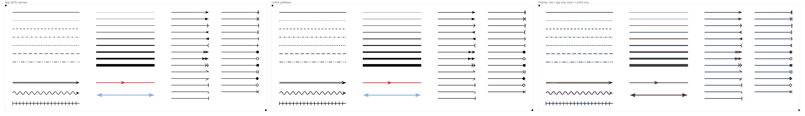
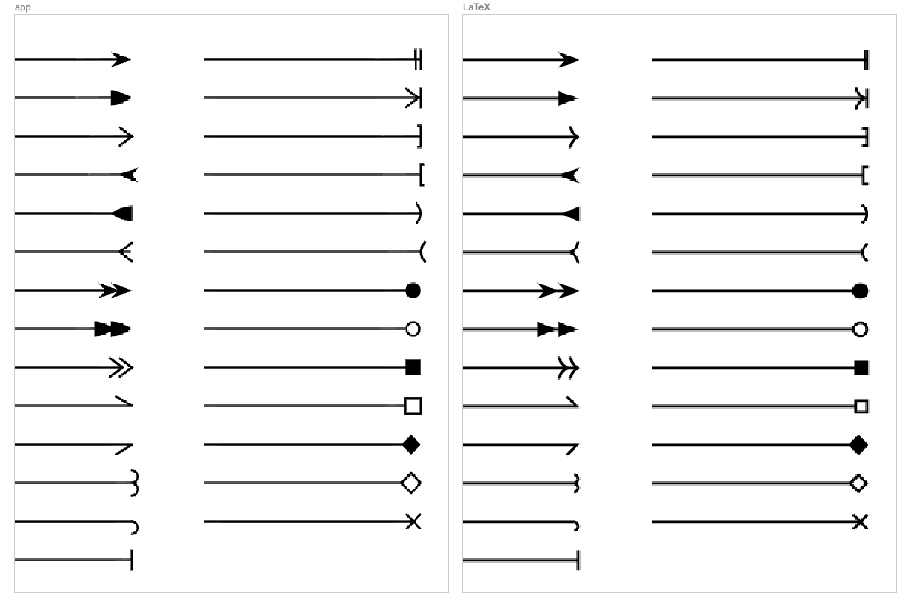
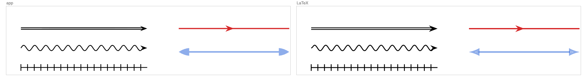
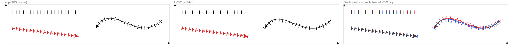
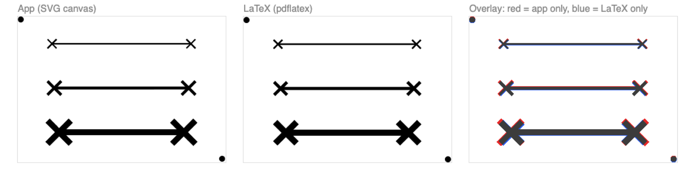

### Shapes, fills, patterns, regions
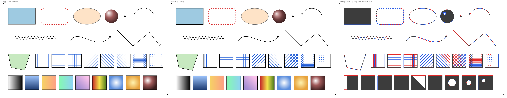
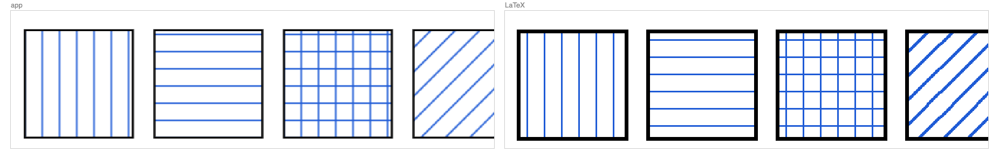
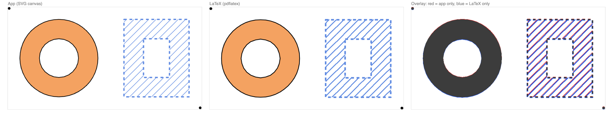

### Text, maths, edge labels
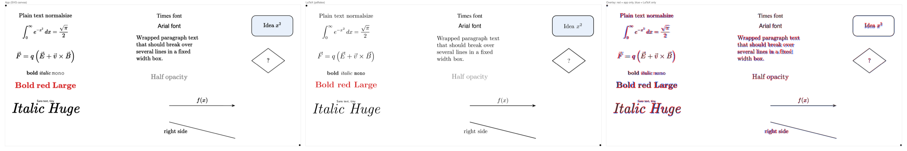
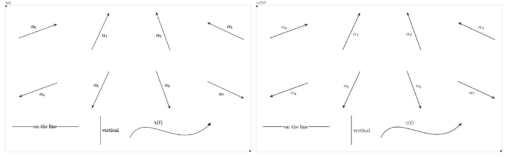

### Library symbols
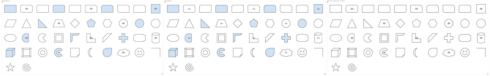
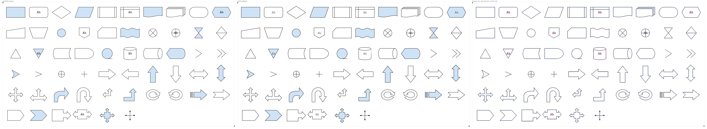
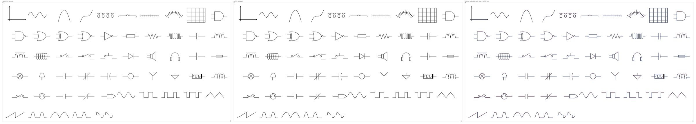
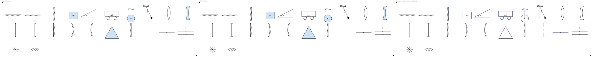

### 2D plots
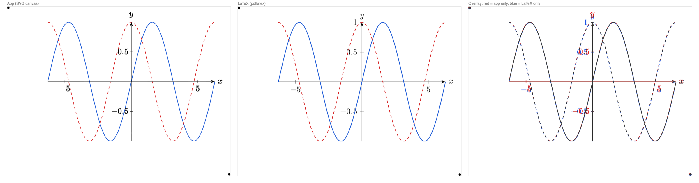
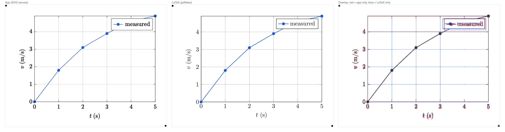
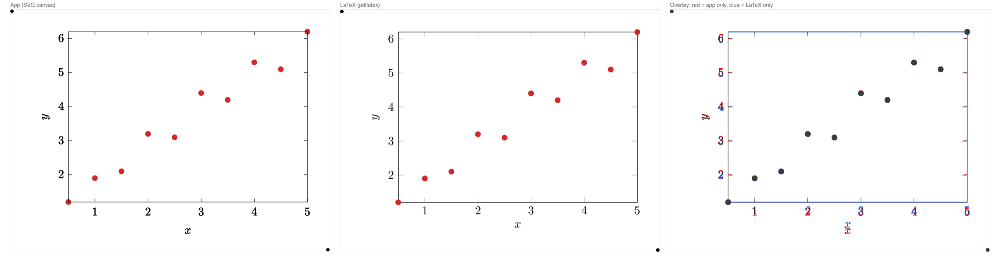
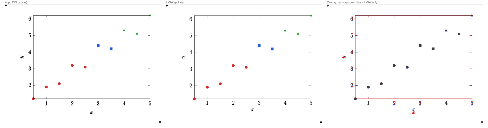
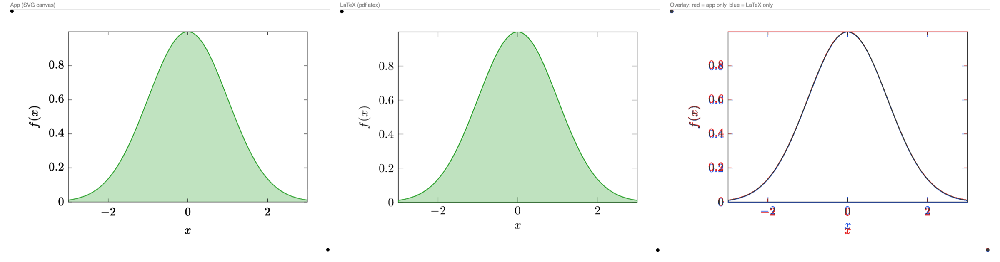
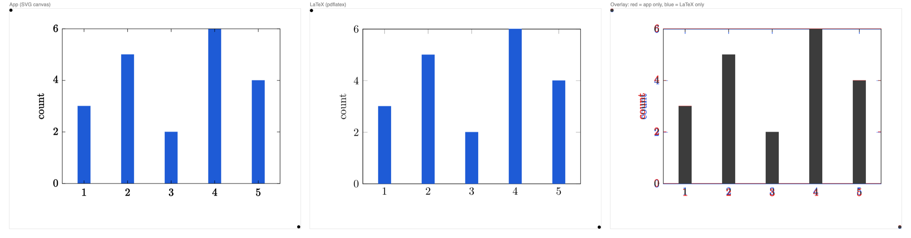
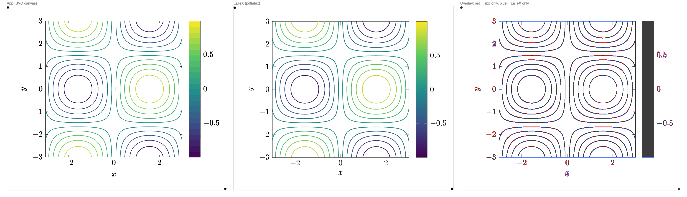
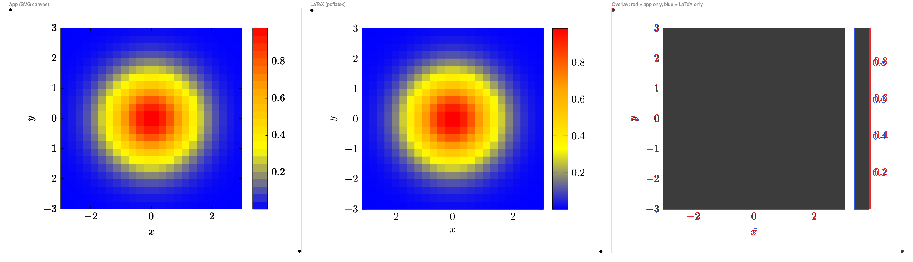

### 3D plots
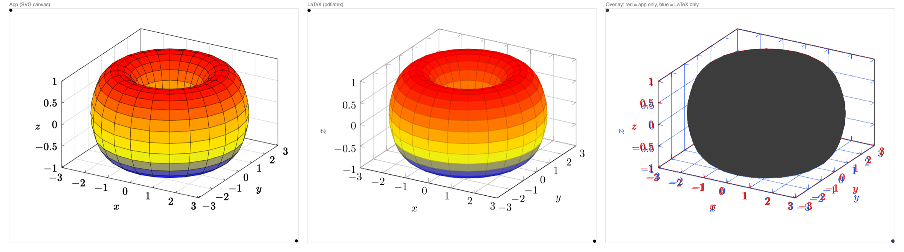
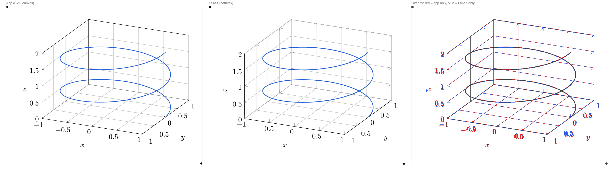
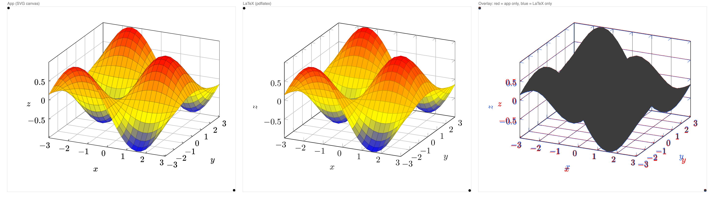
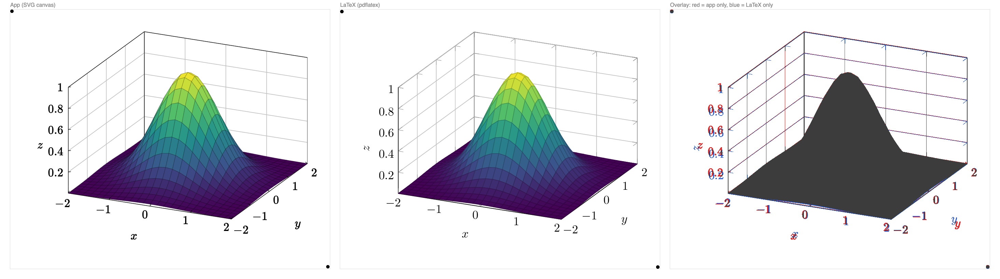
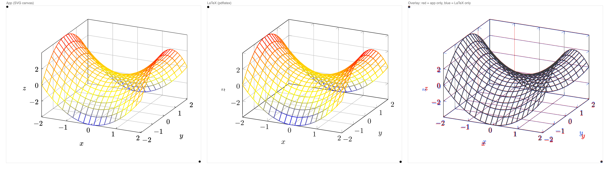
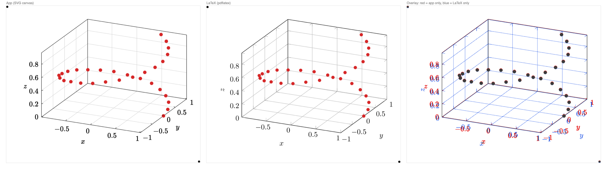

### Pie charts
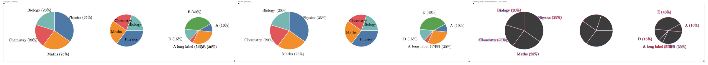

### 3D figures
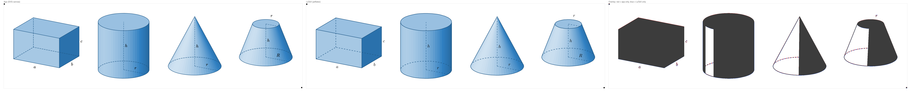
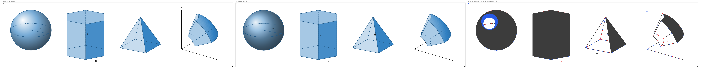
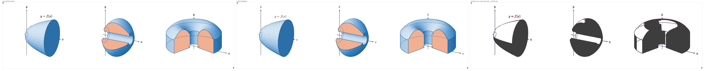
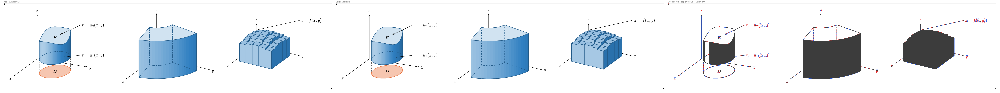

### Blocks
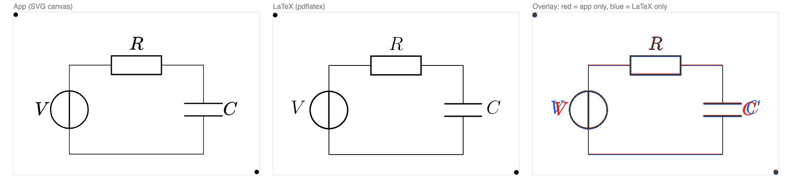
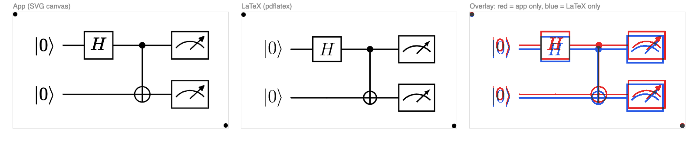
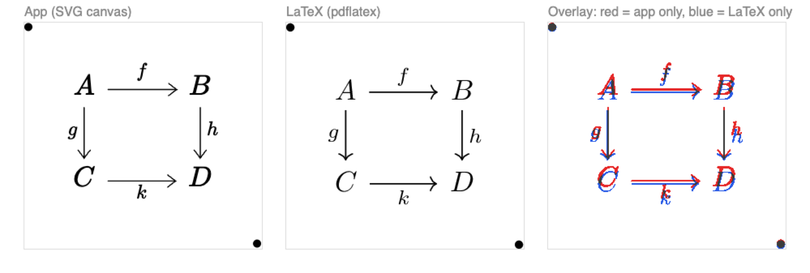
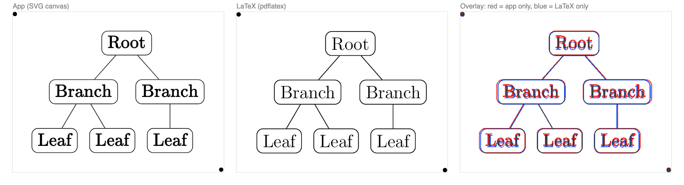
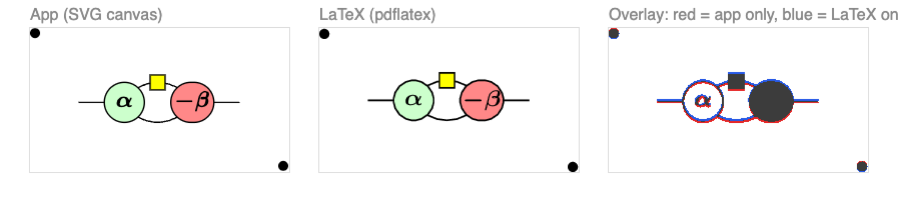
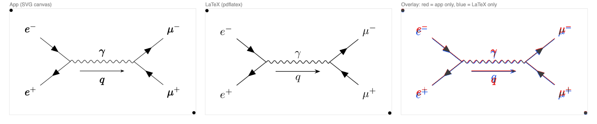
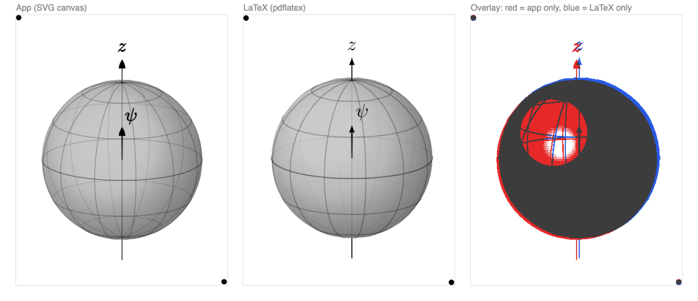
